# نظرة عامة على المنتج والمنصة

## الخلاصة في سطور

- «إبراء» (Ibraa) نظام سحابي (Cloud) متكامل للمحلات: كاشير (POS) وفواتير ومخزون وخزنة وورديات وتقارير، كله في حساب واحد.
- موجّه لأي محل تجزئة. البن والمحامص نشاط واحد من أربعة أنشطة معروضة في صفحات التسويق: **محلات ومحامص البن، محلات التجزئة، تجار الجملة، سيارات التوزيع**.
- بيشتغل على المتصفح، وعلى موبايل أندرويد (تطبيق)، وعلى ويندوز (برنامج سطح مكتب). البيانات كلها على السيرفر، فالمحل بيشوف نفس الأرقام من أي جهاز.
- كل محل (مؤسسة) له بيانات مستقلة تمامًا عن باقي المحلات، وجواه فروع ومخازن وسيارات توزيع، وموظفين كل واحد معيّن على فرع أو أكتر.
- الواجهة عربي أولًا (من اليمين لليسار) مع إنجليزي، ووضع ليلي ونهاري، ومصممة تشتغل باللمس على التابلت والموبايل.
- **مفيش شغل بدون إنترنت**: لو النت قطع، البيع وحفظ البيانات بيقفوا لحد ما الاتصال يرجع (التفاصيل في آخر الملف).

## مين بيستخدمه

| الدور | بيعمل إيه في المنصة |
|---|---|
| صاحب المحل / المدير | يشوف كل حاجة: التقارير، الفروع، الموظفين، الصلاحيات، الإعدادات، الاشتراك |
| الكاشير | يبيع من شاشة نقطة البيع، يفتح ويقفل الوردية، يعمل مرتجعات لو مصرّح له |
| أمين المخزن | الأصناف، الأرصدة، المشتريات، التحويلات بين الفروع |
| المحاسب | الخزنة واليومية والمصروفات وكشوف الحسابات والتقارير |
| فريق الدعم والمبيعات عندنا | بيستخدم لوحة تحكم المنصة المركزية (منفصلة عن المحل، مفصّلة في [الفصل 9: الأمان والتشغيل](09-security-operations.md) و[الفصل 8: الباقات والاشتراك](08-plans-signup-billing.md)) |

الأدوار الأربعة الأولى هي الأدوار الجاهزة، والمدير يقدر يعدّل صلاحيات كل دور أو يعمل أدوار على مزاجه (انظر [الفصل 7: المستخدمين والإعدادات](07-users-roles-settings.md)).

## لمين المنتج: الأنشطة المدعومة

| النشاط | الفكرة | اللي بيميّزه |
|---|---|---|
| محلات التجزئة | كاشير سريع بالباركود واللمس | ورديات، طباعة إيصالات، مخزون بيتحدّث مع كل بيعة |
| محلات ومحامص البن | بيع بالوزن وعمل توليفات | توليفة العميل بدرجة التحميص والطحنة، وحساب تكلفتها ومكسبها |
| تجار الجملة | قطاعي وجملة في نفس الصنف | سعر قطاعي وسعر جملة لكل صنف، كشف حساب ومديونية لكل عميل |
| سيارات التوزيع | كل سيارة مخزن متحرك | تحويل بضاعة من المخزن للسيارة، ومتابعة رصيدها ومبيعاتها |

**البيع بالوزن:** الكميات في النظام بتتسجل بـ 3 أرقام عشرية، فتقدر تبيع 0.250 كجم أو 1.750 كجم. كل الأرصدة والأسعار بتتحسب بدقة من غير تقريب غريب.

مثال: عميل اشترى 0.250 كجم بن برازيلي بسعر 480 ج.م للكيلو = 120.00 ج.م، والمخزون بيخصم 0.250 كجم بالظبط.

## هيكل المحل: مؤسسة، فروع، مخازن، سيارات

المحل في إبراء اسمه «مؤسسة» (Workspace). جواها وحدات تخزين اسمها «فروع ومخازن»، وليها ثلاثة أنواع:

| النوع (زي ما بيظهر في الشاشة) | بيُستخدم في |
|---|---|
| محل / فرع قطاعي | بيع للجمهور من الكاشير |
| مستودع / مخزن رئيسي | تخزين وتوريد وتحويل للفروع |
| سيارة / عربة توزيع | بيع الجملة المتنقل، برصيد مخزون مستقل |

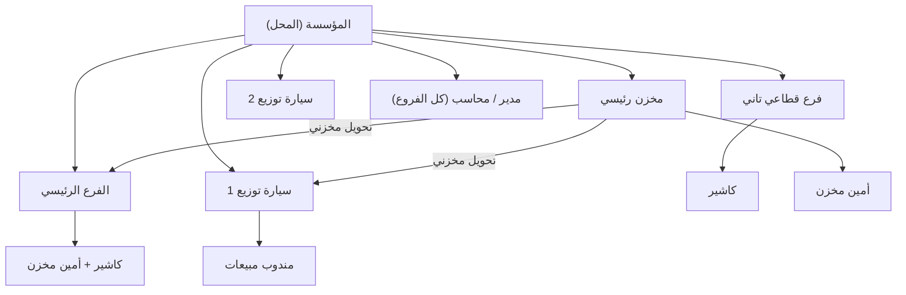

نقط مهمة:

- لكل فرع ومخزن **رصيد مخزون خاص بيه**. التحويل المخزني هو الطريقة الوحيدة الرسمية لنقل بضاعة بين الوحدات (التفاصيل في [الفصل 3: المخزون](03-inventory.md)).
- ممكن تحدد **فرع رئيسي** واحد، وتوقف أي فرع (يبقى غير نشط): الفرع الموقوف مبيقبلش مبيعات ولا مشتريات ولا مرتجعات ولا مصروفات ولا ورديات ولا تحويلات.
- **الموظفين بيتعيّنوا على فروع**. الكاشير المعيّن على فرع واحد بيشتغل عليه بس. لو حساب مش معيّن على أي فرع، بتظهر له رسالة: «حسابك غير معيّن على أي فرع، اطلب من المدير يعيّنك على فرع».
- المستخدم اللي معاه أكتر من فرع بيبدّل بينهم من قايمة الفرع في الشريط العلوي (وفي القايمة الجانبية على الموبايل). المدير بيقدر كمان يشوف «كافة الفروع والمخازن» مجمّعة في الشاشات اللي بتسمح بكده، لكن العمليات اللي بتغيّر مخزون أو فلوس (بيع، شراء، مرتجع…) لازم تتنفذ على فرع واحد محدد.
- الوردية والفرع مربوطين: الإعداد «الوردية مطلوبة للبيع» بيتفعّل لكل فرع لوحده، والفرع اللي مفعّله مينفعش يبيع من غير وردية مفتوحة.
- لما تغيّر الفرع الحالي، النظام بيحمّل سياق الفرع الجديد (الوردية المفتوحة وغيرها) علشان ماتشوفش بيانات الفرع القديم بالغلط.

## المنصات وإزاي تنزّل التطبيق

| المنصة | إزاي بتشتغل |
|---|---|
| المتصفح (ويب) | كل الشاشات من أي جهاز. ممكن تثبّته كتطبيق من المتصفح (بيعرّف نفسه باسم «إبراء» وبيفتح بملء الشاشة) |
| تطبيق أندرويد | غلاف (Capacitor) حوالين نفس نظام الويب. بيفتح المنصة السحابية نفسها، والبيانات محفوظة على السيرفر |
| برنامج ويندوز | برنامج سطح مكتب (Electron) فيه شريط عنوان خاص، اختصارات كيبورد، وطباعة حرارية مباشرة وفتح درج الكاش |
| آيفون / آيباد | **مفيش تطبيق**. ممكن تستخدم النظام من متصفح الجهاز |

### صفحة تحميل التطبيق

- صفحة عامة تقدر تفتحها من غير تسجيل دخول، بتعرض **آخر إصدار رسمي** لأندرويد (ملف APK) ولويندوز (ملف تثبيت)، وكمان الإصدارات الأقدم.
- كل إصدار جنبه **بصمة SHA-256** تقدر تقارنها بالملف اللي نزّلته للتأكد إنه سليم.
- بتشرح خطوات التثبيت: على أندرويد افتح الملف واسمح بالتثبيت من المصدر ده لو طلب. على ويندوز شغّل ملف التثبيت واقفل البرنامج المفتوح الأول.
- الإصدارات بيرفعها فريق المنصة من لوحة التحكم المركزية، والملف بيتحدد نوعه من المنصة المختارة (أندرويد APK بحد أقصى 150 ميجابايت، أو ويندوز).

### التحديث جوه التطبيق

- التطبيق بيسأل السيرفر لو في إصدار أحدث. لو في، بيظهر إشعار «يتوفر تحديث جديد» أو «تحديث إلزامي» لو الإصدار القديم مبقاش مسموح.
- على أندرويد: بينزّل الحزمة، يتأكد من بصمتها ومن إنها موقّعة من الناشر المعتمد، وبعدين يفتح شاشة التثبيت بتاعة النظام (لازم تضغط «تثبيت»). لو الملف مش موقّع من الناشر المعتمد التثبيت بيترفض.
- على ويندوز: نفس الفكرة مع التحقق من توقيع الملف، وبعد التحديث البرنامج بيتعاد تشغيله.
- لو التحديث التلقائي مقدرش يكمّل بأمان، التطبيق بيفتح صفحة التحميل اليدوي.

## تسجيل الدخول

### الخطوات العادية

```text
1. تكتب «كود المؤسسة» (عنوان المحل، مثال: my-shop) وتضغط متابعة
2. النظام يتأكد من المؤسسة ويتصل بيها
3. تكتب رقم الموبايل (أو الإيميل) وكلمة المرور
4. لو عايز: تختار «تذكرني على هذا الجهاز»
```

- **كود المؤسسة / عنوان المحل:** كل محل له عنوان خاص بيه. لو فتحت النظام من رابط المحل مباشرة، النظام بيتعرف عليه تلقائي (رابط الاتصال التلقائي) ومش هيطلب الكود. الجهاز بيفتكر المؤسسة اللي اتصلت بيها آخر مرة.
- **تغيير المؤسسة:** من زر «تغيير المؤسسة» تقدر تتصل بمحل تاني (مفيد لمحاسب أو مستشار بيشتغل على أكتر من محل).
- لو اشتراك المحل متعلّق، بتظهر رسالة «تم تعليق اشتراك هذه المؤسسة، يرجى مراجعة إدارة المنصة».
- **الحماية من التخمين:** بعد محاولات دخول غلط كتير الحساب بيتقفل مؤقتًا لعدد دقايق، وبيوصل إشعار لصاحب المحل. وكمان في حد أقصى للطلبات في الدقيقة.
- **تغيير كلمة المرور الإجباري:** لو المدير طلب من موظف يغيّر كلمة المرور، النظام بيحوّله لشاشة التغيير قبل أي حاجة تانية.

### الدخول السريع

- موجود في الكود كتبويب «دخول سريع» بيخلّيك تختار موظف وتدخل من غير كلمة مرور، لكن هو **ميزة اختبار فقط** ومقفولة افتراضيًا على السيرفر، وبتتفعل بإعداد خاص بالبيئة. في التشغيل الفعلي للمحلات **مفيش دخول بدون كلمة مرور**.
- حتى لو اتفعّل، الجلسة اللي بتتفتح بالدخول السريع ممنوعة من الشاشات الحساسة وتطلب كلمة المرور.

### قفل الشاشة والـ PIN

- بعد فترة من عدم الاستخدام تظهر شاشة «الشاشة مقفولة» وتطلب **كلمة مرور المستخدم أو رمز PIN من 4 إلى 6 أرقام**. المدة بيحددها صاحب المحل في الإعدادات (من 0 إلى 240 دقيقة، والصفر معناه القفل مقفول). الفكرة حماية الجهاز المشترك لما الكاشير يبعد عنه.
- محاولات PIN الغلط الكتيرة بتوقف الـ PIN لباقي اليوم، وتفتح بكلمة المرور.
- من نفس الشاشة تقدر تعمل «تبديل المستخدم» (خروج وتسجيل دخول بحساب تاني). تنبيه: أي بيانات لسه ماتحفظتش، زي سلة بيع مفتوحة، بتضيع.
- في **PIN تاني مختلف**: «PIN موافقة المدير» بنقطة البيع، بيُستخدم للموافقة على أسعار خاصة وإلغاء الفواتير. بيتضبط من الملف الشخصي وبيحتاج كلمة المرور الحالية.

### تذكّر الجهاز

خيار «تذكرني على هذا الجهاز» بيخلّي الجلسة تفضل فاتحة. على الجهاز المشترك الأفضل متفعّلوش، واعتمد على قفل الشاشة.

## التنقل جوه النظام

| العنصر | بيعمل إيه |
|---|---|
| القايمة الجانبية (على الموبايل: درج منسدل) | شاشات النظام مقسّمة لأقسام: الرئيسية، المبيعات ونقاط البيع، المخزون والأصناف والفروع، المشتريات والموردين، وباقي الأقسام. بتظهر لكل مستخدم الشاشات المصرح له بيها بس |
| الشريط العلوي | الفرع الحالي (والتبديل بين الفروع)، الإشعارات، اللغة، المظهر، حالة الاتصال |
| لوحة التحكم الرئيسية | مؤشرات اليوم، آخر الفواتير، الأصناف القاربت تخلص، ساعات الذروة، قائمة خطوات تجهيز المحل، واستخدام الباقة (التفاصيل في [الفصل 6: التقارير](06-reports-and-dashboard.md)) |
| «كل الشاشات» | صفحة بتعرض كل الشاشات المتاحة لك كأيقونات في مكان واحد، مفيدة على الموبايل لما القايمة مزدحمة |
| مركز المساعدة | مقالات تشغيل مبسطة مقسّمة: البداية السريعة، الأصناف والمخزون، نقطة البيع، المرتجعات، المشتريات والموردين، الخزينة والورديات، التقارير، المستخدمين والصلاحيات، الباقات والاشتراك. فيه بحث بالعناوين، وزر «شرح هذه الشاشة» جوه الشاشات، وزر تواصل مع الدعم (واتساب لو الرقم متضاف في إعدادات المنصة) |
| الملف الشخصي | تعديل الاسم والموبايل والإيميل، اختيار المظهر (ليلي/نهاري)، تغيير كلمة المرور، وضبط PIN موافقة المدير |
| الشاشات العامة (من غير دخول) | الصفحة الرئيسية، المزايا، الأسعار، صفحات الأنشطة الأربعة، تواصل معنا، إنشاء حساب، تحميل التطبيق، الشروط والخصوصية |

اختصارات الكيبورد على ويندوز: F1 دليل الاختصارات، F2 نقطة البيع السريعة، F11 الشاشة الكاملة، وفي الشريط زر كتم أصوات الكاشير وزر لتحديث الكاش.

## اللغة والمظهر والأجهزة

- **اللغة:** عربي وإنجليزي، بتبدّل من زر اللغة. العربي هو الأساسي، والاتجاه بيتقلب تلقائي بين يمين-يسار ويسار-يمين.
- **المظهر:** وضع ليلي (الافتراضي) ووضع نهاري، والاختيار بيتحفظ على الجهاز. ألوان الواجهة بتتغير بحسب هوية المحل.
- **الأجهزة المناسبة:** تابلت أو شاشة لمس للكاشير، موبايل للمتابعة (التقارير والأرصدة) أو للمندوب، كمبيوتر للمدير والمحاسب.
- **الباركود:** حقل البحث في نقطة البيع بيقبل الاسم أو الباركود، وكود الصنف/الباركود بيتسجل في بيانات الصنف. أجهزة قراءة الباركود الشائعة بتتعامل كأنها كيبورد (تكتب الرقم وتدوس Enter)، لكن الدعم الخاص لأجهزة بعينها (بلوتوث مثلًا) **غير موثّق**.
- **الإيصالات:** إعداد مقاس الورق 80mm (القياسي) أو 58mm (المدمج). في المتصفح بتطبع بطباعة المتصفح. في برنامج ويندوز فيه **طباعة حرارية مباشرة صامتة** لطابعة الإيصالات، مع اختيار الطابعة وورقة تجربة طباعة.
- **درج الكاش:** على ويندوز بس، بيتفتح من أمر الطابعة. ممكن تختار طرف التوصيل (Pin) لكل جهاز (أغلب الأدراج على Pin 2، ولو ماتفتحش جرّب Pin 5).
- **أندرويد:** مفيش طباعة مباشرة موثّقة من التطبيق، والطباعة بتمشي بحسب إمكانيات الجهاز.

## لو النت قطع (الشغل بدون اتصال)

الوضع الحالي بصراحة: **مفيش وضع أوفلاين**.

- النظام بيراقب الاتصال باستمرار، ولما يقطع بيظهر شريط تنبيه: «لا يوجد اتصال بالإنترنت، البيع وحفظ البيانات متوقفان مؤقتًا لحين عودة الاتصال».
- زر إتمام البيع بيتقفل برسالة «لا يمكن إتمام البيع بدون اتصال». السلة المفتوحة بتفضل محفوظة على الجهاز لحد ما الاتصال يرجع فتكمّل الفاتورة.
- مفيش طابور فواتير بتتسجل على الجهاز وتتزامن بعدين. ده مخطط لمرحلة لاحقة وغير موجود دلوقتي.
- الأثر العملي: المحل اللي النت عنده ضعيف محتاج خط احتياطي (موبايل مثلًا) عند الكاشير.

## الأقسام الأساسية للنظام

| القسم | بيغطي إيه | الملف التفصيلي |
|---|---|---|
| نقطة البيع | شاشة الكاشير السريعة، الفواتير، المرتجعات، الورديات | [الفصل 2: البيع والكاشير](02-sales-and-pos.md) |
| الأصناف والمخزون | الأصناف والفئات، الأرصدة بالفروع، التحويلات المخزنية، تجميع الأصناف (التوليفات)، رادار إعادة الطلب الذكي، استيراد البيانات | [الفصل 3: المخزون](03-inventory.md) |
| العملاء والموردين | بيانات الأطراف، كشوف الحسابات، المديونيات | [الفصل 4: العملاء والموردين](04-customers-and-suppliers.md) |
| المشتريات والخزنة والمصروفات | فواتير التوريد، دفتر اليومية والخزينة، المصروفات والعهد | [الفصل 5: المشتريات والخزنة](05-purchases-treasury-expenses.md) |
| التقارير ولوحة التحكم | مؤشرات اليوم، تقارير المبيعات والأرباح والخسائر | [الفصل 6: التقارير](06-reports-and-dashboard.md) |
| المستخدمين والأدوار والإعدادات | الموظفين، مصفوفة الصلاحيات، إعدادات المحل والكاشير والطباعة | [الفصل 7: المستخدمين والإعدادات](07-users-roles-settings.md) |
| الباقات والتسجيل والاشتراك | إنشاء حساب جديد، الباقات والحدود، فواتير الاشتراك | [الفصل 8: الباقات والاشتراك](08-plans-signup-billing.md) |
| الأمان والتشغيل | سجل النشاط، النسخ الاحتياطي، حالات المحل، لوحة تحكم المنصة | [الفصل 9: الأمان والتشغيل](09-security-operations.md) |

### شاشات المحل ومين بيدخلها (باختصار)

| الشاشة | صلاحية الدخول المطلوبة |
|---|---|
| نقطة البيع | الوصول لنقطة البيع |
| فواتير المبيعات | عرض الفواتير أو الوصول لنقطة البيع |
| المرتجعات | إدارة المرتجعات |
| الأصناف | عرض الأصناف |
| فئات الأصناف | إضافة أو تعديل أو حذف الأصناف |
| تجميع الأصناف | إضافة أصناف |
| الفروع والمخازن | إدارة الفروع |
| أرصدة الفروع | إدارة الفروع أو عرض التحويلات أو المشتريات أو تسوية المخزون |
| التحويلات المخزنية | إدارة الفروع أو عرض/إنشاء التحويلات |
| العملاء / الموردين | إدارة العملاء / إدارة الموردين |
| المشتريات | عرض / إنشاء المشتريات |
| دفتر اليومية | عرض اليومية |
| المصروفات | إدارة المصروفات |
| التقارير | عرض التقارير |
| المستخدمين والأدوار | إدارة الأدوار |
| سجل النشاط | عرض السجلات |
| الاشتراك والفواتير | إدارة الاشتراك |
| الإعدادات | إدارة الإعدادات |
| استيراد البيانات | إضافة أصناف أو إدارة العملاء أو الموردين |
| سلة المحذوفات | صلاحية سلة المحذوفات |
| الملف الشخصي، مركز المساعدة، كل الشاشات، لوحة التحكم | أي مستخدم داخل |

المستخدم اللي يحاول يفتح شاشة مش مصرح له بيها بيرجع للوحة التحكم برسالة، وكمان السيرفر بيرفض الطلب لو اتعمل بشكل مباشر، فالإخفاء من القايمة مش هو الحماية الوحيدة.

## سلة المحذوفات وسجل النشاط (نظرة سريعة)

- **سلة المحذوفات:** لما تحذف صنف أو عميل أو مورد أو فرع أو مصروف أو مرتجع، السجل بيروح للسلة مش بيختفي. من شاشة السلة (تبويب لكل نوع) تقدر **تسترجعه** أو تمسحه **نهائيًا** (ومفيش رجعة بعد المسح النهائي، وبتظهر رسالة تأكيد). الشاشة دي للصلاحية الخاصة بيها بس.
- **سجل النشاط:** كل العمليات المهمة (إضافة، تعديل، حذف، إلغاء فاتورة، دخول ناجح وفاشل، حركات الخزينة والمخزون) بتتسجل بمين عملها ومن أنهي جهاز وإمتى. بتقدر تفلتر بالفترة والمستخدم والفرع وتصدّر لـ Excel. التفاصيل في [الفصل 9: الأمان والتشغيل](09-security-operations.md).

## يوم عمل عادي

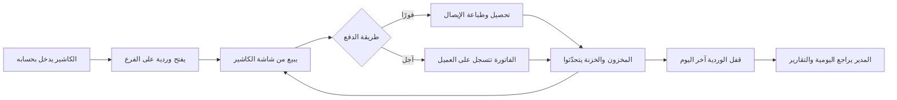

الخطوات:

1. الكاشير يفتح النظام ويدخل بحسابه. لو الجهاز مشترك يبقى قفل الشاشة متفعّل.
2. يفتح وردية على فرعه (لو الفرع مشترط وردية للبيع مش هيقدر يبيع من غير ما يفتحها).
3. يبيع: يدوّر بالاسم أو الباركود، يضيف الأصناف والكميات (بالوزن لو لازم)، يطبّق خصم لو مسموح.
4. يحصّل الفاتورة ويطبع الإيصال. كل بيعة بتخصم المخزون وتسجّل الحركة على الخزنة في نفس اللحظة. لو الفاتورة آجل بتتسجل على حساب العميل.
5. لو عميل رجّع حاجة، يسجّل مرتجع، والمخزون والحساب بيتعدّلوا.
6. آخر اليوم يقفل الوردية، والمدير أو المحاسب يراجع دفتر اليومية والتقارير.

تفاصيل الورديات والتحصيل والمرتجعات في [الفصل 2: البيع والكاشير](02-sales-and-pos.md)، وحسابات الخزنة في [الفصل 5: المشتريات والخزنة](05-purchases-treasury-expenses.md).

## حالة المحل (المؤسسة) على المنصة

المحل نفسه بيعدّي بحالات على المنصة، وده بيأثر على اللي تقدر تعمله: تجريبي، نشط، متأخر في السداد، **قراءة فقط**، موقوف، ملغي، مؤرشف. في حالة «قراءة فقط» تقدر تشوف بياناتك لكن مش تسجّل جديد. شرح الحالات وإزاي المحل بيرجع نشط في [الفصل 8: الباقات والاشتراك](08-plans-signup-billing.md) و[الفصل 9: الأمان والتشغيل](09-security-operations.md).

## الصلاحيات

- **أي مستخدم داخل** يقدر يفتح لوحة التحكم والملف الشخصي ومركز المساعدة وكل الشاشات (القايمة بتعرض له اللي يخصه بس).
- **تبديل الفرع:** المستخدم يشوف الفروع المعيّن عليها بس.
- **كل شاشة وعملية** ليها صلاحية مستقلة، والمدير هو اللي بيمنحها من شاشة الأدوار.
- **تغيير الفرع المعيّن/إيقاف فرع/سلة المحذوفات/الاشتراك/الإعدادات:** عادة للمدير.

## الإعدادات المتاحة (اللي ليها علاقة بالنظرة العامة)

| الإعداد | الأثر |
|---|---|
| قفل الشاشة بعد الخمول | من 0 إلى 240 دقيقة، والصفر = مقفول |
| الوردية مطلوبة للبيع | لكل فرع، ويتعطّل لو الفرع فيه وردية مفتوحة |
| مقاس ورق الإيصال | 80mm أو 58mm |
| الفرع الرئيسي / نشط أو موقوف | من شاشة الفروع |
| اللغة والمظهر | لكل مستخدم/جهاز |

تفاصيل باقي الإعدادات في [الفصل 7: المستخدمين والإعدادات](07-users-roles-settings.md).

## حسب الباقة

بعض الحدود (عدد الفروع، عدد المستخدمين، عدد الأصناف…) وبعض المزايا بتختلف حسب الباقة، وكمان فيه باقة مجانية دائمة بحدود معينة. صاحب المحل يشوف استخدامه من الحد في لوحة التحكم وشاشة الاشتراك. التفاصيل في [الفصل 8: الباقات والاشتراك](08-plans-signup-billing.md).

## لقطات من الشاشات

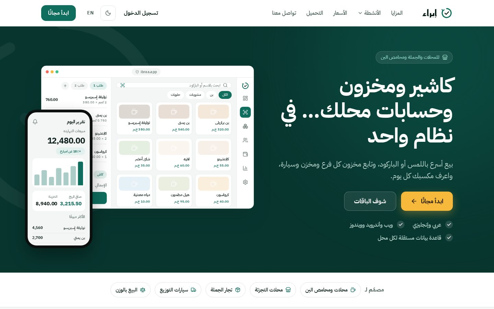
*الصفحة الرئيسية للموقع*

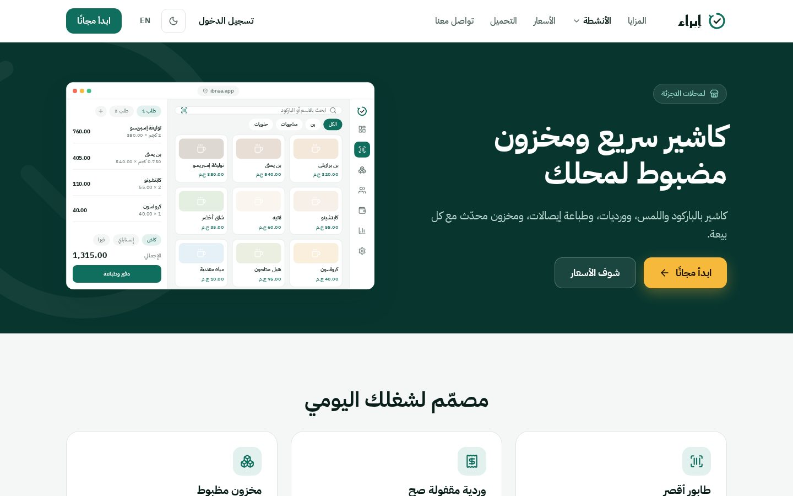
*صفحة نشاط محلات التجزئة*

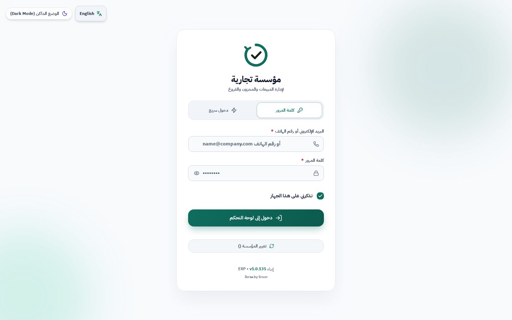
*شاشة الدخول للمحل*

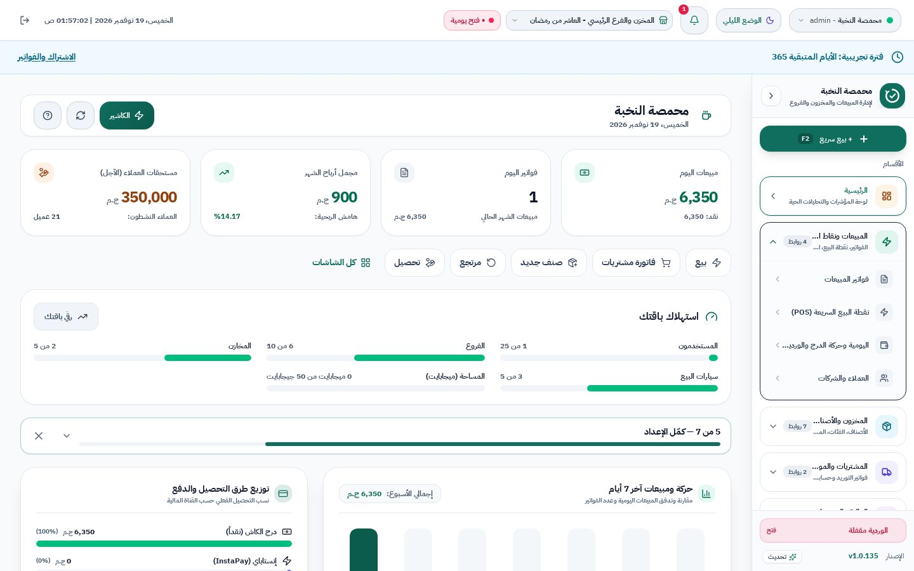
*لوحة التحكم الرئيسية*

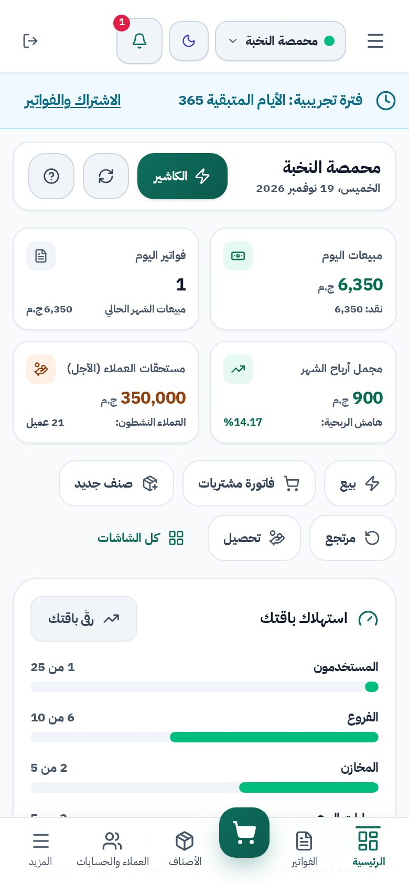
*لوحة التحكم على الموبايل*

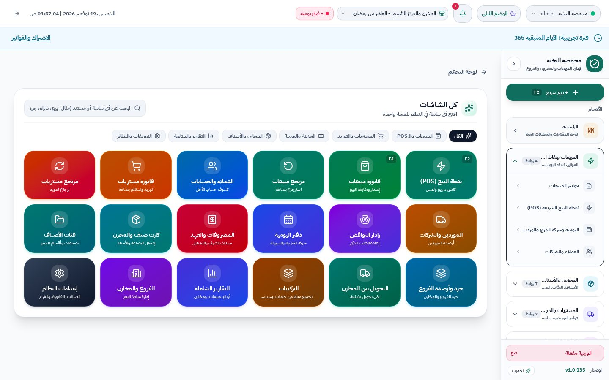
*كل الشاشات في مكان واحد*

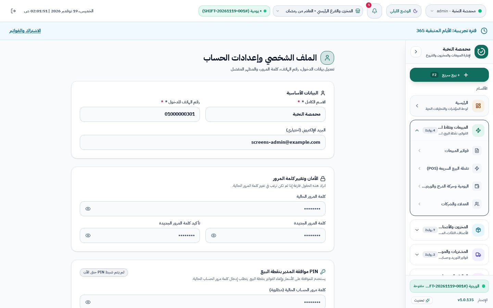
*الملف الشخصي للمستخدم*

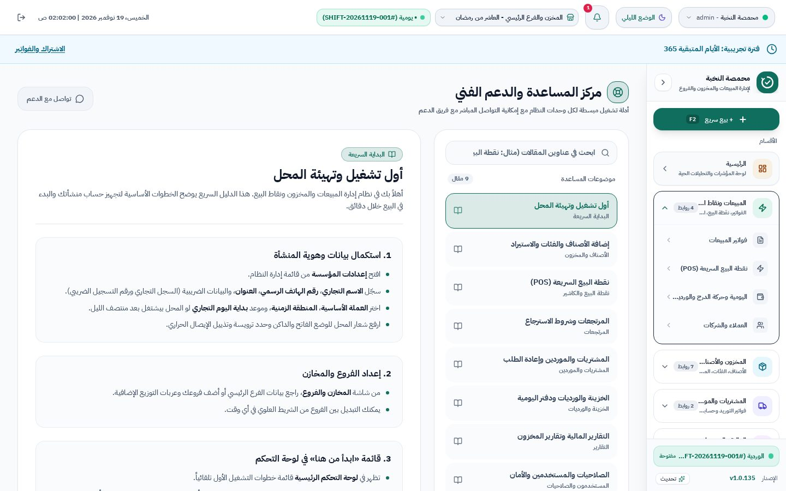
*مركز المساعدة*

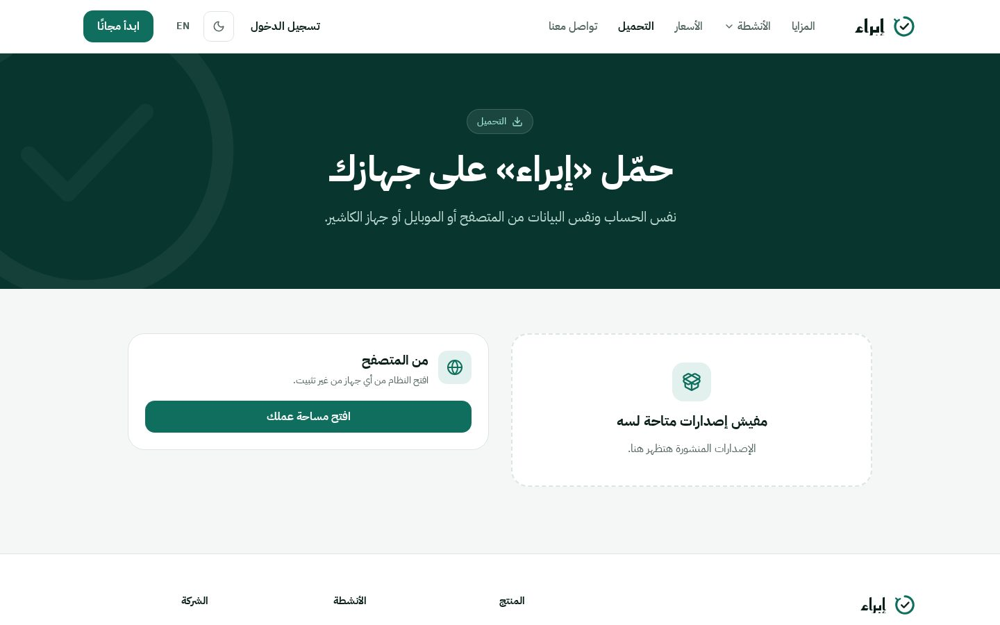
*تحميل التطبيقات (أندرويد وويندوز)*


## أسئلة شائعة

**هل أقدر أستخدم النظام على أكتر من جهاز؟**
أيوه. البيانات على السيرفر، وأي جهاز تسجّل منه بنفس الحساب بيشوف نفس الأرقام.

**لو النت قطع وأنا في نص بيعة؟**
السلة بتفضل محفوظة على الجهاز، لكن إتمام البيع بيستنى رجوع الاتصال. مفيش تسجيل بدون إنترنت.

**هل في تطبيق للآيفون؟**
لأ. أندرويد وويندوز بس، وممكن تفتح النظام من متصفح الآيفون.

**نسيت كود المؤسسة، أعمل إيه؟**
اسأل المدير أو الدعم، أو افتح رابط المحل المباشر وهيتعرف عليه تلقائي. الجهاز كمان بيفتكر آخر مؤسسة اتصلت بيها.

**هل الدخول السريع (بدون كلمة مرور) متاح لمحلي؟**
لأ، ده للاختبار بس ومقفول في التشغيل الفعلي.

**الفرق بين PIN قفل الشاشة وPIN موافقة المدير؟**
الأول بيفتح شاشة اتقفلت من الخمول (من 4 لـ 6 أرقام). التاني بيوافق على عمليات حساسة بالكاشير زي سعر خاص أو إلغاء فاتورة. الاتنين بيتضبطوا من الملف الشخصي والإعدادات، وبيتحميوا بكلمة المرور.

**مسحت حاجة بالغلط؟**
شوفها في سلة المحذوفات واضغط استعادة، طالما ماتمسحتش نهائيًا.

**ينفع أشتغل بالإنجليزي؟**
أيوه، من زر اللغة. الإنجليزي مدعوم، لكن العربي هو الأساسي والأكمل.

**ينفع أبيع بالجرام؟**
الكميات بتدعم 3 أرقام عشرية، فتقدر تبيع 0.250 كجم (250 جرام). الوحدة نفسها بتتحدد على الصنف.

## حدود وملاحظات / فرص تطوير

- **مفيش أوفلاين:** أكبر حد حالي للمحلات اللي النت عندها مش مستقر. طابور الفواتير بدون إنترنت متخطط لمرحلة لاحقة.
- **مفيش تطبيق iOS:** قرار حالي، المتاح أندرويد وويندوز.
- **تطبيق أندرويد** بيفتح الموقع السحابي، فمحتاج اتصال، ودعم الطباعة المباشرة والأجهزة الخاصة (طابعة بلوتوث مثلًا) غير موثّق.
- **قارئ الباركود:** المدعوم عمليًا هو اللي بيشتغل كأنه كيبورد.
- **الدخول السريع** موجود في الكود كأداة اختبار. لازم يفضل مقفول في أي بيئة فعلية.
- **اختصارات الكيبورد وفتح الدرج** مرتبطة ببرنامج ويندوز بس.
- مفيش حاجة اسمها تطبيق للكاشير منفصل عن تطبيق الإدارة: نفس التطبيق والشاشات بتتحكم فيها الصلاحيات.

## ملحق للفريق التقني

- الواجهة: Vue 3 SPA في `backend/resources/js` (الراوتر: `router/index.js`)، والـ API على `/api/v1`.
- الأندرويد: `backend/capacitor.config.json` و`backend/android/`. الإعداد بيشاور على الرابط السحابي (`server.url`).
- ويندوز: `desktop/` (Electron + `electron-builder`، هدف NSIS وPortable). الطباعة في `desktop/src/hardware/`، والتحديث في `desktop/src/updater/`.
- أنواع الفروع: `retail_shop` و`main_warehouse` و`wholesale_van` (عمود `type` في جدول الفروع).
- الأدوار الجاهزة: `UserRole` (admin, cashier, storekeeper, accountant).
- الدخول السريع: `config/auth.php` (`QUICK_LOGIN_ENABLED`، افتراضي false).
- حالة الاتصال: `useConnectivity` + `OfflineBanner`. الملف `public/sw.js` موجود لكن لم أجد تسجيلًا له في الواجهة الحالية.
- الأنشطة التسويقية: مسار `/for/:industry` بقيم coffee/retail/wholesale/vans.
