# البيع والكاشير والفواتير والمرتجعات والورديات

> المجال ده هو قلب «إبراء» اليومي: الكاشير بيبيع، الفاتورة بتتسجل، المخزون بينقص، الفلوس بتدخل الدرج، والوردية بتتقفل في آخر اليوم. الكلام تحت متراجع على الكود الحالي، وأي حاجة مش موجودة مكتوب إنها مش موجودة.

## الخلاصة في سطور

- شاشة الكاشير (POS) بتبيع بالباركود أو البحث أو الأزرار السريعة، وبتدعم الأصناف اللي بتتباع بالوزن وملصقات ميزان الباركود، وبتحفظ كذا طلب مفتوح في نفس الوقت على نفس الجهاز.
- كل فاتورة بتتحفظ مرة واحدة كاملة: بتخصم المخزون من فرع البيع، وبتسجّل الفلوس المدفوعة (كاش أو غيره)، وبتحدّث رصيد العميل. لو حاجة منهم فشلت، مفيش حاجة بتتحفظ.
- الدفع: كاش، بطاقة (Visa)، إنستاباي، محفظة إلكترونية، تحويل بنكي، شيك، أو أخرى. تقدر تدفع كله، أو جزء (والباقي آجل)، أو كله آجل، أو تقسّم على أكتر من وسيلة. الباقي (الفكة) بيتحسب بس على الكاش.
- الفاتورة ما بتتعدّلش ولا بتتمسح بعد الحفظ. تقدر تلغيها (بسبب، وبموافقة مدير لو فيها كاش) أو تعمل لها مرتجع كامل أو جزئي.
- الوردية (Shift) هي درج الكاشير: بتفتحها برصيد افتتاحي، وبتقفلها بعد ما تعدّ الفلوس اللي في الدرج، والنظام بيقارن بالمتوقع ويطلّع الفرق وتقرير Z.
- الباقة المجانية («التجربة») ليها حد 150 فاتورة بيع في الشهر. شاشة الكاشير بتنبّه عند 80% وبتمنع الفاتورة الجديدة عند الوصول للحد، لكن المرتجعات وتحصيل الآجل وقفل الوردية بيفضلوا شغالين.
- مفيش ضريبة قيمة مضافة (VAT) محسوبة على الفاتورة. بس بيتطبع رقم التسجيل الضريبي على فاتورة A4.

## مين بيستخدمه

| الدور | بيعمل إيه في المجال ده |
|---|---|
| الكاشير | يفتح الوردية، يبيع من الكاشير، يطبع الإيصال، يعمل مرتجع، يقفل وردية هو فتحها. |
| مدير الفرع / صاحب المحل (admin) | كل اللي فوق + إلغاء الفواتير، تعديل إعدادات الكاشير (سقف الخصم، شرط الوردية)، الموافقة على بيع تحت الحد الأدنى أو خصم زيادة أو مرتجع متأخر، قفل أي وردية. |
| المحاسب | مراجعة الفواتير والورديات واليومية والتقارير (حسب صلاحياته). |
| أمين المخزن | بيشوف أثر البيع والمرتجع على المخزون، مش دوره يبيع. |

الأدوار الافتراضية: الكاشير عنده صلاحية الكاشير وعرض وإنشاء الفواتير والمرتجعات وفتح/قفل الوردية. باقي الصلاحيات الحساسة (إلغاء فاتورة، حذف مرتجع، بيع تحت الحد الأدنى، تجاوز الخصم، مرتجع بدون فاتورة، تاريخ قديم) للأدمن بس، وتقدر تدّيها لأدوار تانية من شاشة الأدوار.

## الشاشات

| الشاشة | بتعمل إيه |
|---|---|
| الكاشير (POS) | شاشة البيع: كتالوج الأصناف، السلة، العميل، الدفع، الخصم، الطلبات المفتوحة، آخر المبيعات، المرتجع السريع، بوابة الوردية. |
| قائمة الفواتير | كل فواتير البيع مع بحث وفلاتر وإجماليات وتصدير CSV. |
| تفاصيل الفاتورة | عرض تفاعلي + طباعة إيصال حراري 80mm + فاتورة A4 + مشاركة واتساب + الإلغاء + سجل المدفوعات. |
| المرتجعات | قائمة بمرتجعات المبيعات (ومرتجعات المشتريات) وتفاصيلها. |
| إنشاء مرتجع | اختيار الفاتورة الأصلية، تحديد الأصناف والكميات، وطريقة رد الفلوس. |
| اليومية والورديات | حالة الوردية الحالية، فتح/قفل الوردية، حركة اليوم، تقرير Z. |
| الخلطات (Mixes) | شاشة مستقلة لتركيب وبيع الخلطات (تحت). |
| إعدادات الكاشير | تحت إعدادات الفرع: ميزان الباركود، سقف الخصم، شرط الوردية، شكل الكتالوج، الأصناف السريعة. وتحت إعدادات النظام: وسائل الدفع وفئات الكاش وأزرار الخصم والطباعة التلقائية ومدة سماح المرتجع. |

## لقطات من الشاشات

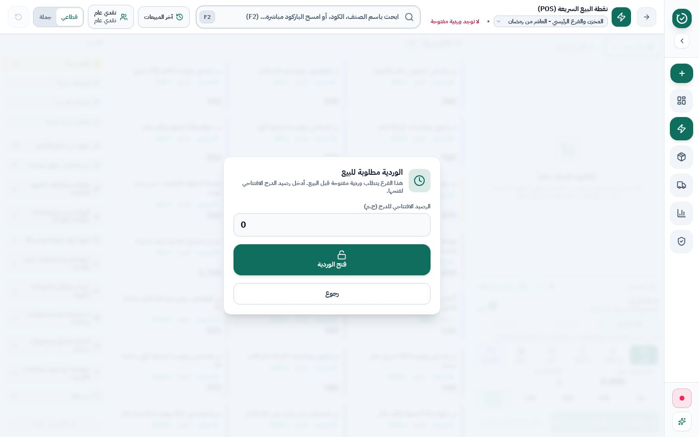
*الكاشير بيطلب فتح وردية قبل البيع*

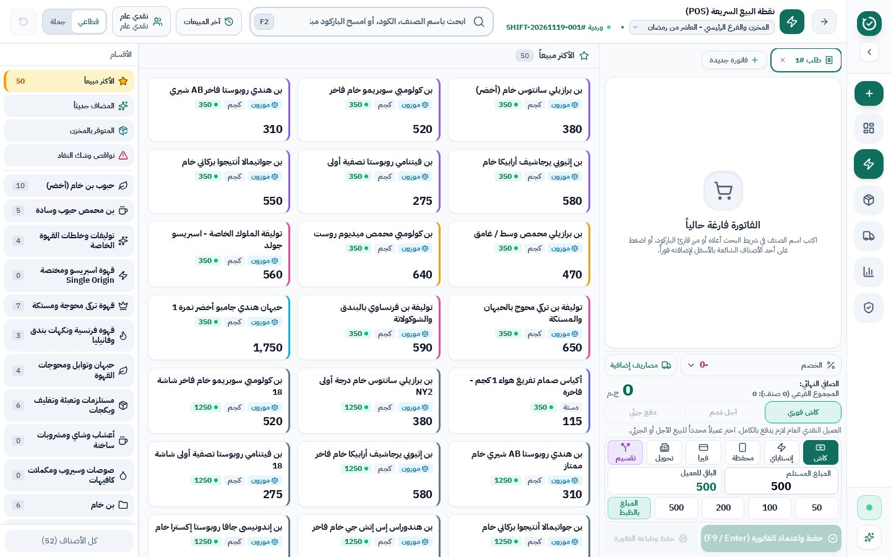
*شاشة الكاشير (POS) بعد فتح الوردية*

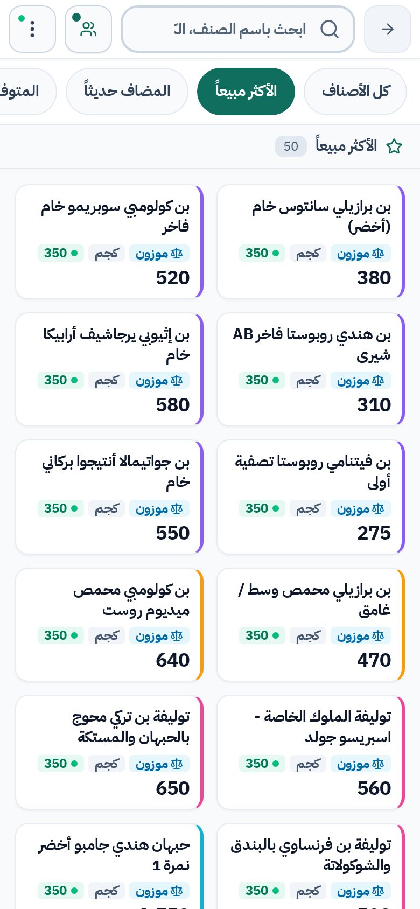
*الكاشير على الموبايل*

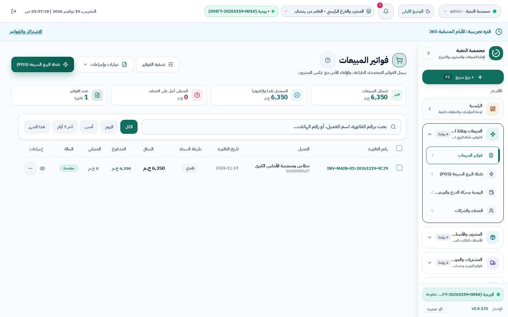
*قائمة فواتير البيع*

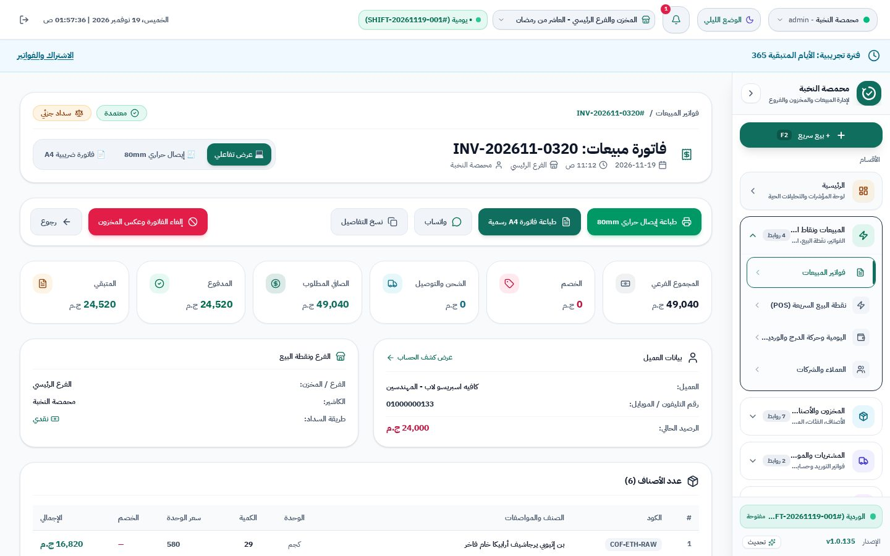
*تفاصيل فاتورة*

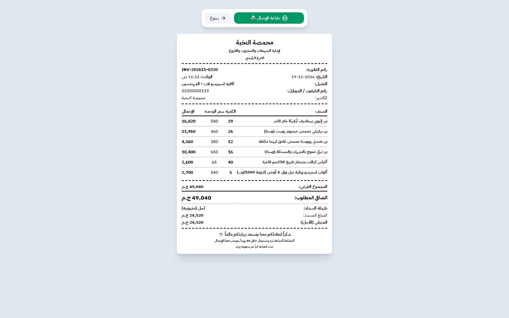
*طباعة الفاتورة*

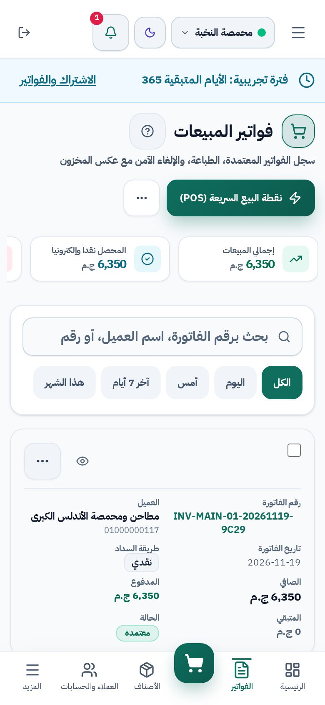
*الفواتير على الموبايل*

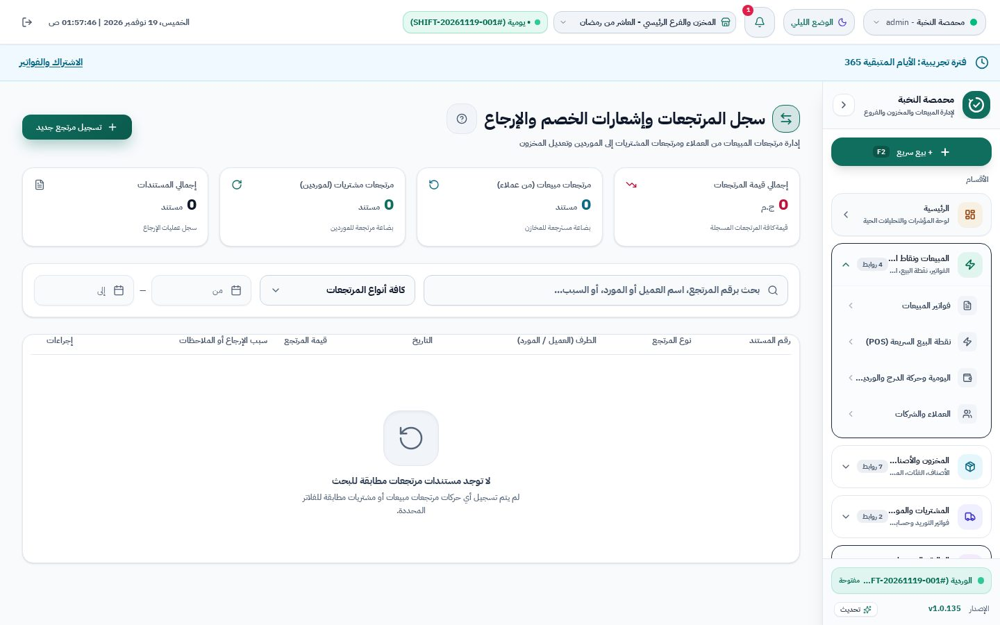
*قائمة المرتجعات*

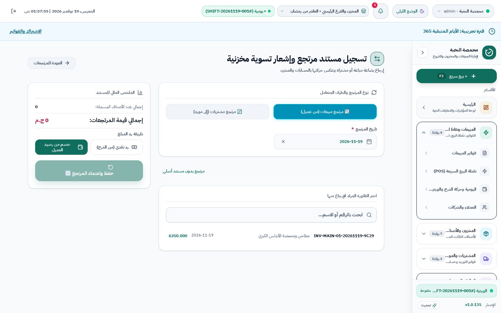
*عمل مرتجع جديد*


## رحلات العمل خطوة بخطوة

### 1) بيع من الكاشير

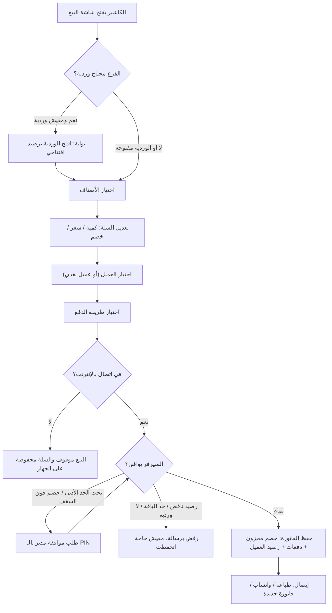

**أ. فتح الوردية.** لو إعداد الفرع «الوردية مطلوبة للبيع» شغّال (وده الوضع الافتراضي)، الكاشير مش هيقدر يبيع قبل ما يفتح وردية. بتظهر بوابة بتطلب «الرصيد الافتتاحي للدرج». لو المستخدم مالوش صلاحية فتح الوردية بتظهر رسالة يطلب من المسؤول.

**ب. اختيار الأصناف.** في أكتر من طريقة:
- **الباركود**: بتعدّي الباركود بالقارئ، النظام بيدوّر على الصنف بنفس الكود بالظبط (مش بحث تقريبي) وبيضيفه.
- **البحث**: بالاسم أو الكود.
- **الفئات**: شرائط/قائمة فئات وعليها عدّاد الأصناف.
- **الأزرار السريعة**: أصناف أو فئات مثبّتة لكل فرع (لحد 300 مفتاح) بترتيب تحدده.
- **الصنف بدون سعر**: لو اتمسح بالباركود بيتعلّم بتحذير والكاشير يكمّل السكانر؛ لو اتضاف يدوي بيفتح له خانة السعر.
- الصنف الموقوف (غير نشط) مش بيظهر.
- المخزون اللي بيظهر هو مخزون **الفرع الحالي** مش الإجمالي.

**ج. الأصناف بالوزن.**
- الصنف المعلّم «بيتباع بالوزن» لو اتضاف من غير وزن بيفتح نافذة تسأل عن الوزن.
- ممكن تكتب الكمية مباشرة بصيغة `الكمية*` فتتضاف على طول.
- الأصناف العادية (قطعة، علبة، كرتونة…) لازم كميتها صحيحة (مفيش 1.5 علبة). النظام بيرفض الكسر على الأصناف دي.
- الكمية بتقبل لحد 3 أرقام عشرية (0.250 كجم).

**د. ملصقات ميزان الباركود (Scale labels).** ده مدعوم فعلًا. لو الفرع فعّل الإعداد ده، الباركود اللي بيطلعه ميزان الطباعة (مثلًا ملصق كيس البن) بيتفكّ تلقائيًا:
- الباركود شكله: بادئة + كود الصنف (PLU) + قيمة + رقم تحقق اختياري.
- القيمة إما **وزن** (مثلًا 00750 ÷ 1000 = 0.750 كجم) أو **سعر** (فيتحسب الوزن = السعر المطبوع ÷ سعر الصنف).
- البادئات الافتراضية من 20 لـ 29، وطول الكود والقيمة (4–6 أرقام) وقواسم الوزن والسعر ورقم التحقق كلها بتتظبط من إعدادات الفرع.
- لو رقم التحقق غلط، النظام بيرفض الملصق ومبيخمّنش وزن من ملصق تالف.
- لو ملصق سعر وسعر الصنف صفر، بيرفض.

**هـ. الخلطات (Mixes) في الكاشير؟ لأ.** الخلطات (مثلًا تركيبة بن بنسب وتحميص وطحن) بتتباع من شاشة «الخلطات» المنفصلة مش من الكاشير. الشاشة بتحسب تكلفة الخلطة وهامش الربح، وبتصدر فاتورة بيع عادية فيها كل مكوّن بالكيلو (الجرامات ÷ 1000) وبتحط تفاصيل الخلطة (التحميص والطحن والوزن) في ملاحظات الفاتورة. الفاتورة دي بتمشي في نفس قواعد الفواتير: المخزون، شرط الوردية، وحد الفواتير الشهري. الخلطات ميزة في باقة «النمو» وما فوق (تحت).

**و. تعديل السلة.**
- زيادة/نقص/كتابة الكمية، وحذف السطر.
- **السعر**: أي كاشير يقدر يغيّر سعر البيع للسطر (بيطلع له سعر القطاعي وسعر الجملة كاقتراح). السعر الأعلى من سعر القائمة مسموح دايمًا. الأقل مقيّد بالحد الأدنى للبيع (تحت).
- **الخصم على السطر**: نسبة % أو مبلغ. لو اتكتب الاتنين، النسبة هي اللي بتتحسب.
- **الخصم على الفاتورة**: نسبة أو مبلغ ثابت على إجمالي بعد خصومات السطور، ومش ممكن يعدّي الإجمالي. وفي أزرار جاهزة للخصم (الافتراضي 0 و5 و10%) بتظهر منها بس اللي في حدود سقف الفرع.
- **مصاريف إضافية** (شحن/توصيل…): بتتضاف على الفاتورة. لو «على حساب العميل» بتزوّد الإجمالي؛ لو «من الخزنة» بتتسجل مصروف منفصل على الفرع.
- ملاحظات على الفاتورة (لحد 500 حرف).

**ز. العميل.**
- من غير ما تختار عميل، الفاتورة بتتسجّل على **«عميل نقدي»** عام بيتعمل تلقائي.
- العميل النقدي لازم يدفع **كامل ونقدًا**؛ الآجل والجزئي مرفوضين عليه لأنه مجهول ومفيش حد نحصّل منه.
- لو اخترت عميل مسمّى، سعره بيتحدد بشريحته: عميل جملة وصنف له سعر جملة = سعر الجملة، غير كده القطاعي. السلة بتتسعّر من جديد لو غيّرت العميل.
- **إضافة عميل سريع** من الكاشير: اسم (مطلوب)، تليفون، شريحة الأسعار (قطاعي/جملة)، عنوان. بياخد مكان من حد العملاء في باقتك. العميل النقدي ما بياخدش مكان.
- مفيش حد ائتماني بيمنع بيع آجل لعميل تعدّى حد معين (مش متطبق، تحت «حدود»).

**ح. الطلبات المفتوحة (تعليق الفاتورة).** مفيش «فاتورة معلقة/مسودة» على السيرفر. اللي موجود: تبويبات طلبات في الكاشير (F4 طلب جديد). كل تبويب بيحتفظ بسلته وعميله وخصمه ودفعه، وبيتخزّن على **الجهاز نفسه** (localStorage). النتيجة:
- تقدر تخدم كذا زبون بالتوازي وترجع لكل طلب.
- الطلب بيفضل حتى لو قفلت الصفحة أو انقطع النت، بس على نفس الجهاز والمتصفح بس.
- مفيش حد تاني (جهاز آخر) يقدر يشوفه أو يكمّله.
- قفل تبويب فيه أصناف بيطلب تأكيد.

**ط. الدفع.**

| الحالة | المعنى | القواعد |
|---|---|---|
| كاش / وسيلة وحدة | دفع كامل | بيتسجّل الإجمالي بوسيلة الدفع المختارة. لو كاش، تكتب المبلغ المستلم (أو تدوس فئة كاش) ويظهر **الباقي** تلقائي. |
| دفع مقسّم | أكتر من وسيلة (لحد 10) | المجموع لازم يغطي الإجمالي. غير الكاش مش ممكن يزيد على المطلوب؛ الزيادة (الباقي) من الكاش بس. لو المجموع أقل من الإجمالي يترفض. |
| جزئي (Partial) | دفع جزء والباقي آجل | المدفوع أكبر من صفر وأقل من الإجمالي، ومفيش باقي فكة. الباقي بيتضاف على حساب العميل. |
| آجل (Credit) | بدون دفع | مفيش دفعات، الإجمالي كله على حساب العميل. |

- وسائل الدفع بتتفعّل/تتقفل من إعدادات النظام (الافتراضي: كاش وإنستاباي ومحفظة وVisa وتحويل بنكي). وسيلة مقفولة مش بتتقبل.
- الشيك و«أخرى» موجودين على السيرفر بس مش في الوسائل الافتراضية للكاشير.
- كل سطر دفع بيتسجّل كسند دفع (بيحمل رقم ووسيلة)، ومجموعهم بالظبط = المدفوع. الباقي ما بيتسجلش كدفعة.

**ي. الحفظ والطباعة.** لما الكاشير يدوس حفظ، حاجات كتير بتحصل في عملية واحدة (ملخصها تحت في «القواعد»). بعدها:
- شاشة نجاح فيها الباقي لو في.
- **طباعة إيصال حراري** (80mm) بنسخة لحد 3. ممكن تتظبط **طباعة تلقائية** من الإعدادات (حتى لو الكاشير داس «حفظ» بس).
- على تطبيق سطح المكتب: طباعة صامتة وفتح درج الكاش لما الدفع كاش. على المتصفح: بتفتح صفحة طباعة.
- **إعادة طباعة** أي فاتورة قديمة من «آخر المبيعات» (F8) أو من تفاصيل الفاتورة، ومش بتفتح الدرج لأن مفيش فلوس اتحركت.
- **فاتورة A4 رسمية** من تفاصيل الفاتورة: بتظهر عليها بيانات الشركة والسجل التجاري ورقم التسجيل الضريبي لو متسجلين.
- **واتساب**: زرار في تفاصيل الفاتورة بيفتح محادثة مع العميل برسالة جاهزة فيها الأصناف والإجمالي والمدفوع والمتبقي ورصيد العميل. رقم العميل بيتحوّل لصيغة دولية (01… ← 20…). ده رابط واتساب بيفتح من جهاز المستخدم، مش إرسال تلقائي من السيرفر.
- **آخر المبيعات** (F8): مبيعات اليوم مع بحث، وإعادة طباعة، و**مرتجع سريع** (تحت).

**ك. اختصارات الكيبورد.** F1 مساعدة، F2 بحث، F3 عميل، F4 طلب جديد، F7 خصم، F8 آخر المبيعات، F9 أو Ctrl+Enter حفظ، F10 كتالوج، وAlt+Q/P/D للكمية والسعر وخصم السطر. شغالة حتى مع الكيبورد العربي.

**ل. لو مفيش إنترنت.** الحفظ **بيتوقف** برسالة «لا يمكن إتمام البيع بدون اتصال»، والسلة والطلبات محفوظة على الجهاز لحد ما النت يرجع. مفيش طابور بيع أوفلاين: ميزة `pos.offline` موجودة كاسم بس ومقفولة في كل الباقات لأن مسارها لسه ما اتبناش.

**م. الضغط المزدوج / إعادة المحاولة.** كل عملية حفظ ليها مفتاح فريد. لو الشبكة وقعت بعد ما الفاتورة اتحفظت وأعاد الكاشير المحاولة، النظام بيرجّع نفس الفاتورة ومش بيعمل واحدة تانية. المفتاح بيتغيّر لو غيّر الكاشير أي حاجة في الطلب.

### 2) الفواتير: القائمة والتفاصيل

- **القائمة**: بحث برقم الفاتورة أو اسم/تليفون العميل، وفلتر بالعميل والتاريخ (من/إلى) وطريقة الدفع ونوع الدفع (كاش/جزئي/آجل) والحالة. ترتيب الأحدث أولًا.
- **الإجماليات** (عدد، إجمالي المبيعات، المدفوع، المتبقي) ظاهرة بس لمن عنده صلاحية التقارير. الفواتير الملغاة بتتحسب في العدد ومش داخلة في إجمالي المبيعات.
- **تصدير CSV** للفواتير المفلترة أو المحددة. في حد أقصى 20,000 صف لكل تصدير.
- **رقم الفاتورة**: بادئة الفرع + التاريخ + تسلسل. كل فرع له سلسلة. الأرقام مش بتتكرر.
- **تاريخ الفاتورة**: بيتحدد من السيرفر بتوقيت المحل وحدود «بداية يوم العمل»، مش من ساعة جهاز الكاشير. فاتورة الكاشير مبتتأرّخش بتاريخ قديم أبدًا.
- **حالات الفاتورة**:
  - الحالة: `مؤكدة` أو `ملغاة`. مفيش حالة «مسودة» أو «معلّقة» على السيرفر.
  - حالة الدفع: `غير مدفوعة` / `مدفوعة جزئيًا` / `مدفوعة`. بتتحدّث لما العميل يسدّد لاحقًا.
- **تفاصيل الفاتورة**: الأصناف، الخصومات، الدفعات ومواعيدها، العميل، الفرع، الكاشير اللي سجّلها.

### 3) إلغاء الفاتورة

الفاتورة **لا بتتعدّل ولا بتتمسح** (مفيش مسار تعديل أو حذف للفواتير في النظام). التصحيح بيتم بالإلغاء ثم فاتورة جديدة، أو بالمرتجع.

شروط الإلغاء:
- صلاحية «إلغاء فاتورة» (الأدمن ومن اتدّاله) + الوصول لفرع الفاتورة. فاتورة من فرع تاني بتظهر كأنها مش موجودة.
- الفاتورة اللي عليها **أي مرتجع** ما تتلغيش (المرتجع لازم يتحذف الأول).
- الفاتورة الملغاة قبل كده بترجع تعارض.
- لو الفاتورة فيها **دفعات كاش لسه فعّالة**: لازم **موافقة أدمن بالـ PIN** (الأدمن يكتب رقمه السري). السبب إن الإلغاء بيطلّع كاش من الدرج. المحاولات الغلط محدودة.
- سبب الإلغاء بيتطلب من الشاشة (بحد 500 حرف) ويتسجل على الفاتورة وفي سجل النشاط.

اللي بيحصل عند الإلغاء (كله مرة واحدة):
1. الأصناف بترجع للمخزون في **نفس الفرع** بتكلفتها وقت البيع.
2. كل دفعة فعّالة بتتعمل لها دفعة عكسية بنفس الوسيلة (كاش من الدرج، فيزا من حساب الفيزا…) بتاريخ اليوم ووردية اليوم، والبيع الأصلي يفضل ظاهر في وردية ويومه.
3. الحالة تبقى `ملغاة` والمتبقي يتصفّر.
4. رصيد العميل يتحسب من جديد.
5. الفاتورة الملغاة **لسه محسوبة** ضمن حد الفواتير الشهري (حتى لا يتحايل أحد بالإلغاء وإعادة الإنشاء).

### 4) المرتجعات

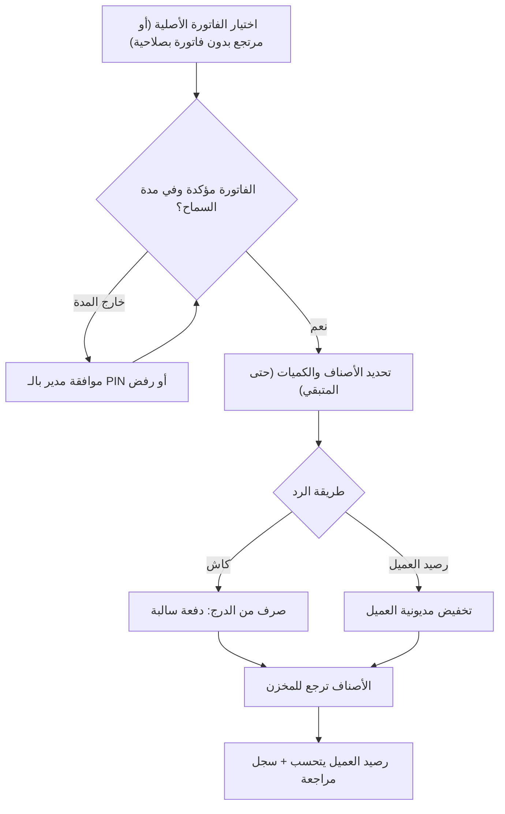

**مرتجع على فاتورة (الأساس):**
- من «المرتجعات ← مرتجع جديد»، أو من «آخر المبيعات» في الكاشير (مرتجع سريع) بنفس القواعد.
- الأسطر والكميات والأسعار **بتيجي من الفاتورة الأصلية**. العميل مش بيكتب سعر. تقدر ترجّع **كمية جزئية** من أي سطر، لحد المتبقي (الأصلي - اللي اتردّ قبل كده). ممكن أكتر من مرتجع على نفس الفاتورة.
- الفاتورة لازم تكون `مؤكدة` (الملغاة مش بتتردّ)، والعميل هو عميل الفاتورة.
- **قيمة المرتجع** = قيمة السطر بعد خصم السطر **وبعد نصيبه من خصم الفاتورة** (الخصم بيتوزّع بنسبة). مصاريف الشحن والإضافية **مش بترجع**.
- آخر كمية متبقية في السطر بتاخد الباقي من القيمة بالظبط (عشان التقريب ميسيبش مليمات).
- **مدة السماح**: إعداد «مدة السماح بالمرتجع (بالأيام)». فاضي = من غير حد. لو الفاتورة أقدم من المدة، المرتجع بيترفض إلا بصلاحية «تجاوز مدة المرتجع» (الأدمن) أو بـ PIN مدير ليه الصلاحية. التجاوز بيتسجل في سجل النشاط.
- **الصنف يرجع المخزن** في فرع الفاتورة. تكلفة الصنف الراجع بتكون تكلفته الحالية، مش بالضرورة تكلفة وقت البيع.

**طريقة رد الفلوس:**
- **كاش**: بتتسجل دفعة سالبة كاش على الفرع، فبتظهر خارجة من الدرج في الوردية واليومية والخزنة. الحد الأقصى للكاش المردود على فاتورة = **المدفوع فعلًا عليها ناقص اللي اترد كاش قبل كده**. لو أكبر بيترفض (حماية من الاحتيال).
- **رصيد العميل**: مفيش فلوس بتتحرك. المرتجع بيقلّل اللي العميل مديون بيه، أو بيعمل له رصيد دائن.
- الاختيار الافتراضي في الشاشة: كاش لو الفاتورة مدفوعة بمبلغ يغطي المرتجع، وإلا رصيد.
- **العميل النقدي**: دايمًا كاش (مفيش حساب يتخصم منه).

**مرتجع بدون فاتورة:** مسموح بصلاحية خاصة («مرتجع بدون فاتورة»، للأدمن افتراضيًا). بيكتب الصنف والكمية والسعر بإيده، ومفيش مدة سماح ولا سقف كاش على فاتورة (مفيش فاتورة تتقاس عليها).

**حذف مرتجع:** بصلاحية «حذف مرتجع» (الأدمن). بيعكس كل حاجة: الأصناف تخرج من المخزن تاني، ودفعة الكاش المردودة تتلغي (الكاش يرجع للدرج حسابيًا)، والرصيد يتحسب من جديد. الحذف مرة واحدة بس (محاولة تانية = غير موجود).

**مرتجع المشتريات** (للمورد) موجود في نفس الشاشة، لكنه خارج نطاق ملف المبيعات ده؛ بينقص مخزون وبيعدّل رصيد المورد.

### 5) الورديات (الدرج)

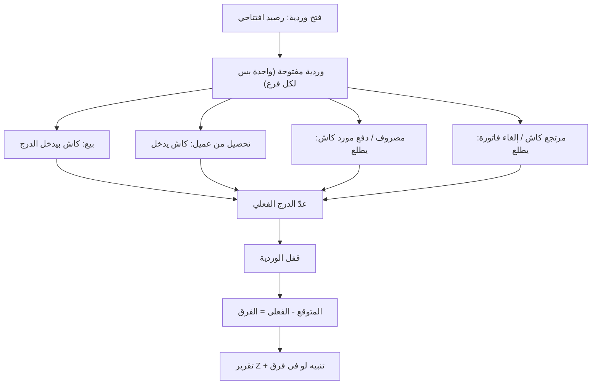

**الفتح:**
- بيحتاج صلاحية «فتح وقفل الوردية». الرصيد الافتتاحي (رقم ≥ 0) إلزامي، وفي ملاحظات اختيارية.
- **وردية واحدة مفتوحة لكل فرع** في نفس الوقت. الدرج مشترك بين كل كاشيرات الفرع: كاشير «ب» بيبيع جوه وردية فتحها كاشير «أ». لو حاولت تفتح تانية يقولك إن رقم كذا مفتوحة.
- رقم الوردية: `SHIFT-` + تاريخ يوم العمل + تسلسل (بيبدأ من جديد كل يوم عمل). يوم العمل بيتحدد بتوقيت المحل وحدود بداية اليوم، فوردية فتحت 01:30 والحد 03:00 بتتبع اليوم اللي قبله.

**إزاي كل حاجة بتتنسب لوردية:** كل فاتورة وسند دفع ومصروف ومرتجع مبيعات بيتختم بالوردية المفتوحة في فرعه وقت إنشائه، ومش بتتغيّر بعد كده حتى لو الساعة اتغيّرت أو الوردية اتقفلت. بيع وسط قفل الوردية: القفل بيستنى العمليات اللي في نص الحفظ، والبيع اللي بييجي بعد القفل بيتوقف (رسالة «الوردية اتقفلت أثناء البيع») ومفيش حاجة بتتحفظ.

**الأرقام اللي بتتحسب (المتوقع في الدرج):**

```
المتوقع = الرصيد الافتتاحي
        + كاش المبيعات (اللي اتقبض لحظة البيع)
        + تحصيل من العملاء كاش
        - مصروفات كاش
        - مدفوعات موردين كاش
        - مرتجعات كاش (ورد كاش على إلغاء فاتورة)
```

- **غير الكاش** (فيزا، إنستاباي…) ما بيدخلش في حساب الدرج.
- **المبيعات الآجلة** بتتعرض في التقرير للمعلومية فقط (مفيش فلوس دخلت).
- في الجزئي، الكاش اللي اتدفع بس هو اللي بيدخل الدرج.

**القفل:**
- بصلاحية «فتح وقفل الوردية». بيقفلها **اللي فتحها أو مدير** (أدمن أو من عنده صلاحية التقارير). وردية فتحتها عملية آلية بيقفلها مدير بس. غير كده 403.
- بتدخل **النقدية الفعلية** اللي عدّيتها (≥ 0) وملاحظات اختيارية.
- **العدّ الأعمى (Blind count)**: الكاشير (من غير صلاحية التقارير) مش بيشوف الرصيد المتوقع قبل ما يكتب اللي عدّه. المتوقع والفرق بيظهروا بعد الإغلاق في تقرير Z.
- النظام بيحفظ: المتوقع، الفعلي، والفرق = **الفعلي - المتوقع**. موجب = زيادة، سالب = عجز.
- لو في فرق (زيادة أو عجز)، بيتبعت **تنبيه تيليجرام** في الخلفية (لو تيليجرام متفعّل في باقتك ومتظبط). التنبيه مبيعطّلش القفل لو فشل.
- بعد القفل الأرقام بتتثبّت ومبتتغيّرش.

**تقرير Z:** بيتعرض ويتطبع (حراري): رقم الوردية، الفرع، الكاشير، وقت الفتح والقفل، والأرقام اللي فوق. تقرير وردية **مفتوحة** بيطلع مؤقت (X) باللحظة الحالية، وبدون المتوقع للكاشير بسبب العدّ الأعمى. الكاشير بيقرا تقرير ورديته بس، والمدير بيقرا الكل.

**الارتباط بالخزنة:** الورديات واليومية والخزنة بيقروا من نفس سندات الدفع (الكاش اللي دخل أو خرج). عشان كده المرتجع الكاش والمصروف والتحصيل بيظهروا في الخزنة وفي الوردية بنفس الرقم. المبالغ بتتصرف لحساب «كاش» أو «فيزا» أو غيره حسب وسيلة الدفع.

**إلغاء شرط الوردية:** من إعدادات الفرع تقدر تقفل «الوردية مطلوبة للبيع». ممنوع تقفله وفي وردية مفتوحة في نفس الفرع، وأي تغيير في الإعداد بيتسجل في سجل النشاط.

## القواعد التجارية

### اللي بيحصل لحظة حفظ الفاتورة (كله أو لا شيء)

1. **المخزون**: كل صنف بيتخصم من مخزون **الفرع اللي بيتباع منه** (مش من الإجمالي)، ويتسجل له حركة مخزون برقم الفاتورة. لو الرصيد مش كفاية الفاتورة بتترفض، إلا لو الإعداد «السماح بالرصيد السالب» شغّال (الافتراضي: لأ).
2. **التكلفة**: تكلفة كل سطر بتتسجل وقت البيع (متوسط التكلفة المرجّح لو متاح، وإلا سعر التكلفة). منها بيتحسب الربح لاحقًا.
3. **السعر**: السيرفر هو المرجع. لو السعر ما اتبعتش، بياخد سعر القائمة حسب شريحة العميل (والفرع). بيتسجل سعر القائمة وقت البيع جنب سعر البيع الفعلي.
4. **الدفعات**: سند دفع لكل وسيلة (مدفوع)، على الفرع، بتاريخ اليوم.
5. **رصيد العميل**: بيتحدّث = (الفواتير - المدفوعات - المرتجعات + الرصيد الافتتاحي لو مستورد).
6. **التسجيل**: سجل مراجعة وسجل نشاط للفاتورة.
7. **الوردية**: كل ده بيتنسب لوردية الفرع المفتوحة.

### الحسابات والتقريب

- كل المبالغ والكميات بـ 3 أرقام عشرية، والتقريب نصف لأعلى (HALF UP) بنفس الطريقة في السيرفر والكاشير (المعاينة اللي بتشوفها هي نفس الحساب النهائي).
- سعر السطر = (الكمية × السعر) - خصم السطر. لو الخصم أكبر من قيمة السطر بيترفض.
- الإجمالي الفرعي = مجموع صافي السطور. خصم الفاتورة = نسبة × الإجمالي الفرعي (أو مبلغ ثابت)، ومش بيعدّي الإجمالي الفرعي.
- **الصافي** = الإجمالي الفرعي - خصم الفاتورة + المصاريف الإضافية اللي على حساب العميل.
- **المتبقي** = الصافي - المدفوع.

### الخصم والحد الأدنى للسعر

- **سقف الخصم لكل فرع**: إجمالي الخصم (سطور + فاتورة) كنسبة من إجمالي البيع قبل الخصم. الافتراضي **5%** (الفروع القديمة بقت على 10%). تقدر تغيّره 0–100 لكل فرع، أو تسيبه فاضي للافتراضي.
- فوق السقف: يحتاج صلاحية «تجاوز سقف الخصم» أو **موافقة مدير بالـ PIN** (بيظهر طلب الموافقة في الشاشة). والسيرفر بيتحقق، مش بس الشاشة.
- **الحد الأدنى للبيع** (`سعر البيع الأدنى` للصنف، صفر = مفيش حد): أي سطر صافيه (بعد الخصم، وحتى بعد توزيع خصم الفاتورة) أقل من الكمية × الحد الأدنى يحتاج صلاحية «بيع تحت الحد الأدنى» أو PIN مدير. حتى لو بسعر القائمة.
- الكاشير **ما بيشوفش الحد الأدنى** نفسه، بس بيشوف إن في حد.
- كل موافقة بتتسجل باسم المدير اللي وافق على السطر/الفاتورة.
- الـ PIN بيتتحقق منه السيرفر، ومحاولات الغلط محدودة.
- صلاحية `خصم الفواتير` موجودة في شاشة الأدوار بس مش بتتفحص فعليًا على السيرفر حاليًا (تحت «حدود»). اللي بيحكم هو سقف الفرع والحد الأدنى.

### حد الفواتير الشهري حسب الباقة

- ده حد **عدد فواتير البيع** في الشهر. بيتحسب لكل فاتورة اتنشأت في شهر يوم العمل (بتوقيت المحل)، حتى الملغاة والمحذوفة. المرتجعات والمشتريات مش بتتحسب.
- بيتطبق على **كل** مصادر فاتورة البيع: الكاشير، وإنشاء الفاتورة، وفاتورة الخلطات.
- لما العدّاد يوصل الحد، السيرفر بيرفض أي فاتورة جديدة (403 «وصلت للحد»)، وإعادة محاولة لفاتورة اتحفظت قبل كده بترجع نفس الفاتورة.
- **بانر في الكاشير** (فوق شاشة البيع):
  - من **80%** من الحد: بانر أصفر «استهلكت X من Y فاتورة…» وفيه المتبقي.
  - عند **الوصول للحد**: بانر أحمر «وصلت إلى حد باقتك من الفواتير هذا الشهر (150 فاتورة)» + «لا يمكن إصدار فاتورة بيع جديدة حتى يبدأ العدّاد من جديد في <تاريخ أول الشهر الجاي> أو ترقية الباقة. المرتجعات وتحصيل الآجل وإغلاق الوردية تعمل كالمعتاد.»
  - فيه زرار «ترقية الباقة» لمن عنده صلاحية الاشتراك، وغيره بيشوف «اطلب من المالك الترقية».
  - الكاشير بيتنبّه **قبل** الحفظ، ولو حاول، بتظهر رسالة الترقية بدل طلب هيفشل. والبانر بيتحدّث بعد كل فاتورة.
- **اللي بيفضل شغال عند الحد**: المرتجعات، تحصيل الآجل من العملاء، المصروفات، قفل الوردية، وعرض الفواتير وطباعتها وإلغائها. البيع الجديد بس هو اللي بيتوقف.
- لو الباقة من غير حد (بقية الباقات المدفوعة) أو المحل مش مفعّل عليه الحد، مفيش بانر ولا قيد.
- العدّاد بيبدأ من الصفر أول يوم من الشهر الجاي بتوقيت المحل.

### الضريبة (VAT)

**مش متطبقة.** مفيش نسبة ضريبة، ولا حساب ضريبة على السطر أو الفاتورة، ولا ضريبة في الإجماليات، ولا ربط بمنظومة الفاتورة الإلكترونية. اللي موجود فقط: خانتين في إعدادات الشركة للسجل التجاري ورقم التسجيل الضريبي، بيظهروا مطبوعين على فاتورة A4 (اللي عنوانها «فاتورة ضريبية»). كمان صفحة الأسعار بتوضّح إن أسعار الاشتراك لا تشمل ضريبة القيمة المضافة. لو محلك مسجّل في الضريبة، لازم تضمّنها في سعر الصنف نفسه.

## أمثلة بأرقام

### مثال 1: فاتورة 3 أصناف بخصم ودفع جزئي

فرع سقف الخصم فيه 10%. العميل «أحمد» (قطاعي).

| الصنف | الكمية | السعر | قبل الخصم | خصم السطر | الصافي |
|---|---|---|---|---|---|
| بن برازيلي | 0.500 كجم | 400.000 | 200.000 | - | 200.000 |
| كوب سيراميك | 2 | 75.000 | 150.000 | 10% = 15.000 | 135.000 |
| شاي (علبة) | 1 | 55.000 | 55.000 | - | 55.000 |

- الإجمالي الفرعي = 200 + 135 + 55 = **390.000**
- خصم الفاتورة 5% = 390 × 5% = **19.500**
- الصافي = 390.000 - 19.500 = **370.500**
- إجمالي الخصم = 15 + 19.5 = 34.5 من 405 قبل الخصم = 8.52%، تحت السقف (10%)، فمفيش موافقة مطلوبة. (لو السقف 5% كان هيطلب PIN مدير.)
- الدفع: جزئي، مقسّم **120.000 كاش + 80.000 فيزا** = مدفوع 200.000.
- المتبقي على أحمد = 370.500 - 200.000 = **170.500** (حالة الدفع: مدفوعة جزئيًا).

اللي بيحصل:
- المخزون: بن -0.500 كجم، كوب -2، شاي -1 (من الفرع).
- سندان للدفع: 120 كاش، 80 فيزا.
- الدرج: بيزيد **120.000 بس** (الفيزا مش كاش).
- رصيد أحمد: +170.500 (مديونية).

لو نفس الفاتورة كانت كاش كاملة والزبون سلّم 400: الباقي = 400 - 370.5 = **29.500**، والمتسجّل دفعة كاش 370.500 بس.

### مثال 2: مرتجع جزئي على فاتورة المثال 1

أحمد رجّع **كوب واحد** و**0.200 كجم** من البن، ورد على رصيده أو كاش.

- نسبة خصم الفاتورة = 19.5 ÷ 390 = 5% بتتوزّع على السطور.
- البن: صافي السطر 200 → بعد نصيبه من الخصم = 190.000 → المرتجع = 190 × (0.200 ÷ 0.500) = **76.000**
- الكوب: صافي السطر 135 → بعد الخصم = 128.250 → المرتجع = 128.250 × (1 ÷ 2) = **64.125**
- إجمالي المرتجع = 76.000 + 64.125 = **140.125**
- المخزون: بن +0.200 كجم، كوب +1.
- باقي القابل للإرجاع: بن 0.300، كوب 1، شاي 1.

**لو الرد كاش** (مسموح لأن المدفوع 200 ≥ 140.125): بيخرج 140.125 من الدرج (سند سالب)، ومديونية أحمد تفضل **170.500** (لأن المرتجع والسند متعادلين). يعني أخد فلوس وهو لسه مديون بالباقي، النظام ما بيقاصّش تلقائي.

**لو الرد على الرصيد**: مفيش كاش بيخرج، ومديونية أحمد = 370.5 - 200 - 140.125 = **30.375**.

### مثال 3: قفل الوردية

وردية الصبح، رصيد افتتاحي 500.000:

| البند | المبلغ |
|---|---|
| رصيد افتتاحي | 500.000 |
| + كاش المبيعات | 2,350.000 |
| + تحصيل من عملاء كاش | 300.000 |
| - مصروفات كاش | 150.000 |
| - دفع مورد كاش | 400.000 |
| - مرتجع كاش (مثال 2) | 140.125 |
| **المتوقع** | **2,459.875** |

الكاشير عدّ **2,450.000**: الفرق = 2,450 - 2,459.875 = **-9.875** (عجز). التقرير بيعرضه عجز، ويتبعت تنبيه تيليجرام لو متفعّل.

## الصلاحيات

| الإجراء | مين يقدر |
|---|---|
| البيع من الكاشير وإضافة عميل سريع | صلاحية الكاشير أو إنشاء فاتورة (الكاشير والأدمن). |
| عرض الفواتير والتفاصيل | عرض فواتير أو الكاشير + الوصول لفرع الفاتورة. |
| إجماليات قائمة الفواتير | من عنده صلاحية التقارير. |
| إلغاء فاتورة | إلغاء فاتورة (أدمن افتراضيًا) + موافقة PIN أدمن لو فيها كاش. |
| بيع تحت الحد الأدنى للسعر | صلاحية «بيع تحت الحد الأدنى» أو PIN مدير عنده الصلاحية. |
| خصم فوق سقف الفرع | صلاحية «تجاوز سقف الخصم» أو PIN مدير عنده الصلاحية. |
| عمل مرتجع | صلاحية المرتجعات (الكاشير والأدمن). |
| مرتجع بدون فاتورة | صلاحية خاصة (أدمن افتراضيًا). |
| مرتجع بعد مدة السماح | صلاحية تجاوز المدة (أدمن) أو PIN مدير. |
| حذف مرتجع | صلاحية حذف المرتجعات (أدمن). |
| فتح الوردية وقفلها | صلاحية فتح/قفل الوردية. والقفل لمن فتحها أو مدير. |
| قراءة تقرير Z | الأدمن/صاحب صلاحية التقارير يقرا أي وردية، والكاشير ورديته بس. |
| رؤية الرصيد المتوقع في الوردية المفتوحة | من عنده صلاحية التقارير (غيره بيعدّ أعمى). |
| إعدادات الكاشير للفرع | صلاحية الإعدادات + الوصول للفرع. |
| فاتورة بتاريخ قديم (من غير الكاشير) | صلاحية «تأريخ قديم» (أدمن). الكاشير بيتأرّخ دايمًا بتاريخ اليوم. |
| الكاشير يشوف تكلفة الأصناف | لأ، التكلفة لمن عنده صلاحية عرض التكلفة بس. |

أي وصول لفرع المستخدم مالوش صلاحية عليه بيتعامل كأنه مش موجود (مش «ممنوع»)، فمستخدم فرع ما يعرفش بوجود فواتير فرع تاني.

## الإعدادات المتاحة

**على مستوى الفرع (إعدادات الكاشير):**
- ميزان الباركود: تفعيل، البادئات، طول كود الصنف (4–6)، نوع القيمة (وزن/سعر)، طول القيمة (4–6)، قاسم الوزن والسعر، رقم التحقق.
- سقف الخصم (%).
- الوردية مطلوبة للبيع (افتراضي: نعم).
- شكل الكتالوج: عدد الكروت في الصف (2 أو 3 أو تلقائي) وإظهار صور الأصناف.
- الأصناف السريعة (لحد 300 مفتاح).

**على مستوى المحل (إعدادات النظام):**
- وسائل الدفع المفعّلة في الكاشير.
- فئات الكاش السريعة (الافتراضي 50 / 100 / 200 / 500).
- أزرار الخصم الجاهزة (0 / 5 / 10).
- الطباعة التلقائية (بدون / حراري) وعدد نسخ الإيصال (1–3).
- السماح بالرصيد السالب (افتراضي: لأ).
- مدة السماح بالمرتجع بالأيام (1–3650، فاضي = مفيش حد).
- بداية يوم العمل والمنطقة الزمنية (بتحكم تاريخ الفاتورة والوردية والعدّاد الشهري).
- بيانات الشركة والسجل التجاري ورقم التسجيل الضريبي (بتظهر على A4).

## حسب الباقة

| | التجربة (مجانية دايمة) | البداية | النمو | الأعمال |
|---|---|---|---|---|
| حد فواتير البيع الشهري | **150** | بدون حد | بدون حد | بدون حد |
| فروع | 1 | 1 | 3 | 10 |
| مستخدمين | 2 | 3 | 8 | 25 |
| الكاشير، الفواتير، المرتجعات، الورديات | متاحة | متاحة | متاحة | متاحة |
| الخلطات (Mixes) | لأ | لأ (إضافة) | نعم | نعم |
| تنبيهات تيليجرام (فرق الوردية) | لأ | نعم | نعم | نعم |
| تصدير التقارير | لأ | نعم | نعم | نعم |

ملاحظات:
- الأرقام من إعدادات الباقات الحالية؛ أي باقة ممكن تتعدّل أو تتخصّص لمحل معيّن من لوحة الإدارة.
- الكاشير والفواتير والمرتجعات والورديات من المزايا الأساسية في كل الباقات.
- عدد العملاء المسموح (يشمل اللي بتضيفه من الكاشير) محدود برضو حسب الباقة.

## أسئلة شائعة

**هل أقدر أعدّل فاتورة بعد الحفظ؟**
لأ. مفيش تعديل فاتورة في النظام. الغلط بيتصلّح بإلغاء الفاتورة وعمل واحدة جديدة، أو بمرتجع لو الغلط في صنف أو كمية. (لو في مرتجع على الفاتورة لازم تحذف المرتجع الأول عشان تلغيها.)

**أقدر أمسح فاتورة؟**
لأ. الإلغاء هو الوسيلة الوحيدة. الفاتورة الملغاة بتفضل ظاهرة بحالة «ملغاة» وللمراجعة.

**ليه الإلغاء طلب PIN؟**
لأن الفاتورة فيها كاش اتقبض، والإلغاء هيطلّعه من الدرج. فلازم مدير يوافق بنفسه بالـ PIN. الفاتورة الآجلة بالكامل أو المدفوعة بغير كاش بتتلغي من غير PIN.

**الزبون عاوز يرجّع بعد شهر، أعمل إيه؟**
لو مدة السماح في الإعدادات أقصر، المرتجع بيترفض ويطلب موافقة مدير بالـ PIN (أو الأدمن يعمله بنفسه). لو مفيش مدة محددة، بيتقبل.

**ممكن أبيع من غير وردية؟**
لو إعداد الفرع «الوردية مطلوبة» شغّال (الافتراضي)، لأ. تقدر تقفله لو مفيش وردية مفتوحة، بس ساعتها الفلوس مش بتتنسب لوردية والتقارير اليومية هتكون أقل دقة.

**ليه مبيعات كاشير بتظهر على درج غيره؟**
لأن الدرج واحد لكل فرع مش لكل كاشير. الوردية بتتفتح مرة والكل بيبيع جواها، والكاشير بيشوف أرقامه هو بس (مبيعاته).

**الإنترنت قطع في نص البيع.**
السلة بتفضل محفوظة، والحفظ بيتوقف لحد ما النت يرجع. لو كان الحفظ اتنفّذ وأنت ما شفتش الرد، أعد المحاولة: هيرجع نفس الفاتورة ومش هيتكرر.

**وصلت حد 150 فاتورة، هل أقفل الوردية وأحصّل ديون؟**
أيوه. المرتجعات والتحصيل وقفل الوردية والمصروفات شغالة. بس البيع الجديد متوقف لحد أول الشهر الجاي أو الترقية.

**الفاتورة الملغاة بتتحسب من الـ 150؟**
أيوه، بتتحسب. العدّاد بيعدّ كل فاتورة اتنشأت.

**أعمل خلطة من الكاشير؟**
لأ. من شاشة «الخلطات»، وبتطلّع فاتورة عادية.

## حدود وملاحظات / فرص تطوير

- **مفيش ضريبة قيمة مضافة**: لا حساب ولا تقرير ولا فاتورة إلكترونية. الموجود رقم تسجيل مطبوع بس.
- **مفيش تعديل ولا حذف فاتورة**، ومفيش فاتورة معلّقة أو مسودة على السيرفر. الطلبات المفتوحة محلية على الجهاز.
- **مفيش بيع أوفلاين**: البيع بيتوقف مع قطع الإنترنت (ميزة الأوفلاين مقفولة ومش مبنية). ده خطر في محل نتّه ضعيف.
- **صلاحية «خصم الفواتير»** معروضة في شاشة الأدوار لكن مش مطبّقة على السيرفر؛ أي كاشير يقدر يدخل خصم لحد سقف الفرع. اللي بيحكم السقف والحد الأدنى للسعر فقط.
- **السعر قابل للتعديل من أي كاشير** للأعلى دايمًا، وللأقل لحد الحد الأدنى للصنف. لو صنف مالوش حد أدنى (صفر)، الكاشير يقدر يبيعه بأي سعر حتى بصفر.
- **مفيش حد ائتماني للعميل**: ممكن عميل آجل يعدّي أي مديونية.
- **المرتجع الكاش لعميل مديون** بيخرج كاش وما بيتقاصّش تلقائيًا مع المديونية (شفناه في المثال 2).
- **تكلفة الصنف الراجع** بتتحسب بتكلفته الحالية مش تكلفة وقت البيع، فممكن تأثر على الربح لو التكلفة اتغيّرت.
- **حد الكاش المردود** محسوب على إجمالي المدفوع بكل الوسائل مش الكاش بس، فمرتجع فاتورة اتدفعت بفيزا ممكن يتردّ كاش (بحد المدفوع).
- **الواتساب** رابط بيفتح من الجهاز، مش إرسال تلقائي، ومحتواه نص بس بدون ملف PDF.

## ملحق للفريق التقني

- المسارات: `POST /api/v1/invoices` (الكاشير بيستخدمه)، `POST /api/v1/pos/checkout`، `GET /api/v1/pos/bootstrap|items|lookup|invoice-limit|quick-keys`، `POST /api/v1/invoices/{id}/cancel`، `POST /api/v1/returns`، `GET /api/v1/return-sources/{type}`، `POST /api/v1/shifts/open|close`، `GET /api/v1/shifts/{id}/z-report`.
- المنطق الأساسي: `InvoiceService::confirmInvoice/cancelInvoice`، `ReturnService`، `ReturnSourceService`، `ShiftService`، `SalePriceGuard`، `SaleDiscountGuard`، `SaleShiftGuard`، `ReturnWindowGuard`، `InvoiceCancelGuard`، `MonthlyInvoiceCounter` + `PlanEnforcer`.
- `InvoiceService::updateInvoice` موجودة في الكود بدون route، وسياسة `delete` على الفاتورة بدون route.
