# الأصناف والمخزون والمخازن

## الخلاصة في سطور

- كل صنف في «إبراء» له رصيد **إجمالي** ورصيد **في كل مكان تخزين** (فرع، مخزن رئيسي، عربية توزيع). المبيعات والمشتريات والتحويلات بتشتغل على رصيد المكان، والإجمالي هو مجموع الأماكن.
- الكميات بـ **3 أرقام عشرية** (مثلًا 0.250 كجم)، والفلوس كمان. مفيش تقريب عشوائي: الحسابات بتتم بأرقام عشرية دقيقة.
- **كل تغيّر في الرصيد بيتسجّل في «كارت حركة الصنف»**: مين عمل إيه، إمتى، الرصيد قبل وبعد، وتكلفة الوحدة. مفيش حاجة بتتغيّر في الرصيد من غير أثر.
- تكلفة الصنف بتتحسب **بالمتوسط المرجّح** مع كل فاتورة شراء، والربح في الفواتير بيتحسب على أساس المتوسط ده.
- التحويل بين الأماكن **فوري** (مفيش «طلب ثم استلام»): بيتنفّذ أول ما تعتمده، ويتلغي بس لو الكمية لسه موجودة في المكان المستلِم.
- استيراد الأصناف من Excel بيشتغل **كله أو ولا حاجة**، والحد الأقصى 5000 صف في الملف.
- الباقة المجانية بتسمح بـ **100 صنف** ومكان تخزين واحد بس؛ التحويلات والمزج وإعادة الطلب الذكية مش متاحة فيها.

## مين بيستخدمه

| الدور | بيعمل إيه في المخزون |
|---|---|
| صاحب المحل / المدير (admin) | كل حاجة: إضافة وتعديل الأصناف، الأسعار والتكلفة، التسويات، التحويلات، المخازن، الاستيراد، سلة المحذوفات |
| أمين المخزن | يشوف الأصناف **وتكلفتها**، يعمل مشتريات وتحويلات. مش بيضيف ولا بيعدّل أصناف (قرار تجاري: الأسعار والتكلفة عند المدير بس) |
| المحاسب | يشوف الأصناف وتكلفتها والتقارير |
| الكاشير | يشوف الأصناف ويبيع منها. مش بيشوف التكلفة |

## الشاشات

| الشاشة | بتعمل إيه |
|---|---|
| الأصناف | قائمة الأصناف بالرصيد والأسعار، إضافة/تعديل/حذف، تفعيل وإيقاف، تسوية الرصيد، وفتح كارت الحركة |
| كارت حركة الصنف | كل حركات الصنف بفلاتر (تاريخ، مكان، نوع الحركة) وإجمالي الوارد والمنصرف وصافي الحركة، مع طباعة A4 |
| التصنيفات | إدارة تصنيفات الأصناف (الاسم، أيقونة، لون، ترتيب، مفعّل/موقوف) |
| الفروع والمخازن | إضافة وتعديل أماكن التخزين وتحديد الفرع الرئيسي وتعيين الموظفين لكل مكان |
| أرصدة المخزن | رصيد كل صنف في مكان معيّن، مع فلتر «ناقص» و«نافد» |
| التحويلات | قائمة أذونات التحويل، تفاصيل إذن، وإلغاؤه |
| إذن تحويل جديد | اختيار من/إلى، التاريخ، الأصناف والكميات |
| المزج (Mixes) | حاسبة تركيبة (خلطة) وإصدار فاتورة بيع مباشرة منها (شاشة «خلّاط البن» سابقًا) |
| إعادة الطلب الذكي | اقتراحات بالكميات المطلوب شراؤها حسب سرعة البيع |
| الاستيراد | معالج رفع Excel/CSV للأصناف (والعملاء والموردين والتصنيفات) |
| سلة المحذوفات | استرجاع أو حذف نهائي للأصناف والفروع المحذوفة |
| الإعدادات ← وحدات القياس، السماح بالرصيد السالب، حد النواقص | إعدادات المخزون العامة |

## لقطات من الشاشات

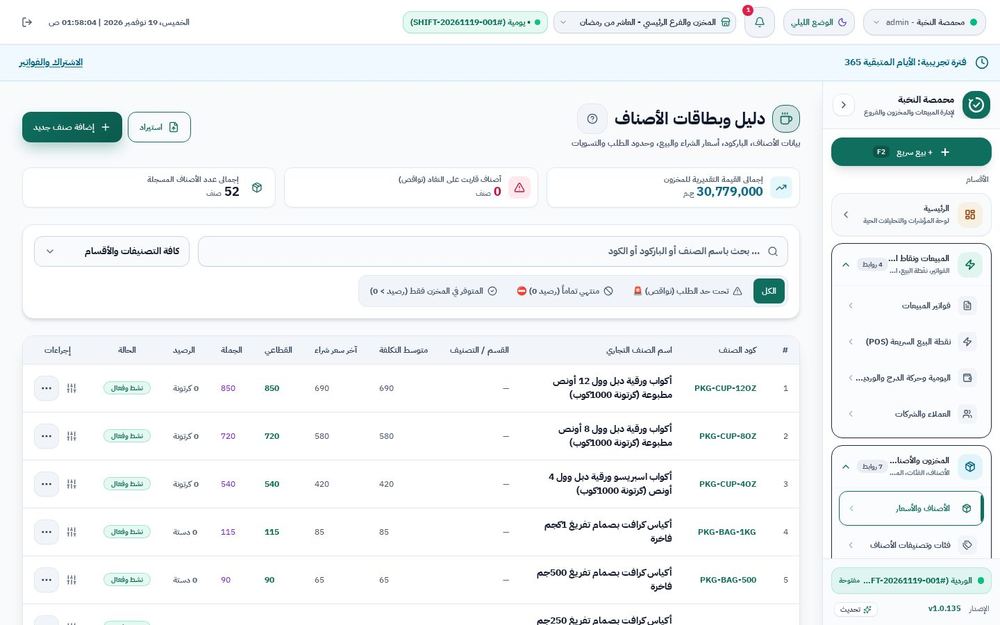
*قائمة الأصناف*

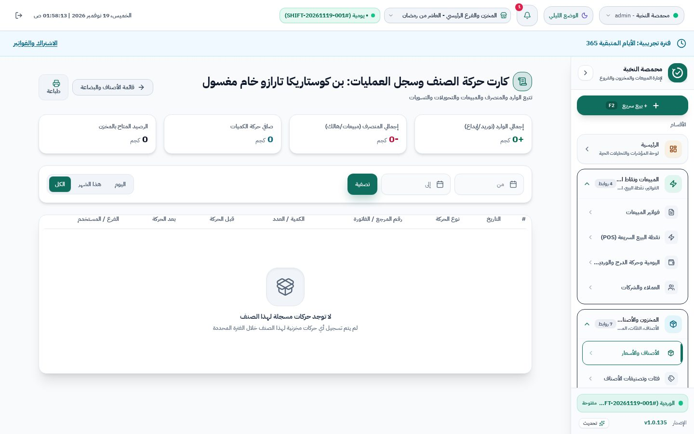
*حركة صنف (كارت الصنف)*

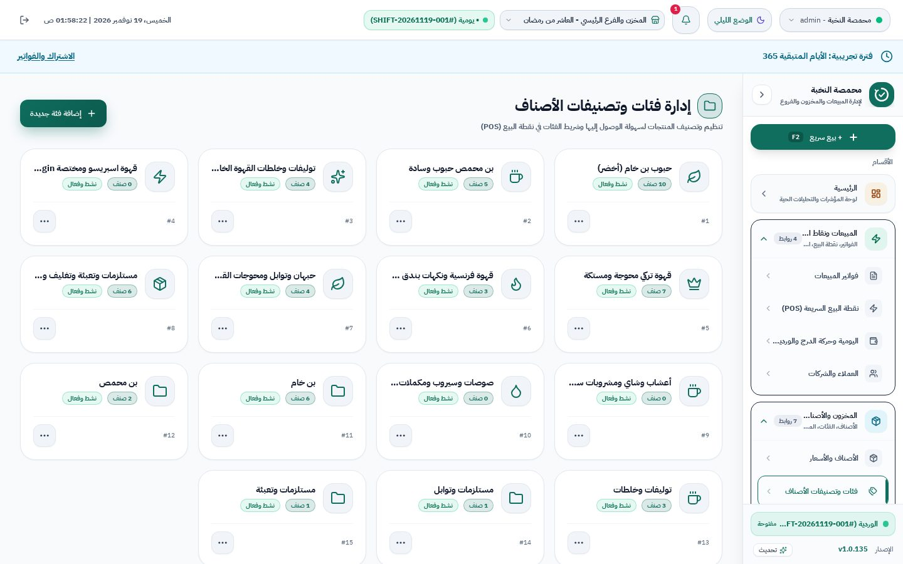
*التصنيفات*

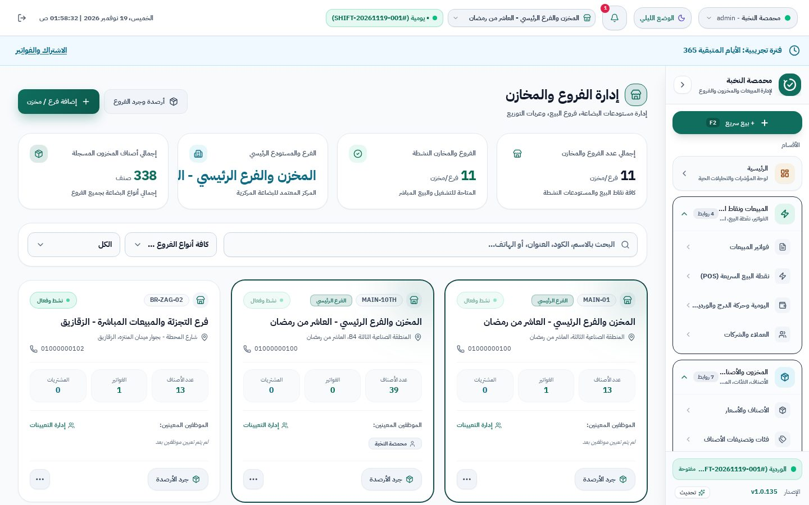
*الفروع والمخازن والعربيات*

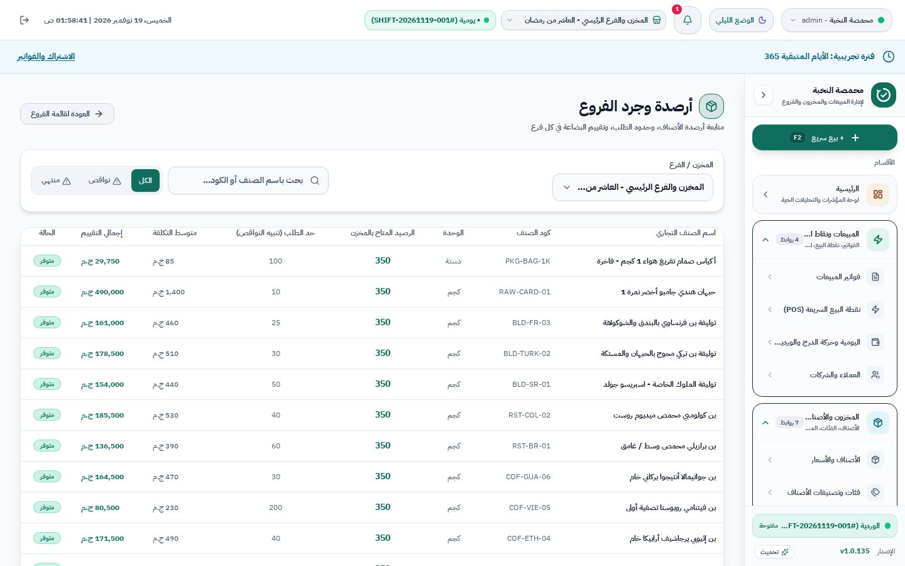
*رصيد المخزون في كل مكان*

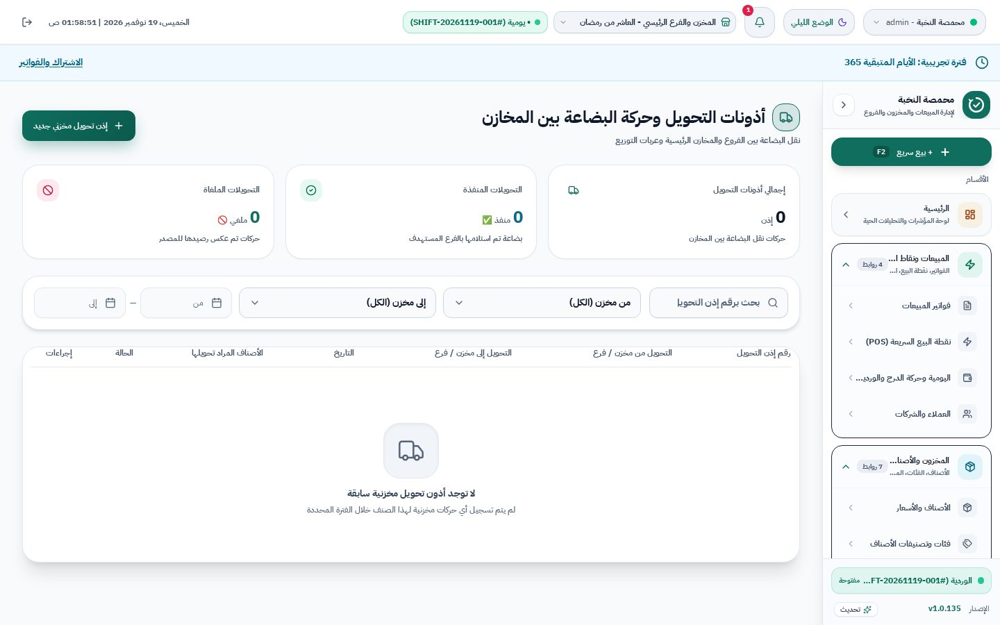
*التحويلات بين المخازن*

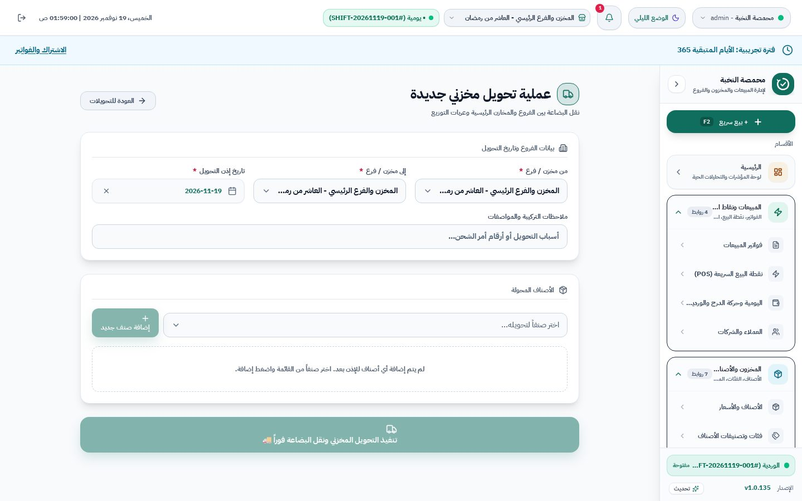
*تحويل مخزني جديد*

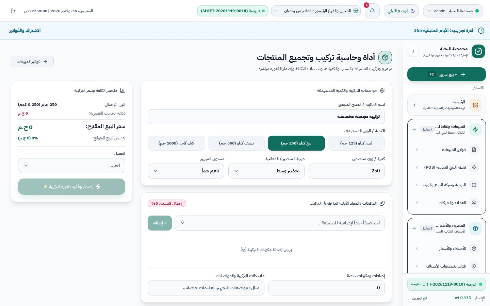
*شاشة الخلطات (المزج)*

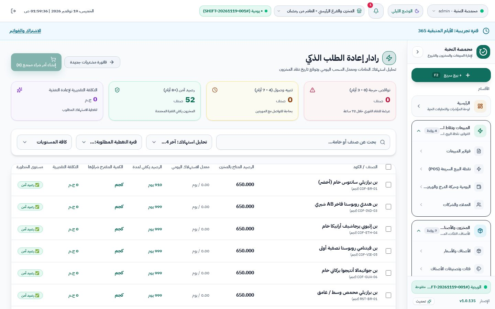
*إعادة الطلب الذكي*

## بيانات الصنف

| الحقل | معناه |
|---|---|
| الاسم | مطلوب (حتى 255 حرف) |
| الكود | اختياري. لو سبته فاضي النظام بيولّد `ITM-0001` و`ITM-0002`… تلقائي. الكود لازم يكون فريد حتى لو الصنف القديم اتحذف |
| التصنيف | اختياري، من قائمة التصنيفات |
| الوحدة | مطلوبة، ولازم تكون من **قائمة وحدات المحل** (انظر تحت) |
| سعر التكلفة | آخر تكلفة شراء. بتتحدّث مع كل فاتورة شراء |
| متوسط التكلفة | بيتحسب تلقائي من المشتريات (المتوسط المرجّح) |
| سعر البيع (التجزئة) | مطلوب |
| سعر الجملة | اختياري. لو فاضي أو صفر، عميل الجملة بيدفع سعر التجزئة |
| أدنى سعر بيع | حد أدنى للبيع (0 = مفيش حد). البيع تحته بيحتاج موافقة مدير بـ PIN |
| حد الطلب (الحد الأدنى للمخزون) | لو الرصيد نزل عنه الصنف يظهر في «النواقص» |
| صنف موزون | البيع بالوزن (كميات كسرية وملصقات ميزان). بيتفعّل تلقائي لو الوحدة كجم/جرام |
| ملاحظات | نص حر حتى 1000 حرف |
| مفعّل / موقوف | الصنف الموقوف مبيظهرش في الكاشير ولا بيتقرأ بالباركود |
| الرصيد | مبيتكتبش بإيد على شاشة التعديل. بيتغيّر بس بالمشتريات والمبيعات والتحويلات والتسويات |

### الوحدات
- قائمة الوحدات (قطعة، علبة، كجم، جرام، لتر…) بتتظبط من **الإعدادات** للمحل، وفيه قائمة جاهزة تضيف منها بسرعة. أي صنف جديد (يدويًا أو بالاستيراد) لازم وحدته تكون ضمن القائمة.
- الوحدة اسم بس: **مفيش تحويل بين الوحدات**. مينفعش تشتري «كرتونة» وتبيع «قطعة» والنظام يحوّل لك. لو محتاج ده، عرّف صنفين أو اشتغل بوحدة واحدة.

### الباركود
- مفيش خانة باركود منفصلة. **كود الصنف نفسه هو الباركود**: الكاشير بيمسح الكود والنظام بيدوّر عليه بمطابقة كاملة.
- لو المحل شغّل «ملصقات الميزان» في إعدادات نقطة البيع، النظام بيفك الباركود (كود الصنف + الوزن أو السعر) ويحسب الكمية. لو رقم التحقق غلط بيرفض بدل ما يخمّن.

### الصور
- الحقل موجود في قاعدة البيانات لكن **مفيش رفع صور للأصناف** من الشاشات حاليًا.

## رحلات العمل خطوة بخطوة

### 1) إضافة صنف
1. الأصناف ← «إضافة صنف».
2. تكتب الاسم، تختار الوحدة، تدخل التكلفة وسعر البيع (وحد الطلب لو عايز تنبيه نواقص).
3. الصنف بيتعمل برصيد **صفر** في كل أماكن التخزين (الفروع والمخازن والعربيات).
4. الرصيد الأولي بييجي من **فاتورة شراء** أو **استيراد برصيد أول المدة** أو **تسوية بالزيادة**.

لو المحل على الحد الأقصى للباقة (مثلًا 100 صنف في المجانية): الإضافة بتتوقف برسالة «وصلت للحد الأقصى المسموح في باقتك من الأصناف… رقّي باقتك أو أضف إضافة». الأصناف الموجودة مبتتأثرش.

### 2) حذف صنف أو إيقافه
- **الحذف مسموح بس للصنف اللي عمره ما اتحرّك**: مفيش رصيد (لا إجمالي ولا في أي مكان)، ومفيش فواتير بيع أو شراء أو مرتجعات أو تحويلات أو حركات مخزنية عليه. غير كده النظام بيعرض أسباب المنع.
- الصنف اللي اشتغل بيه المحل يتعمل له **إيقاف** (مفعّل ← موقوف) بدل الحذف. بيختفي من الكاشير وتفضل تقاريره وتاريخه.
- المحذوف بيروح **سلة المحذوفات**. الاسترجاع بيحتسب مكان في حد الباقة تاني، فلو المحل وصل للحد الاسترجاع بيترفض (يمنع الالتفاف على الحد بالحذف ثم الاسترجاع).

### 3) تسوية الرصيد (جرد / هالك)
من شاشة الأصناف ← «تسوية الرصيد» على الصنف:

| النوع | الأثر |
|---|---|
| تسوية بالزيادة | بيزوّد رصيد المكان المختار |
| تسوية بالعجز | بينقّص الرصيد |
| هالك / تالف | بينقّص الرصيد وبيتسجل بنوع «هالك» عشان يتفرّق عن العجز |
| إيداع / رصيد افتتاحي إضافي | بيزوّد الرصيد |

- بتختار **المكان** والكمية (أقل كمية 0.001) وسبب اختياري. كل تسوية بتاخد رقم مستند `ADJ-يوم-تسلسل` وبتظهر في كارت الحركة باسم المستخدم.
- مفيش «ورقة جرد» تدخل فيها الرصيد الفعلي لكل الأصناف مرة واحدة؛ التسوية صنف صنف، وإنت اللي بتحسب الفرق (الفعلي ناقص الدفتري) وتدخله.
- مفيش منع للسالب في التسوية بالعجز والهالك: لو نقصت أكتر من الرصيد، الرصيد هيبقى بالسالب (انظر «حدود وملاحظات»).

### 4) كارت حركة الصنف
بيظهر كل حركة بنوعها وكميتها والرصيد قبل وبعد والمستند اللي سببها. أنواع الحركات:

| الحركة | بتحصل لما |
|---|---|
| مبيعات (صرف) | فاتورة بيع (كاشير أو فواتير) أو فاتورة من المزج |
| مرتجع مبيعات (وارد) | مرتجع من عميل |
| إلغاء فاتورة (وارد) | إلغاء فاتورة بيع بيرجّع البضاعة |
| شراء (وارد) | فاتورة شراء |
| إلغاء شراء (صرف) / استعادة شراء (وارد) | إلغاء فاتورة شراء أو التراجع عن الإلغاء |
| مرتجع مشتريات (صرف) | إرجاع بضاعة لمورد |
| تحويل صادر / تحويل وارد | إذن تحويل بين مكانين |
| عكس تحويل | إلغاء إذن تحويل |
| تسوية بالزيادة / بالعجز، هالك، إيداع | التسوية اليدوية |
| رصيد أول المدة | الاستيراد من Excel برصيد افتتاحي |

- فلتر بنوع الحركة والمكان والتاريخ، وإجماليات: **إجمالي الوارد، إجمالي المنصرف، صافي الحركة**، وطباعة A4 رسمية.
- التكلفة في الكارت **مخفية** عن أي مستخدم ملوش صلاحية رؤية التكلفة.

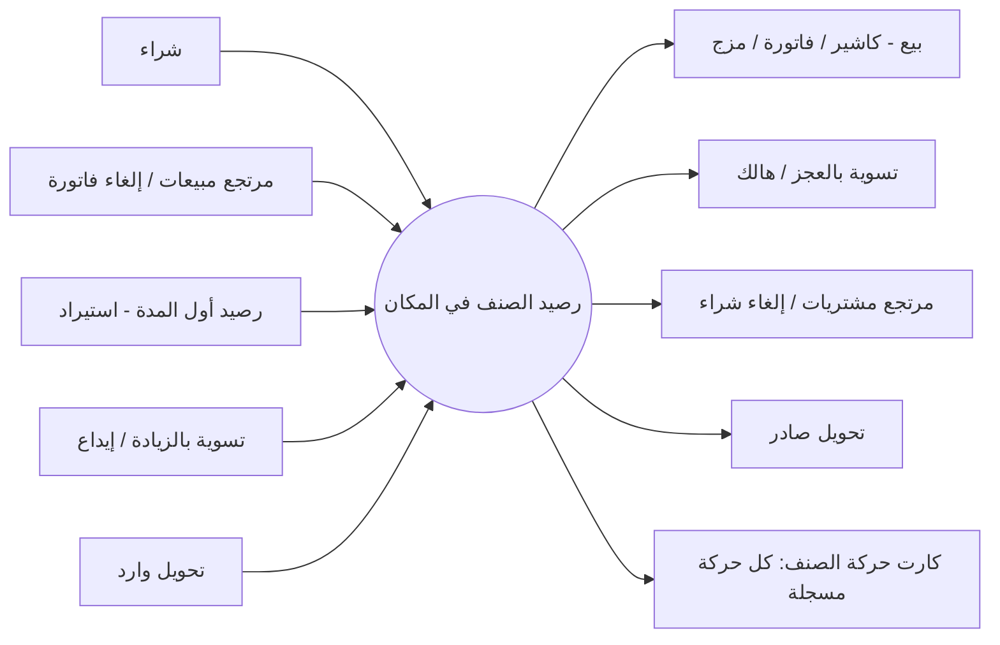

### 5) أماكن التخزين (الفروع والمخازن والعربيات)
- النوع: **فرع/محل**، **مخزن رئيسي**، أو **عربية توزيع** (لتاجر الجملة المتجول). كل نوع له عدّاد في حدود الباقة.
- فيه **فرع رئيسي** واحد دايمًا؛ لما تحدد غيره بيتشال من الأول. الرئيسي مينفعش يتحذف.
- أي مكان جديد بيتفتح له رصيد صفر لكل الأصناف الموجودة، وأي صنف جديد بيتفتح له رصيد صفر في كل الأماكن.
- **الحذف** مسموح بس لو المكان فاضي: مفيش رصيد، ولا فواتير بيع أو شراء أو تحويلات أو مصروفات عليه، وليس هو الرئيسي. لو مش مسموح استخدم الإيقاف.
- لكل مستخدم أماكن مسموح له يشتغل فيها (تعيين الموظفين). المستخدم بيشوف أرصدة أماكنه بس، إلا لو عنده صلاحية «رؤية كل الفروع» أو إدارة الفروع.
- الأرصدة في «أرصدة المخزن»: لكل صنف الكمية والحد الأدنى، مع فلتر «ناقص» (تحت حد الطلب، أو تحت **حد النواقص الافتراضي** من الإعدادات لو الصنف ملوش حد) و«نافد» (صفر أو أقل).

### 6) تحويل بضاعة بين مكانين

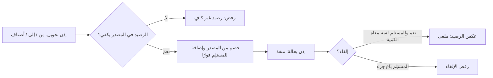

1. التحويلات ← «إذن تحويل جديد».
2. تختار **من** و**إلى** (لازم مختلفين) والتاريخ وملاحظات.
3. تضيف الأصناف والكميات (أقل كمية 0.001).
4. «تنفيذ التحويل»: الرصيد بيتخصم من المصدر ويتضاف للمستلِم **في نفس اللحظة**. بيتسجّل إذن برقم `TRF-تاريخ-تسلسل` وحركتين (صادر ووارد) لكل صنف.
5. الحالات: **منفذ** أو **ملغي** بس. مفيش «معلّق» أو «في الطريق» أو استلام لاحق.
6. **الإلغاء**: بيرجّع الكميات للمصدر لو المكان المستلِم لسه معاه نفس الكمية. لو باع منها، الإلغاء بيترفض برسالة فيها الكمية المتاحة والمطلوبة. تقدر تدخل سبب الإلغاء.
7. من يقدر ينقل: لازم تكون عندك صلاحية على **مكان المصدر**، وعلى المكان المستلِم أو صلاحية رؤية كل الفروع. أي حد مش مسموح له على المصدر بيتلقى رفض.

**مثال:** رصيد البن البرازيلي في المخزن الرئيسي 12.000 كجم وفي الفرع 1.500 كجم. تحويل 4.500 كجم من المخزن للفرع:

| | المخزن الرئيسي | الفرع | الإجمالي |
|---|---|---|---|
| قبل | 12.000 | 1.500 | 13.500 |
| بعد | 7.500 | 6.000 | 13.500 |

الإجمالي ثابت (البضاعة اتنقلت مش اتباعت)، والتكلفة مبتتغيّرش بالتحويل. لو حاولت تحوّل 8.000 من المخزن بعد كده (المتاح 7.500) يترفض.

### 7) استيراد الأصناف من Excel
1. الاستيراد ← اختار «الأصناف» ← حمّل **القالب** (ملف xlsx بالعناوين بالعربي وصف مثال).
2. أعمدة الأصناف: الكود، اسم الصنف*، التصنيف، الوحدة*، سعر التكلفة، سعر البيع*، أقل سعر بيع (جملة)، حد الطلب، صنف موزون، كمية أول المدة، تكلفة أول المدة. (* مطلوب)
3. ارفع الملف (xlsx أو csv، حتى 5 ميجا و**5000 صف**). النظام بيعمل **معاينة** من غير ما يكتب أي حاجة، وكل صف بيطلع **سليم** أو **فيه أخطاء** أو **مكرر**، وفيه تنبيهات (مثلًا سعر البيع أقل من التكلفة، أو أقل سعر أعلى من سعر البيع) والصف بيفضل صالح والقرار ليك.
4. **التأكيد**: النظام بيعيد فحص الملف من الأول (مش بيصدّق المعاينة) ثم بيكتب كل الصفوف السليمة في **عملية واحدة**:
   - لو فيه صفوف فيها أخطاء لازم تعلّم «تخطي الصفوف اللي فيها أخطاء واستيراد الباقي»، وإلا مفيش استيراد.
   - **الصف المكرر** (كود موجود، حتى لو الصنف محذوف) بيتخطى ومبيتحدّثش.
   - لو حصل أي خطأ أثناء الكتابة، **كل الاستيراد بيتلغي** ومفيش نص استيراد.
   - لو العدد الجديد هيعدّي حد أصناف الباقة، الاستيراد كله بيترفض (مش بيتقطع نص).
5. التصنيف: لو اسمه موجود بيتربط، وإلا بيتعمل تلقائي. الكود الفاضي بيتولّد تلقائي.
6. **رصيد أول المدة**: لو كتبت كمية أول المدة، بتتسجل في **الفرع النشط وقت الاستيراد** (لازم يكون فرع واحد محدد، مش «كل الفروع») بحركة «رصيد أول المدة» بتكلفة أول المدة، ومتوسط تكلفة الصنف يبدأ منها.
7. كل صف جديد بيتكتب برصيد صفر في باقي الأماكن.
8. بيتحتاج صلاحية «إضافة أصناف». زرار الاستيراد عليه حد معدل طلبات عشان محدش يكرر الرفع.

### 8) المزج (خلطة بن) والبيع منها
المزج في «إبراء» هو **حاسبة تركيبة + بيع**، مش أمر إنتاج يخزّن منتج نهائي.

1. المزج ← اسم الخلطة، الوزن المستهدف (مثلًا 250 جم)، درجة التحميص (فاتح/وسط/غامق/دبل)، درجة الطحن (تركي/إسبريسو/فرنش برس/حبوب).
2. تضيف مكونات (أصناف البن) بنسب مئوية، والنظام يحسب الجرامات لكل مكون من الوزن المستهدف.
3. اختياري: جرامات **هيل**.
4. الشاشة بتعرض التكلفة والسعر الإجمالي والربح ونسبة هامش الربح.
5. «إصدار فاتورة»: بيتعمل فاتورة بيع نقدية مؤكدة لعميل (أو عميل نقدي) بكل مكون كسطر بالكيلو. **رصيد كل مكون بيتخصم فعلًا من المكان النشط** بحركة «مبيعات». اسم الخلطة والتحميص والطحن والوزن بتتكتب في ملاحظات الفاتورة. لازم تكون وردية مفتوحة لو الفرع بيشترطها.

**مثال: خلطة 250 جم**

| المكون | النسبة | الجرامات | الكيلو | تكلفة الكيلو | سعر بيع الكيلو | التكلفة | السعر |
|---|---|---|---|---|---|---|---|
| برازيلي | 60% | 150 | 0.1500 | 400 | 600 | 60.000 | 90.000 |
| كولومبي | 40% | 100 | 0.1000 | 500 | 700 | 50.000 | 70.000 |
| **الإجمالي** | 100% | 250 | | | | **110.000** | **160.000** |

الربح 50.000 جنيه ونسبته 31.3% من السعر. لو أضفت 5 جم هيل: التكلفة +7.5 والسعر +12.5 (ثوابت 1.5 و2.5 جنيه للجرام) فتبقى التكلفة 117.5 والسعر 172.5 والهامش 31.9%.

### 9) إعادة الطلب الذكي
شاشة بتقترح تشتري كام من كل صنف. الحساب:

1. بتحدد **فترة التحليل** (افتراضي 14 يوم) و**أيام التغطية المطلوبة** (افتراضي 15 يوم).
2. **الاستهلاك اليومي** = كمية المبيعات المؤكدة في الفترة ÷ عدد أيام الفترة.
3. **الأيام المتبقية** = الرصيد الحالي ÷ الاستهلاك اليومي (مقرّبة لأسفل).
4. **الكمية المقترحة** = (الاستهلاك اليومي × أيام التغطية) − الرصيد، لو موجبة.
5. **التكلفة التقديرية** = الكمية المقترحة × متوسط التكلفة.
6. **الدرجة**: «حرج» (أحمر) لو نفد أو هينفد خلال 3 أيام أو أقل، «تحذير» (أصفر) خلال 7 أيام، وإلا «آمن».
7. مرتبة بالأخطر ثم الأقل أيامًا. فيه فلتر بالدرجة وبحث.

**مثال:** صنف اتباع منه 21 كجم في 14 يوم والرصيد 6 كجم ومتوسط تكلفته 220 جنيه: الاستهلاك 1.500 كجم/يوم، الأيام المتبقية 4 (تحذير)، المستهدف 22.500، المقترح **16.500 كجم**، التكلفة التقديرية **3,630.000 جنيه**.

## القواعد التجارية

### تكلفة الصنف (المتوسط المرجّح)
- مع كل فاتورة شراء: **المتوسط الجديد = (الرصيد الحالي × المتوسط الحالي + الكمية الجديدة × تكلفة الوحدة) ÷ (الرصيد + الكمية الجديدة)**. لو الرصيد الحالي صفر أو سالب بيتعامل كأنه صفر.
- «تكلفة الوحدة» هنا هي **التكلفة الواصلة**: سعر الشراء + نصيب الوحدة من المصاريف الإضافية للفاتورة (نقل مثلًا) لو اتحمّلت عليها.
- «سعر التكلفة» المعروض في الصنف = تكلفة آخر شراء، أما «متوسط التكلفة» فهو اللي بيتحسب منه **ربح الفواتير** والتقارير وتقييم المخزون. لو المتوسط صفر بيستخدم آخر تكلفة.
- إلغاء فاتورة شراء بيرجّع المتوسط والتكلفة لقيمتهم قبل الشراء. مرتجع المشتريات بيشيل قيمة البضاعة من المتوسط.
- **المتوسط واحد للصنف على مستوى المحل كله**، مش لكل فرع. التحويل مبيغيّرهوش.

**مثال:** اشتريت 10 كجم بن بـ 200 ج/كجم (المتوسط 200). بعدين اشتريت 5 كجم بـ 260 ج/كجم:
(10 × 200 + 5 × 260) ÷ 15 = 3,300 ÷ 15 = **220.000 ج/كجم**، والرصيد 15 كجم. أي بيع بعد كده تتحسب تكلفته 220. لو بعت 0.250 كجم: تكلفتها 55.000 جنيه.

### الرصيد السالب
- **الافتراضي: ممنوع.** أي بيع أو تحويل بيتجاوز رصيد المكان (أو الرصيد الإجمالي) بيترفض برسالة فيها المتاح.
- في **الإعدادات ← السماح بالرصيد السالب** تقدر تسمح بالبيع تحت الصفر (مفيد لو الجرد مش محدّث). التفعيل بيطلب تأكيد.
- التسوية بالعجز والهالك **مبتفحصش** الرصيد (انظر الملاحظات).

### الدقة
- كل الكميات 3 أرقام عشرية. أقل كمية في التسوية والتحويل 0.001. الأصناف اللي وحدتها كجم/جرام بتتعامل كموزونة.

### الأمان على التكلفة
- مين مفيش عنده صلاحية «رؤية التكلفة» مبيشوفش سعر التكلفة ولا متوسطها (لا في الأصناف ولا الحركات ولا التقارير ولا الكاشير).

### فروقات الرصيد
- فيه تقرير **انحراف الرصيد** بيقارن رصيد الصنف الإجمالي بمجموع أرصدة أماكنه، ويطلّع أي فرق (للأخطاء النادرة). مش تعديل، تقرير بس.

## الصلاحيات

| الإجراء | مين يقدر |
|---|---|
| مشاهدة الأصناف وكارت الحركة | مدير، وأي دور عنده «عرض الأصناف» (كاشير، أمين مخزن، محاسب). الكاشير يشوف الأصناف حتى بصلاحية نقطة البيع |
| رؤية التكلفة | مدير، أمين المخزن، المحاسب (صلاحية مستقلة) |
| إضافة صنف / تصنيف / استيراد | «إضافة أصناف» (مدير افتراضيًا) |
| تعديل صنف أو إيقافه | «تعديل أصناف» (مدير افتراضيًا) |
| حذف صنف | «حذف أصناف» |
| تسوية الرصيد | «تسوية المخزون» (مدير افتراضيًا) |
| تحويل بين الأماكن | «إنشاء تحويلات» أو «إدارة الفروع» + صلاحية على مكان المصدر (مدير وأمين المخزن افتراضيًا) |
| الفروع والمخازن | «إدارة الفروع» |
| سلة المحذوفات | «الوصول لسلة المحذوفات» |
| إعادة الطلب الذكي | «عرض المشتريات» + الميزة متاحة في الباقة |
| المزج | «إنشاء فواتير» أو «نقطة البيع» + الميزة متاحة في الباقة |

- كل الصلاحيات قابلة للتعديل من شاشة الأدوار.

## الإعدادات المتاحة

| الإعداد | أثره |
|---|---|
| وحدات القياس (الإعدادات) | القائمة المسموح بها للأصناف الجديدة. الصنف الموجود بوحدة مش في القائمة بيفضل زي ما هو |
| السماح بالرصيد السالب | يفتح البيع والتحويل تحت الصفر (افتراضي: مقفول) |
| حد النواقص الافتراضي | الحد اللي بيتقاس عليه أي صنف ملوش «حد طلب» خاص |
| إعدادات نقطة البيع للفرع | ملصقات الميزان (للباركود الموزون) |
| الفرع الرئيسي | الفرع اللي بتتحدد عليه العمليات لو مفيش فرع نشط |

وحدات القياس الافتراضية على مستوى المنصة بيديرها مدير المنصة (Super Admin)؛ المحل بيختار منها ويضيف وحداته الخاصة.

## حسب الباقة

| | المجانية (التجربة) | البداية | النمو | الأعمال |
|---|---|---|---|---|
| عدد الأصناف | **100** | غير محدود | غير محدود | غير محدود |
| فروع/محلات | 1 | 1 | 3 | 10 |
| مخازن رئيسية | 0 | 1 | 2 | 5 |
| عربيات توزيع | 0 | 0 | 1 | 5 |
| التحويلات بين الأماكن | لا | نعم | نعم | نعم |
| المزج | لا | إضافة اختيارية | نعم | نعم |
| إعادة الطلب الذكي | لا | ضمن حزمة إضافية | نعم | نعم |
| كارت حركة الصنف | نعم | نعم | نعم | نعم |
| الاستيراد من Excel | نعم (يحترم حد الأصناف) | نعم | نعم | نعم |

- الحدود ممكن تتعدّل لمحل بعينه من شاشة المنصة (استثناءات لكل محل).
- لو المحل نزل لباقة أقل: الأصناف والفروع الموجودة **متتمسحش**، لكن بيتمنع من إضافة جديد لحد ما يرجع تحت الحد.
- المحل المجاني عنده فرع واحد ومفيش مخزن ولا عربية، فتحويل البضاعة أصلًا مش متاح له.

## أسئلة شائعة

**ليه مش قادر أعدّل رصيد صنف من شاشة التعديل؟**
الرصيد بيتغير بمستند (شراء، بيع، تحويل، تسوية) عشان يفضل فيه أثر. استخدم «تسوية الرصيد».

**الصنف وصل الحد الأقصى في الباقة المجانية، أعمل إيه؟**
تحذف أصناف ما اتحركتش أو ترقّي الباقة. الأصناف اللي اشتغل بيها المحل متتحذفش، توقفها لكن هتفضل محسوبة ضمن العدد.

**هل الصنف الموقوف بيتحسب ضمن الـ 100؟**
أيوه، الإيقاف مش بيحرر مكان. الحذف (لو مسموح) هو اللي بيحرر.

**ممكن أبيع كرتونة وأخصم قطع؟**
لا، مفيش تحويل وحدات. اتعامل بوحدة واحدة أو صنفين.

**ليه التحويل اترفض؟**
غالبًا الرصيد في المصدر مش كفاية. حتى لو «السماح بالرصيد السالب» مفعّل، التحويل بيفحص رصيد المكان المصدر ويرفض لو أقل من المطلوب.

**ليه مش قادر ألغي تحويل؟**
المكان المستلِم باع أو حوّل جزء من الكمية. لازم الكمية تكون موجودة لسه عشان تتعكس.

**الاستيراد رفض الملف كله، ليه؟**
إما فيه صفوف فيها أخطاء ومعلّمتش «تخطي»، أو العدد هيعدّي حد الأصناف، أو كود اتاخد بالتوازي. مفيش استيراد جزئي.

**كود صنف اتحذف مش قادر أستخدمه؟**
الكود فريد حتى مع المحذوف. استرجع الصنف من سلة المحذوفات أو استخدم كود تاني.

**الربح بيتحسب بالتكلفة الأخيرة ولا المتوسط؟**
بالمتوسط المرجّح (ولو صفر، بآخر تكلفة).

**الخلطة بتتحفظ؟**
لا. كل مرة بتركّبها وتبيعها؛ مفيش وصفات محفوظة.

## حدود وملاحظات / فرص تطوير

- **مفيش تحويل وحدات** (كرتونة ← قطعة) ولا وحدات متعددة للصنف الواحد.
- **مفيش حقل باركود مستقل** (كود الصنف هو الباركود)، فمينفعش باركودين لنفس الصنف أو باركود المصنّع جنب الكود الداخلي.
- **مفيش صور للأصناف** رغم وجود الحقل.
- **التسوية بالعجز والهالك ممكن توصّل الرصيد للسالب** حتى لو «السماح بالرصيد السالب» مقفول، والتسوية مبتتحقق من الرصيد. وفيه دالة جرد «اضبط الرصيد على الكمية الفعلية» في النظام بس مش موصولة بأي شاشة.
- **نص إعداد «السالب» بيقول إنه بيشمل التحويل**، لكن التحويل بيرفض دايمًا لو رصيد المصدر مش كفاية.
- **التحويل خطوة واحدة**: مفيش طلب / موافقة / استلام / «في الطريق»، فمينفعش تعرف بضاعة اتشحنت ولسه ماوصلتش.
- **المزج مش تصنيع**: مفيش صنف نهائي بيتخزّن ولا حركة «إنتاج»، والهيل أسعاره **ثابتة في الكود** (تكلفة 1.5 وبيع 2.5 للجرام) وبيدخل في الحاسبة بس، **مش بيتحط كسطر في الفاتورة ولا بيتخصم من المخزن**. التكلفة المعروضة في الحاسبة من «سعر التكلفة» (آخر شراء) مش المتوسط، فممكن تختلف عن ربح الفاتورة الفعلي. الحاسبة بتفترض إن الصنف بالكيلو.
- **إعادة الطلب**: المبيعات بتتحسب للفرع المختار لكن **الرصيد المقارن به هو الإجمالي** لكل الأماكن، فاقتراح فرع معيّن ممكن يطلع أقل من الحقيقي. ولا بتراعي الموسمية ولا مدة التوريد ولا حد الطلب الخاص بالصنف. والاقتراح مبيتحوّلش لفاتورة شراء بضغطة.
- **الجرد**: مفيش ورقة جرد جماعية ولا قفل فترة جرد.
- **ملف الاستيراد**: بيضيف أصناف جديدة بس، مبيعدّلش صنف موجود. وبيحط سعر الجملة فاضي.
- **سلة المحذوفات للأصناف** عمليًا فيها أصناف ما اتحركتش بس، لأن الحذف الأصلي ممنوع على أي صنف له حركة.
- وصف الباقة المجانية في بعض الشاشات («كل مزايا النمو») قديم ومش مطابق للمزايا الفعلية (التحويلات والمزج وإعادة الطلب غير متاحة فيها).

## ملحق للفريق التقني

- الأصناف: `ItemController`, `CreateItemAction`, `AdjustItemStockAction`, `DeleteItemAction`، النموذج `Item` (`getDeletionBlockers`).
- محرك الرصيد: `StockService` (`deductStock`, `addStock`, `depositStock`, `adjustStock` غير مستخدم)، المتوسط في `PurchaseService::calculateWeightedAverageCost`.
- التحويل: `StockTransferService`، المسارات `/api/v1/transfers`.
- المزج: `CalculateBlendCostAction`, `CreateBlenderInvoiceAction`، المسارات `/api/v1/mixes/*` (و`/coffee-blender/*` قديمة).
- إعادة الطلب: `ReorderAssistantService`، المسار `/api/v1/purchases/smart-reorder`.
- الاستيراد: `CommitImportAction`, `ItemsImportHandler`, `SpreadsheetReader::MAX_DATA_ROWS = 5000`.
- حدود الباقات: `PlanEnforcer::assertWithinLimit`، كتالوج الباقات `PlanCatalog`.
- أنواع الحركات: `StockMovementTypes`.
