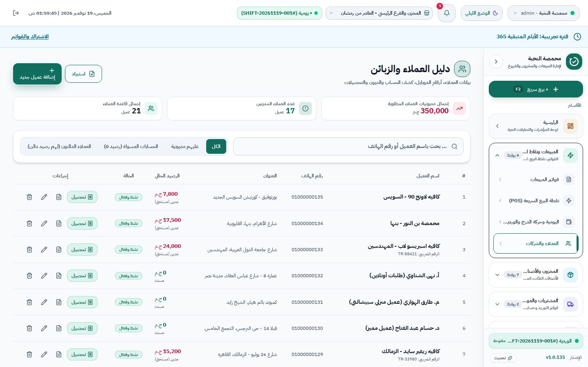
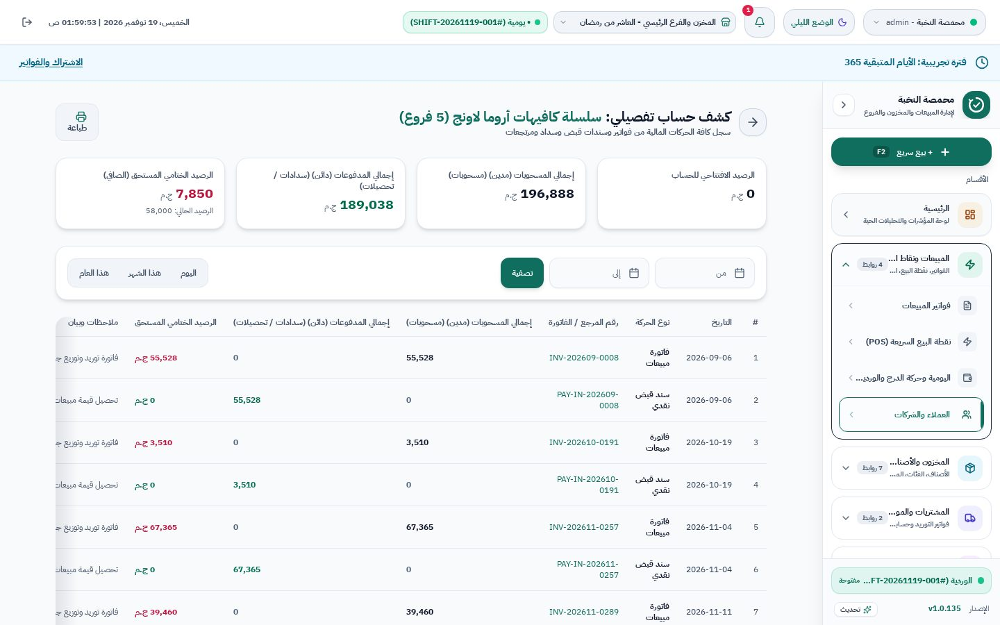
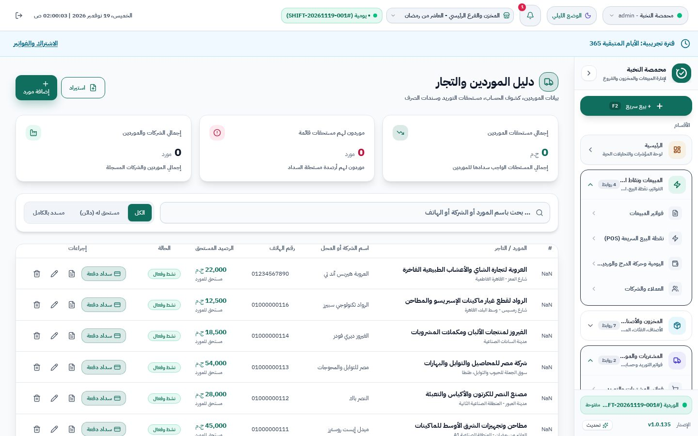
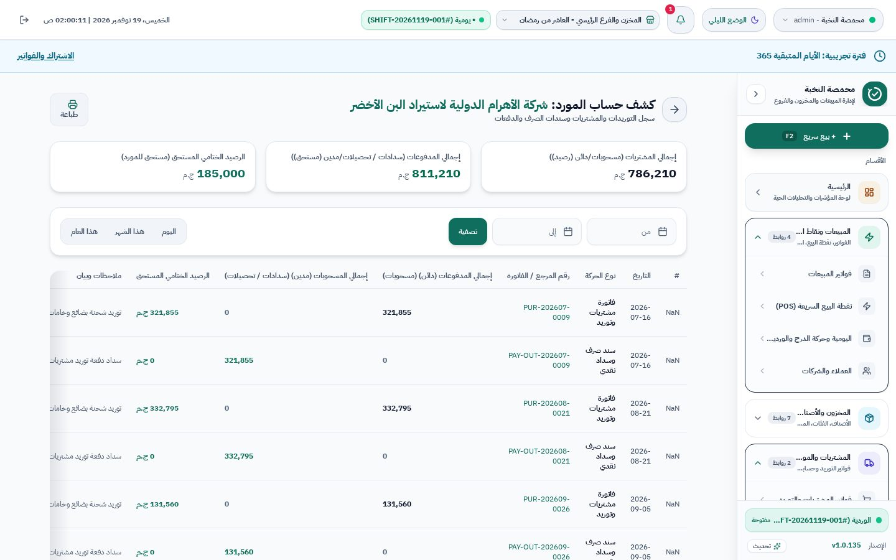
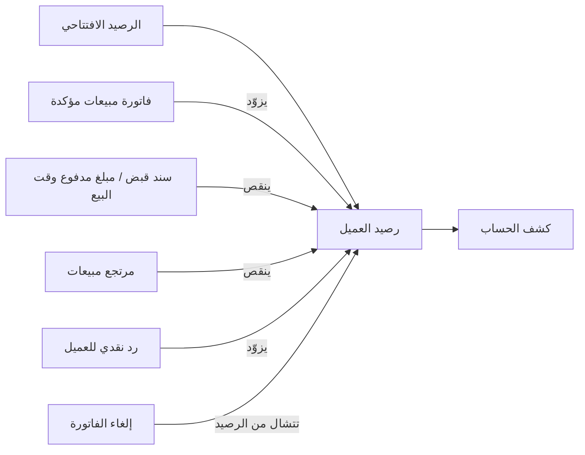

# العملاء والموردين والآجل وكشوف الحساب

## الخلاصة في سطور

- كل عميل وكل مورد له **رصيد واحد** بيتحسب تلقائيًا من حركاته (فواتير، سندات، مرتجعات). مفيش رقم بيتكتب باليد.
- عميل «عليه فلوس» رصيده **موجب**. لو رصيده **سالب** يبقى له عندنا فلوس (دفع زيادة أو مرتجع أكبر من الفاتورة).
- مورد «له عندنا فلوس» رصيده **موجب**. لو سالب يبقى المورد ماسك فلوس لينا.
- الدفعات بتتسجل بـ **سند قبض** (من عميل) و**سند صرف** (لمورد)، وبتتحسب في الخزنة حسب طريقة الدفع.
- **كشف الحساب** بيعرض كل حركة بالتاريخ مع رصيد متحرك بعد كل سطر، وبيتطبع A4 للعميل.
- «العميل النقدي» (Walk-in) عميل خاص بيتعمل تلقائيًا، لازم يدفع كامل، ومش بيخصم من حد الباقة.
- الباقة المجانية: 50 عميل و20 مورد. الباقات المدفوعة بدون حد.

## مين بيستخدمه

| الدور | بيعمل إيه |
|---|---|
| صاحب المحل / المدير | كل حاجة: إضافة وتعديل وحذف، التحصيل والسداد، كشوف الحساب، الاستيراد |
| محاسب / مسؤول حسابات | إدارة العملاء والموردين وكشوف الحساب وسندات القبض والصرف |
| كاشير | يشوف قائمة العملاء ويبيع لعميل محدد، ويقدر يسجل سند قبض من الكاشير (تحصيل دين عند الكاشير) |
| مسؤول المخزن | مش بيتعامل مع الأرصدة غالبًا؛ بيتعامل مع المورد من خلال فواتير الشراء |

## الشاشات

| الشاشة | بتعمل إيه |
|---|---|
| قائمة العملاء | بحث، فلترة (عليهم مديونية / مسددين / لهم رصيد، نشط / موقوف)، إجمالي المديونيات، إضافة وتعديل وتحصيل وكشف حساب وحذف |
| كشف حساب العميل | حركات العميل بالتاريخ مع الرصيد المتحرك، فلتر فترة، طباعة A4 |
| قائمة الموردين | نفس فكرة العملاء، مع «سداد دفعة» بدل «تحصيل» |
| كشف حساب المورد | مشتريات وسندات صرف ومرتجعات مشتريات مع الرصيد المتحرك |
| نافذة التحصيل (عميل) | مبلغ + طريقة دفع + تاريخ + ملاحظة، وتأكيد |
| نافذة السداد (مورد) | نفس الحقول |
| سجل المدفوعات (واجهة API فقط مؤكدة) | قائمة سندات القبض والصرف بفلتر عميل / مورد / فترة؛ شاشة مستقلة ليها غير مؤكدة في الكود |
| استيراد من Excel | رفع عملاء أو موردين دفعة واحدة (من شاشة الاستيراد، زرار «استيراد» في قائمة العملاء) |
| سلة المحذوفات | استرجاع عميل أو مورد اتحذف |

## لقطات من الشاشات

*قائمة العملاء*

*كشف حساب عميل*

*قائمة الموردين*

*كشف حساب مورد*

## رحلات العمل خطوة بخطوة

### 1) إضافة عميل
1. من قائمة العملاء اضغط «إضافة عميل جديد».
2. الاسم إجباري. الباقي اختياري: الهاتف، العنوان، الرقم الضريبي، ملاحظات.
3. **الرصيد الافتتاحي** (اختياري): لو العميل عليه فلوس قبل ما تبدأ على إبراء اكتبها موجبة. لو له فلوس عندك اكتبها بالسالب. بتتسجل كأول سطر في كشف حسابه بتاريخ اليوم.
4. لو الباقة على حدها الأقصى، الإضافة بتترفض برسالة واضحة.

### 2) بيع آجل لعميل
1. في الكاشير اختار عميل **محدد** (مش العميل النقدي).
2. اختار «آجل (على الحساب)» لو هيدفع بعدين، أو «دفع جزئي» (مقدم + متبقي).
3. الفاتورة المؤكدة بتزوّد رصيد العميل بقيمتها الصافية. أي مبلغ دفعه وقت البيع بيتسجل كسند وبينزل من الرصيد.

### 3) تحصيل دين
1. من قائمة العملاء اضغط «تحصيل» جنب العميل.
2. اكتب المبلغ (أكبر من صفر)، طريقة الدفع، التاريخ، وملاحظة اختيارية.
3. بعد التأكيد: بيتعمل **سند قبض** برقم تلقائي، الرصيد بينقص، والمبلغ بيدخل الخزنة حسب طريقة الدفع (نقدي أو إنستاباي أو محفظة…).
4. التحصيل من الكاشير ممكن يتربط بفاتورة معينة، وساعتها حالة الفاتورة بتتحدث (مدفوعة / مدفوعة جزئيًا).

### 4) مرتجع من عميل
- المرتجع بينقص رصيد العميل بقيمته.
- لو رجّعت له فلوس نقدي من الدرج: بيتسجل «رد نقدي للعميل» وده بيرجّع الرصيد لفوق بنفس القيمة (لأننا دفعنا فلوس).
- لو سبت مبلغ الرد صفر: القيمة بتفضل رصيد في حساب العميل (تسوية آجل).

### 5) شراء آجل من مورد وسداده
1. فاتورة الشراء المؤكدة بتزوّد مستحقات المورد.
2. من قائمة الموردين اضغط «سداد دفعة»: مبلغ + طريقة دفع + تاريخ.
3. بيتعمل **سند صرف** برقم تلقائي، ورصيد المورد بينقص، والمبلغ بيخرج من الخزنة.
4. مرتجع المشتريات بينقص مستحقات المورد برضه.

### مخطط حركة الرصيد

للمورد نفس الفكرة بالعكس: فاتورة شراء مؤكدة تزوّد المستحق، وسند الصرف ومرتجع المشتريات ينقصوه.

## كشف حساب العميل

| العمود | المعنى |
|---|---|
| التاريخ | تاريخ المستند نفسه (مش وقت تسجيله) |
| نوع الحركة | فاتورة مبيعات / سند قبض / رد نقدي للعميل / مرتجع مبيعات / رصيد افتتاحي |
| رقم المرجع | رقم الفاتورة أو السند أو المرتجع |
| مدين | اللي زوّد على العميل (فاتورة، رد نقدي، افتتاحي موجب) |
| دائن | اللي نقّص من على العميل (سند قبض، مرتجع، افتتاحي سالب) |
| الرصيد بعد الحركة | الرصيد المتحرك = السابق + مدين - دائن |
| ملاحظات | ملاحظة الفاتورة أو السبب أو ملاحظة السند |

- **الفترة**: الافتراضي آخر 90 يوم. تقدر تختار «من - إلى» أو «كل الفترات». لو «من» بعد «إلى» بيرفض.
- **الرصيد السابق**: أي حركة قبل بداية الفترة بتتجمع في سطر «الرصيد السابق»، فالرصيد المتحرك دايمًا صح حتى لو الفترة قصيرة.
- **الملخص**: إجمالي المدين، إجمالي الدائن، الرصيد السابق، الرصيد الختامي، وعدد الحركات للفترة كلها (مش الصفحة بس).
- **الترتيب**: الرصيد الافتتاحي الأول، بعدين بتاريخ المستند، ولو نفس اليوم: فاتورة ثم سند ثم مرتجع.
- **الطباعة**: زرار «طباعة كشف الحساب (A4)» بيجمّع كل الصفحات الأول (مع شريط تقدم وإمكانية الإلغاء) وبعدها يطبع.
- فواتير الإلغاء مش بتظهر في الكشف (بس الفواتير المؤكدة).

## كشف حساب المورد

- نفس الأعمدة، لكن الرصيد المتحرك = السابق + دائن (مشتريات) - مدين (سندات صرف ومرتجعات).
- أنواع الحركات: فاتورة مشتريات وتوريد، سند صرف وسداد نقدي، مرتجع مشتريات، رصيد افتتاحي، ورصيد لصالحنا من فاتورة مشتريات ملغاة.
- فلتر الفترة «من - إلى» اختياري. من غير فلتر بيعرض كل التاريخ، ومفيش تقسيم صفحات.
- الملخص: إجمالي المشتريات، إجمالي المدفوع، الرصيد السابق، الرصيد الحالي.

## مثال شغال: بيع آجل 1,000 وتحصيل 400 ومرتجع 150

العميل: «أحمد»، رصيده الافتتاحي صفر.

| التاريخ | النوع | المرجع | مدين | دائن | الرصيد بعد الحركة |
|---|---|---|---|---|---|
| 10/11 | فاتورة مبيعات (آجل) | رقم الفاتورة | 1,000.000 | 0.000 | 1,000.000 |
| 12/11 | سند قبض (نقدي) | رقم السند | 0.000 | 400.000 | 600.000 |
| 14/11 | مرتجع مبيعات | رقم المرتجع | 0.000 | 150.000 | 450.000 |

- ملخص الفترة: إجمالي مدين 1,000.000، إجمالي دائن 550.000، رصيد ختامي **450.000 ج.م** (أحمد لسه عليه 450).
- لو الـ150 اتردّوا له نقدي من الدرج، بيتضاف سطر رابع «رد نقدي للعميل» مدين 150.000 والرصيد يبقى **600.000**.
- لو دفع 400 وقت البيع نفسه (دفع جزئي): السطر الأول نفسه 1,000، وبعده مباشرة سند بـ 400، والنتيجة واحدة.

## القواعد التجارية

**معادلة رصيد العميل**: الفواتير المؤكدة - المدفوعات - مرتجعات المبيعات + الرصيد الافتتاحي (الموجب = عليه، السالب = له).

**معادلة رصيد المورد**: فواتير الشراء المؤكدة - المدفوعات - مرتجعات المشتريات + الرصيد الافتتاحي (الموجب = مستحق للمورد).

- الأرصدة بتتعاد حسابها من المستندات نفسها، فمفيش «تعديل رصيد يدوي» ممكن يتمحي بعدين.
- **العميل النقدي**: اسمه «عميل نقدي» ورقمه الوهمي `0000000000`. بيتعمل مرة واحدة تلقائيًا أول ما حد يبيع من غير عميل. البيع عليه لازم يتدفع كامل (مفيش آجل ولا دفع جزئي) لأنه مجهول ومفيش حد نحاسبه. بيتعرف بالاسم القديم («نقدي عام» / «عميل نقدي») أو بالرقم الوهمي. مش بيتحسب من حد العملاء في الباقة، وإعادته من السلة مفيش حد بيرفضها لو مفيش غيره.
- **الإلغاء**: الفاتورة الملغاة بتخرج من الرصيد. مدفوعات فاتورة قديمة ملغاة من غير عكس مش بتتحسب رصيد للعميل.
- **الشراء الملغي**: اللي اتدفع للمورد عليه بيفضل رصيد لصالحنا عند المورد، وبيظهر في الكشف بسطر مخصوص. ومينفعش تدفع على فاتورة شراء ملغاة.
- **الدفع على فاتورة**: السند لازم يكون لنفس عميل/مورد الفاتورة، ومينفعش على فاتورة من فرع المستخدم مش مصرّح له بيه.
- **الدفع الزيادة**: مفيش منع. لو العميل دفع أكتر من اللي عليه، رصيده بيبقى سالب (له فلوس).
- **الدقة**: كل المبالغ بـ 3 خانات عشرية، الحسابات بتتم من غير تقريب عشوائي.
- **سقف الآجل للعميل**: الكلمة موجودة في الواجهة («الحد الأقصى للآجل») لكن **مفيش حد بيتخزن أو بيتطبّق**. العميل ممكن يعدي أي مبلغ.
- **طرق الدفع**: لازم تكون مفعّلة في الإعدادات. المتاح: نقدي، إنستاباي، محفظة إلكترونية، بنك/تحويل بنكي، فيزا (حسب المسار).
- **التاريخ**: تاريخ السند بيخضع لقاعدة تاريخ المستندات في الإعدادات (مثلًا مينفعش تاريخ بعيد أو مقفول).
- **التحصيل والسداد** محتاجين فرع نشط (مش «كل الفروع») عشان الفلوس تتسجل على درج فرع معين.
- كل سند قبض/صرف بيتسجل في سجل التدقيق (مين عمله ومتى).

## حذف وإيقاف واسترجاع

- **الحذف ممنوع** لو العميل (أو المورد) عنده: رصيد مش صفر، أو أي فاتورة، أو أي سند، أو أي مرتجع (للمورد: فاتورة شراء أو سند صرف). عمليًا بيتحذف بس اللي اتفتح له حساب ومتعاملش.
- البديل لأي عميل له تاريخ: **إيقاف** (نشط / موقوف) بدل الحذف.
- الحذف «ناعم»: السجل بيروح **سلة المحذوفات** ويتسترجع منها. الاسترجاع بيتحسب على حد الباقة (لو وصلت للحد مش هيرجع). العميل النقدي استثناء.
- الحذف النهائي من السلة بيتحكم فيه بصلاحية الحذف.

## الصلاحيات

| العملية | مين يقدر |
|---|---|
| عرض قائمة العملاء | المدير، من عنده إدارة العملاء، الكاشير، ومن يقدر ينشئ فواتير |
| إضافة وتعديل وإيقاف عميل / مورد | المدير ومن عنده «إدارة العملاء» / «إدارة الموردين» |
| تحصيل من عميل (شاشة العملاء) | المدير ومن عنده «إدارة العملاء» |
| سند قبض من الكاشير | المدير، إدارة العملاء، أو صلاحية الكاشير |
| سداد مورد | المدير ومن عنده «إدارة الموردين» |
| كشف حساب العميل / المورد | المدير، أو صلاحية «كشف الحساب»، أو الإدارة |
| حذف عميل | المدير فقط افتراضيًا (صلاحية حذف العملاء) |
| حذف مورد | المدير ومن عنده «إدارة الموردين» |
| إجمالي مديونيات العملاء في الملخص | من يشوف التقارير فقط |
| سجل المدفوعات | المدير، اليومية، إدارة العملاء أو الموردين |

التحصيل والسداد مرتبطين كمان بميزة «المدفوعات» في الباقة.

## الاستيراد

- من شاشة الاستيراد (نوع عملاء أو موردين): تنزّل نموذج Excel، ترفعه، تعمل معاينة، وبعدين تأكيد.
- أعمدة العملاء: الاسم (إجباري)، الهاتف، العنوان، الرقم الضريبي، شريحة السعر (تجزئة / جملة)، الرصيد الافتتاحي (يقبل سالب)، ملاحظات. التكرار بيتكشف بالهاتف.
- الرصيد الافتتاحي بيتحول لسطر افتتاحي في الكشف.
- التأكيد **كله أو ولا حاجة**: أي صف غلط بيمنع الاستيراد، وأي فشل بيرجّع الكل.
- حد الباقة بيتفحص على **الدفعة بالكامل** قبل الكتابة: لو الصفوف الصالحة هتعدّي الحد، الدفعة كلها بتترفض ومفيش ولا عميل بيتضاف.

## الإعدادات المتاحة

- طرق الدفع المفعّلة (بتحدد اللي يظهر في نوافذ التحصيل والسداد).
- قاعدة تاريخ المستندات.
- العملة المعروضة.
- فرع نشط (X-Store-Id) لتسجيل السند على درج الفرع.

## حسب الباقة

| | المجانية | المدفوعة (الثلاث باقات) |
|---|---|---|
| عدد العملاء | 50 (من غير العميل النقدي) | بدون حد |
| عدد الموردين | 20 | بدون حد |
| تجاوز الحد | رفض الإضافة أو الاستيراد أو الاسترجاع من السلة | لا ينطبق |

- الحد بيتفحص عند: الإضافة اليدوية، الاستيراد، واسترجاع من السلة.
- تفاصيل ميزة «المدفوعات» حسب الباقة في ملف الباقات والاشتراكات.

## أسئلة شائعة

**ليه مش قادر أبيع آجل؟** غالبًا العميل المختار هو «العميل النقدي». اختار عميل محدد.

**العميل دفع زيادة، يحصل إيه؟** رصيده بيبقى سالب ويظهر «دائن (رصيد)»، ويتخصم من مشترياته الجاية أو تردّه له.

**مش قادر أحذف عميل.** عنده رصيد أو فواتير أو سندات أو مرتجعات. أوقفه بدل الحذف.

**أغيّر الرصيد الافتتاحي بعد الإضافة؟** من التعديل لا. الرصيد الافتتاحي بيتسجل مرة واحدة عند الإضافة (أو الاستيراد)، وتعديل العميل مش بيمسّه.

**الكشف مش ظاهر فيه حركات قديمة.** الافتراضي آخر 90 يوم، اختار «كل الفترات».

**ليه الرصيد الختامي في الكشف غير الرصيد في القائمة؟** لو اخترت فترة بتنتهي قبل النهاردة، الختامي هو رصيد آخر الفترة، والقائمة بتعرض الرصيد الحالي.

**اتحذف عميل بالغلط؟** من سلة المحذوفات، لو لسه فيه مكان في الباقة.

**فاتورة اتلغت، الرصيد اتغيّر؟** أيوه، الفاتورة الملغاة بتخرج من الرصيد والكشف.

## حدود وملاحظات / فرص تطوير

- **لا يوجد سقف آجل مطبّق** رغم وجود الاسم في الواجهة.
- **لا يوجد تعمير ديون (Aging) ولا تنبيه تأخير**: مفيش تاريخ استحقاق للفاتورة ولا تقرير «متأخرات».
- **لا يوجد تعديل رصيد يدوي (تسوية / خصم مسموح به)**: التسوية الوحيدة المتاحة سند قبض أو مرتجع.
- طباعة سند القبض/الصرف نفسه ومشاركة الكشف (واتساب أو PDF) **مش مؤكدة في الكود الحالي**؛ المؤكد هو طباعة كشف العميل A4.
- كشف المورد بدون تقسيم صفحات وبدون فترة افتراضية، فهيتقل مع تاريخ طويل.
- الرصيد الافتتاحي مينفعش يتعدّل من شاشة التعديل.
- حقل «شريحة السعر» (تجزئة / جملة) موجود في السجل والاستيراد والإضافة السريعة من الكاشير، ومش واضح إن نموذج التعديل العادي بيعرضه.
- رسائل أسباب منع الحذف مكتوبة نصًا جوه الكود وليست مترجمة بالكامل (دين تقني).

## ملحق للفريق التقني

- Actions: `app/Actions/Customers`, `app/Actions/Suppliers`.
- حساب الأرصدة والكشف: `CustomerBalanceService`, `SupplierBalanceService`; السندات: `PaymentService`.
- العميل النقدي: `ResolveWalkInCustomerAction`; عدّاد الحدود: `PartyLimitCounter`.
- المسارات: `/api/v1/customers`, `/api/v1/suppliers`, `/api/v1/payments`.
- شاشات Vue: `resources/js/views/Customers`, `resources/js/views/Suppliers`.
