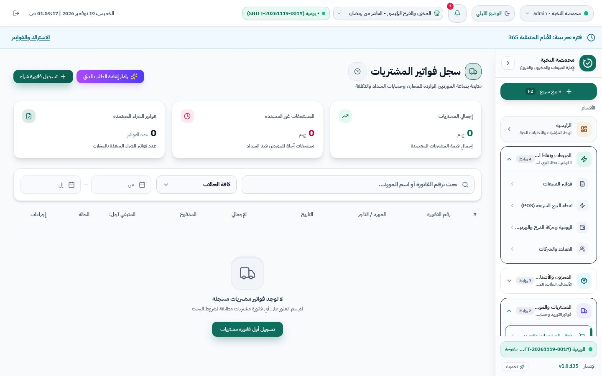
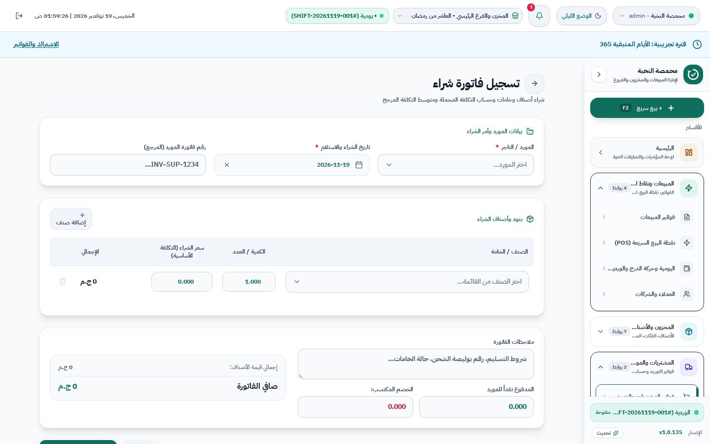
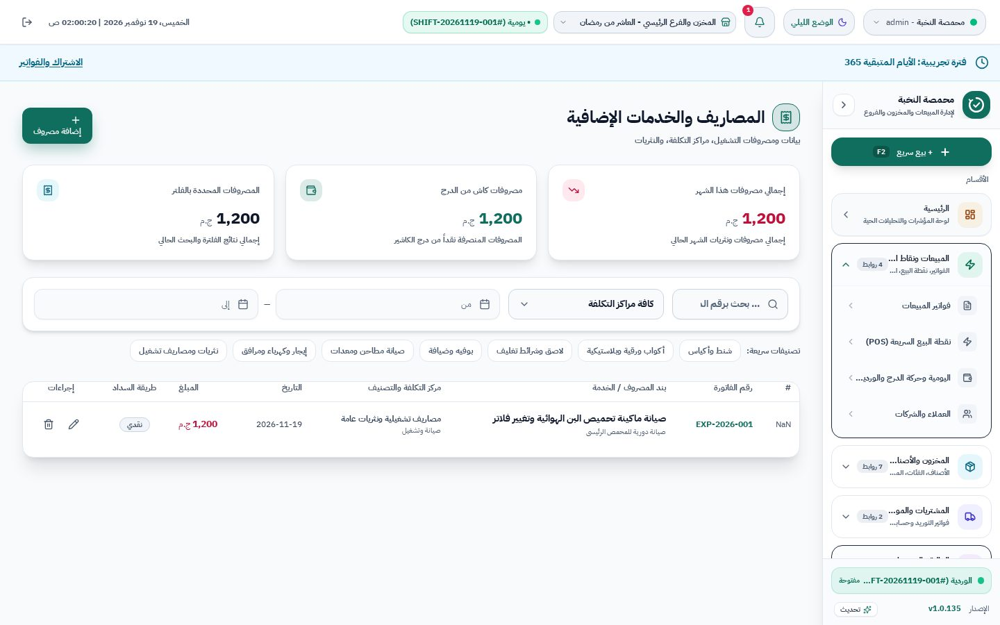
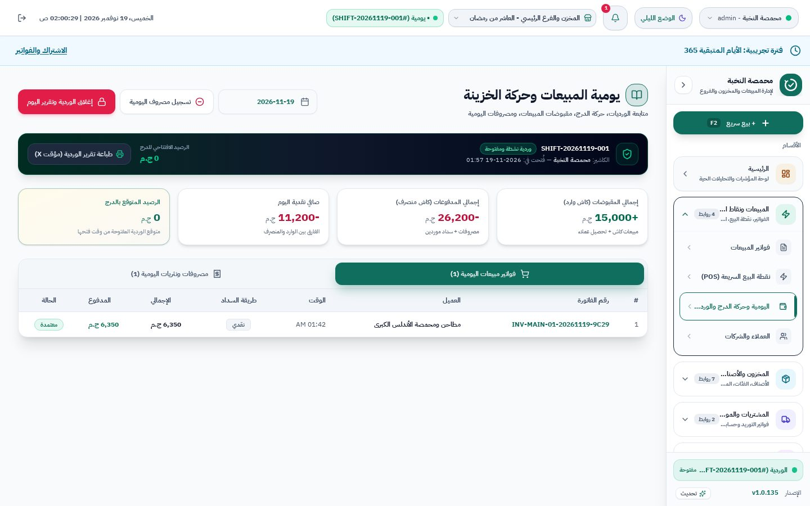
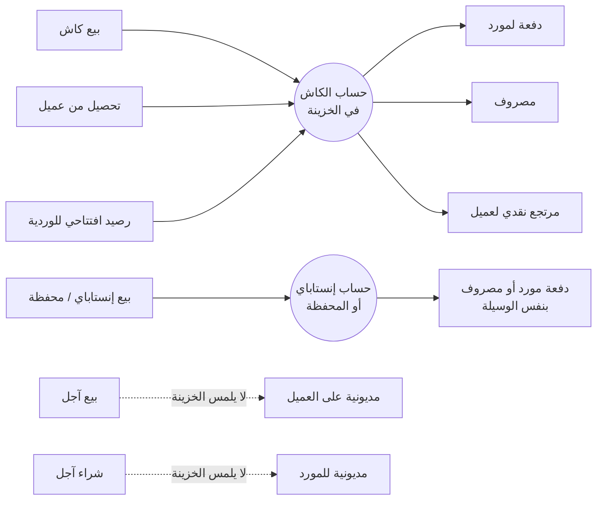

# المشتريات والخزنة والمصروفات واليومية

الجزء ده بيشرح الفلوس الداخلة والخارجة من المحل في «إبراء»: بتشتري بضاعة من المورد، بتسدّله، بتصرف مصروفات، وفي آخر اليوم بتقفل الوردية وتقارن اللي في الدرج باللي السيستم متوقعه.

## الخلاصة في سطور

- **فاتورة الشراء** بتدخّل البضاعة مخزن الفرع النشط فورًا، وبتحدّث تكلفة الصنف، وبتسجّل المديونية للمورد (كلها أو الباقي بعد الدفعة).
- **مفيش «خزنة» واحدة ثابتة بأسماء**: الخزينة في «إبراء» هي **حسابات حسب طريقة الدفع** (كاش، إنستاباي، محفظة إلكترونية) لكل فرع. الرصيد بيتحسب من حركات السندات والمصروفات، مش بيتكتب باليد.
- **كل حركة فلوس بتسجّل نفسها**: البيع، التحصيل من العميل، دفعة المورد، المصروف. مفيش حاجة اسمها «سند قبض» أو «سند صرف» بتكتبها بإيدك من شاشة خزنة؛ السندات بتتولّد من العملية نفسها.
- **المصروفات** تسجيل مباشر (بدون موافقة)، بتخصم من حساب طريقة الدفع اللي اخترتها، وبتدخل في حساب الدرج لو كاش.
- **اليومية** هي شاشة اليوم: مبيعات، مقبوضات، مدفوعات، مصروفات، ومعاها فتح وإغلاق الوردية.
- **الوردية** هي اللي بتحدد «المفروض يكون في الدرج كام». الكاشير بيعدّ الفلوس ويكتب الرقم، والسيستم بيحسب الفرق (عجز أو زيادة).
- كل المبالغ بدقة **3 أرقام عشرية** وبحساب عشري دقيق، من غير أي كسور عائمة، فمفيش «قرش بيضيع» في التقريب.

## مين بيستخدمه

| الدور | بيعمل إيه |
|---|---|
| صاحب المحل / المدير | يشوف أرصدة الخزينة، يراجع المشتريات، يلغي فاتورة شراء، يراجع تقرير الخزينة والمصروفات |
| أمين المخزن / المشتريات | يسجّل فواتير الشراء ويستلم البضاعة |
| المحاسب | يسدّد الموردين، يسجّل المصروفات، يراجع اليومية |
| الكاشير | يفتح الوردية ويقفلها بعد جرد الدرج (لو معاه صلاحية الإغلاق)، ويشوف معاملاته هو بس. تسجيل المصروف محتاج صلاحية المصروفات |

## الشاشات

| الشاشة | بتعمل إيه |
|---|---|
| المشتريات (السجل) | قائمة فواتير الشراء مع بحث وفلتر بالمورد والحالة والتاريخ، وإجماليات: المشتريات المؤكدة، عددها، والمتبقي للموردين |
| فاتورة مشتريات جديدة | اختيار المورد، الأصناف والكميات وسعر الشراء، خصم، والمبلغ المدفوع للمورد |
| تفاصيل فاتورة الشراء | الأصناف، التكلفة، التكلفة المحمّلة لو فيه مصاريف ملحقة، وزر إلغاء الفاتورة |
| مساعد المشتريات الذكي | اقتراح كميات الشراء حسب معدل البيع (متاح في باقات معيّنة، شوف «حسب الباقة») |
| المصروفات | تسجيل وتعديل وحذف المصروفات مع فلاتر وإجماليات |
| اليومية | ملخص اليوم + فواتير اليوم + مصروفات اليوم + فتح/إغلاق الوردية + طباعة تقرير التقفيل |
| الموردين (كشف الحساب والسداد) | تسجيل دفعة لمورد، وكشف حسابه |
| التقارير ← الخزينة | أرصدة كل حساب، وحركة الخزينة بالتفصيل خلال فترة |
| لوحة التحكم / ملخص الخزينة | رصيد كل حساب دلوقتي، حركة النهارده، إجمالي المستحق لنا وعلينا |

## لقطات من الشاشات


*فواتير المشتريات*


*فاتورة مشتريات جديدة*


*المصروفات*


*اليومية وحركة الدرج والورديات*


## رحلات العمل خطوة بخطوة

### 1) تسجيل فاتورة شراء

1. اختار الفرع النشط (البضاعة بتدخل **الفرع اللي أنت شغال عليه**، مش بتختار مخزن تاني من الفاتورة).
2. اختار المورد، وتاريخ الشراء، وأدخل رقم فاتورة المورد الورقية لو عايز تربطها.
3. ضيف الأصناف: الكمية (ممكن كسر زي 12.500 كجم) وسعر الشراء للوحدة.
4. اكتب الخصم لو فيه، والمبلغ اللي دفعته للمورد دلوقتي (ممكن صفر).
5. أكّد. السيستم في نفس اللحظة:
   - يدخّل الكميات مخزن الفرع.
   - يحدّث سعر التكلفة للصنف (شوف القواعد).
   - يحسب الصافي والمتبقي وحالة السداد.
   - لو دفعت مبلغ، يسجّل سند صرف للمورد ويخصمه من الكاش.
   - يحدّث رصيد المورد.

الحالات الثلاث:

| الحالة | المبلغ المدفوع | النتيجة |
|---|---|---|
| نقدي بالكامل | = الصافي | حالة «مدفوعة»، المتبقي صفر، سند صرف بالمبلغ كله |
| آجل | صفر | حالة «غير مدفوعة»، الصافي كله يتضاف لمديونية المورد، ولا يتحرك الدرج |
| جزئي | أقل من الصافي | حالة «مدفوعة جزئيًا»، سند بالمدفوع، والباقي مديونية |

### 2) سداد المورد بعد كده

من شاشة الموردين بتسجّل دفعة (ممكن تربطها بفاتورة شراء معيّنة أو تسيبها على الحساب العام). الفاتورة المربوطة بتتحدث (مدفوع/متبقي/حالة)، ورصيد المورد بيقل، والمبلغ بيخرج من الحساب اللي اخترته (كاش، إنستاباي، محفظة…).

### 3) مصروف

بتكتب البيان، الفئة، مركز التكلفة، المبلغ، التاريخ، وطريقة الدفع. بيتسجّل برقم تلقائي بتاريخ اليوم، وبيتخصم من الحساب المختار. لو دفعت كاش، بيدخل في حساب الدرج للوردية المفتوحة.

### 4) نهاية اليوم: اليومية وتقفيل الوردية

1. افتح اليومية وراجع الأرقام: مبيعات اليوم، المقبوض نقدًا، تحصيلات العملاء، سداد الموردين، المصروفات.
2. شوف «الرصيد المتوقع بالدرج».
3. اعدّ الفلوس الفعلية في الدرج.
4. اضغط إغلاق الوردية واكتب الرقم اللي عددته. (الشاشة مش بتوريك المتوقع قبل ما تكتب العدّ، عشان العدّ يكون أمين، وبتظهر المقارنة بعد الإغلاق.)
5. السيستم يحسب الفرق، يحفظ تقرير التقفيل، ولو فيه فرق يبعت تنبيه تلقائي (على تيليجرام لو مفعّل).



## القواعد التجارية

### فاتورة الشراء

- **الفرع المستلم**: الفرع النشط وقت التسجيل (لازم تكون شغال على فرع محدد مش «كل الفروع»). المستخدم اللي معندوش صلاحية على فرع مش بيشوف فواتيره.
- **الحسابات**:
  - إجمالي الأصناف = مجموع (الكمية × سعر الشراء) لكل سطر.
  - الصافي = الإجمالي − الخصم (+ أي مصاريف ملحقة محمّلة على حساب المورد).
  - المتبقي = الصافي − المدفوع.
- **تكلفة الصنف**: بعد كل شراء، آخر سعر شراء بيبقى «سعر التكلفة الأخير»، والسيستم كمان بيحسب **متوسط التكلفة المرجّح** = (قيمة المخزون الحالي + قيمة الشراء الجديد) ÷ (الكمية القديمة + الكمية الجديدة). المتوسط ده بيتحسب على إجمالي الصنف في المحل كله، مش فرع فرع.
- **المصاريف الملحقة (شحن، عتالة، جمارك)**: السيستم قادر يوزّعها على أسطر الفاتورة (حسب الكمية، أو القيمة، أو بالتساوي) فتطلع «التكلفة الفعلية المحمّلة للوحدة» وتدخل في المتوسط. المصروف ممكن يتحسب على حساب المورد أو يتدفع كاش من الخزينة بسند صرف مستقل. (شوف «حدود وملاحظات»: شاشة تسجيل الفاتورة الحالية مفيهاش خانات للمصاريف دي.)
- **الأرقام التسلسلية**: رقم الفاتورة وأرقام السندات بتتولّد تلقائي.
- **التاريخ**: ممنوع تاريخ في المستقبل. التاريخ القديم محتاج صلاحية «تعديل التاريخ للخلف» وفي حدود عدد أيام محدد في الإعدادات.
- **مفيش تعديل لفاتورة الشراء بعد التأكيد.** لو غلطت: ألغِ الفاتورة وسجّل واحدة جديدة، أو سجّل مرتجع للمورد.

### إلغاء فاتورة الشراء

- بيتم من تفاصيل الفاتورة، ويفضل سبب الإلغاء متسجل.
- السيستم بيخصم الكميات من المخزن، لكن **مش هيسمح بالإلغاء** لو:
  - جزء من الشحنة اتباع والكمية الحالية مش كفاية للخصم.
  - الفاتورة عليها مرتجع نشط.
  - الفاتورة ملغاة قبل كده.
- التكلفة ومتوسط التكلفة بيرجعوا لحالتهم قبل الفاتورة (لو ممكن حسابيًا).
- **الفلوس اللي اتدفعت للمورد مش بترجع للخزينة.** قرار صاحب المنتج: السندات تفضل زي ما هي، والمبلغ يتحول **رصيد لصالحنا عند المورد** يتخصم من مشترياتك أو دفعاتك الجاية. السبب إن الفلوس خرجت فعلًا ومحدش استلمها منه.
- سندات المصاريف الملحقة اللي اتدفعت كاش بتتلغي (لأنها كانت لجهات تانية مش للمورد).

### مرتجع الشراء

بيتسجّل من وحدة المرتجعات، مربوط بفاتورة الشراء: بيخصم الكمية من المخزن ويقلل مديونية المورد بقيمة المرتجع، وبيعكس أثره على متوسط التكلفة. **مفيش رد فلوس نقدي من المورد بيتسجل في الخزينة**؛ الأثر كله على حساب المورد (لو المورد رد فلوس فعلًا، مفيش سند قبض مخصوص ليها حاليًا).

### الخزينة وحساباتها

- الخزينة **لكل فرع**. التقارير بتعرض فرع واحد، وفي التقارير بس ممكن تعرض كل الفروع مجمّعة.
- الحسابات الفعّالة للاختيار: **كاش (الدرج)**، **إنستاباي**، **محفظة إلكترونية**. فيزا، تحويل بنكي، شيك، وأخرى بتظهر في التقارير بس لو عليها حركة، ومتاحة كوسيلة في المصروفات وسداد الموردين.
- **رصيد الحساب** = المقبوضات − المدفوعات − المصروفات ± التحويلات − الرسوم.
  - **مقبوضات**: مبيعات (بوسيلة الدفع)، تحصيلات العملاء. المرتجعات النقدية للعملاء بتتحسب كمدفوعات.
  - **مدفوعات**: سداد الموردين (ومنه دفعة فاتورة الشراء)، المصروفات، مصاريف الفاتورة الملحقة المدفوعة من الخزينة.
  - **البيع الآجل والشراء الآجل مش بيأثروا على الخزينة** لحد ما تتحصل أو تتسدد.
- **الرصيد الافتتاحي** لعهدة الدرج بيتحسب في حساب الكاش طول ما الوردية مفتوحة.
- **أنواع السندات**: الموجود فعلًا:
  - **سند قبض** (مقبوضات من عميل): بيتولّد من البيع ومن «تحصيل من عميل».
  - **سند صرف** (دفعة لمورد): بيتولّد من الشراء المدفوع ومن «سداد مورد».
  - **مصروف**: وثيقة منفصلة برقم خاص بيها.
  - **مرتجع نقدي لعميل**: سند بقيمة سالبة.
- **التحويل بين الحسابات** (مثلًا سحب كاش من إنستاباي لتغذية الدرج): المحرك موجود ومتحقق من كفاية الرصيد وبيحسب عمولة التحويل، لكن **مفيش شاشة ولا واجهة ظاهرة للمستخدم له حاليًا**. شوف «حدود وملاحظات».

### المصروفات

- **الحقول**: بيان، فئة (نص حر، وفيه اقتراحات سريعة زي شنط، أكواب، ضيافة، صيانة معدات، إيجار ومرافق)، مركز تكلفة من قائمة ثابتة (مصاريف تشغيلية، إيجارات، مرافق، رواتب، سيارات، صيانة، تعبئة، ضيافة، تسويق، شحن)، مبلغ (أكبر من صفر)، تاريخ، وسيلة دفع، ملاحظات.
- **مفيش دورة موافقة**: المصروف بيتسجل ويتحسب فورًا.
- **مفيش حد للرصيد**: السيستم مش بيمنع مصروف أكبر من اللي في الدرج أو الحساب.
- **التعديل والحذف** متاحين لمن له صلاحية المصروفات، والحذف «ناعم» (بيتشال من الحسابات). التاريخ لازم يلتزم بنفس قاعدة تاريخ المستندات.
- **ربط بالوردية**: المصروف بيتسجّل على الوردية المفتوحة في الفرع وقت إنشائه. لو مفيش وردية مفتوحة بيتسجّل عادي لكن من غير ربط (شوف «الوردية والخزينة»).
- **مصروف من اليومية** (المصروف السريع) هو نفس المصروف، بيتسجّل من شاشة اليومية.

### اليومية

بتعرض يوم واحد (النهارده افتراضيًا) لفرع واحد:

| البند | معناه |
|---|---|
| إجمالي المبيعات | صافي كل فواتير اليوم غير الملغاة |
| مبيعات كاش | الكاش اللي اتقبض وقت البيع |
| تحصيلات عملاء | الكاش اللي اتحصّل من عملاء على ديون |
| المبيعات الآجلة | المتبقي على فواتير الآجل والجزئي |
| سداد موردين (كاش) | دفعات الموردين من الدرج |
| المصروفات | إجمالي مصروفات اليوم، والجزء الكاش منها |
| مرتجعات نقدية | الكاش اللي رجع لعملاء |
| صافي النقدية | الداخل كاش − الخارج كاش لليوم |
| الرصيد المتوقع بالدرج | افتتاحي الوردية المفتوحة + كل حركة الكاش من وقت فتحها (حتى لو فتحت من أيام) |

- أرقام الكاش في اليومية واللوحة وملخص الخزينة بتيجي من **نفس المصدر**، فمش المفروض تختلف.
- «صافي نقدية اليوم» هو حركة اليوم المختار بس، أما «المتوقع بالدرج» فهو رصيد الوردية المفتوحة كلها.
- الكاشير (من غير صلاحية التقارير) بيشوف **معاملاته هو بس**، من غير الرصيد الافتتاحي ولا المتوقع.

### الوردية وحساب الدرج

- **وردية واحدة مفتوحة لكل فرع** في نفس الوقت. فتحها بيحتاج عهدة افتتاحية (ممكن صفر).
- **البيع في نقطة البيع محتاج وردية مفتوحة** (بيرفض لو مفيش). المشتريات والمصروفات وسداد الموردين لأ؛ بتتسجّل حتى من غير وردية.
- **المتوقع بالدرج** = العهدة الافتتاحية + مبيعات الكاش + تحصيلات العملاء الكاش − مصروفات الكاش − دفعات الموردين الكاش − المرتجعات النقدية.
- **بس الكاش بيدخل الحساب ده.** إنستاباي والمحفظة والفيزا والآجل مش من الدرج.
- **المقصود بـ «ربط بالوردية»**: وقت إنشاء أي سند أو مصروف أو فاتورة أو مرتجع مبيعات، السيستم بيختمه برقم الوردية المفتوحة في فرعه. الختم ده نهائي ومش بيتغيّر، وهو اللي بيحدد إن الحركة دي بتتعد في جرد الوردية دي، حتى لو ساعة الجهاز اتغيرت. وبكده لو اتفتحت وردية جديدة بعدها، الحركة القديمة مش بتتحسب فيها.
  - حركة اتسجلت وقت ما مفيش وردية مفتوحة (مثلًا دفعة مورد الصبح قبل الفتح) مش بتتختم، وبتتعد بس لو وقتها وقع داخل فترة وردية.
- **الإغلاق**: بيحفظ للوردية المتوقع، الفعلي، والفرق، وتفاصيل (مبيعات كاش، تحصيلات، مصروفات، موردين، مرتجعات). وبيصدّر تقرير التقفيل.
- مين يقدر يقفل: اللي فتح الوردية أو مدير. فتح الوردية وإغلاقها محتاجين صلاحية خاصة.
- التقفيل **مش بيعمل سند** ولا بيرحّل الفلوس لحساب تاني؛ هو جرد ومقارنة بس.

## مثال محسوب: يوم كامل

الفرع بدأ الوردية بعهدة **500 ج**. حصل خلال اليوم:

| العملية | المبلغ | وسيلة | أثرها |
|---|---|---|---|
| مبيعات كاش | 3,200.000 | كاش | داخل للدرج |
| بيع آجل لعميل | 800.000 | آجل | مديونية على العميل، لا يلمس الدرج |
| تحصيل من عميل | 300.000 | كاش | داخل للدرج |
| مصروف | 150.000 | كاش | خارج من الدرج |
| دفعة لمورد | 1,000.000 | كاش | خارج من الدرج |

**اليومية:**

- إجمالي المبيعات = 3,200 + 800 = **4,000.000**
- مبيعات كاش 3,200، آجل 800، تحصيلات 300
- إجمالي الكاش الداخل = 3,200 + 300 = **3,500.000**
- إجمالي الكاش الخارج = 150 + 1,000 = **1,150.000**
- صافي نقدية اليوم = 3,500 − 1,150 = **2,350.000**

**المتوقع بالدرج في الوردية (وبالتالي ما يطلبه جرد الكاشير):**

```
500.000 + 3,200.000 + 300.000 − 150.000 − 1,000.000 = 2,850.000
```

**رصيد حساب الكاش في الخزينة** (بافتراض إنه يوم بداية الشغل ومفيش حركة قبله): نفس الحساب، المقبوضات 3,500 − المدفوعات 1,150 + العهدة الافتتاحية للوردية المفتوحة 500 = **2,850.000**.

لو الكاشير عدّ **2,840.000** فعليًا: الفرق = 2,840 − 2,850 = **−10.000 (عجز 10 جنيه)**، ويتبعت تنبيه. لو عدّ 2,850 بالظبط: «مطابقة تماماً».

**أثر اليوم على الحسابات التانية:** مديونية العميل زادت 800 ونقصت 300 (**+500 صافي عليه**)، والمورد اتخصم له 1,000 من مديونيته. الـ 800 الآجلة والمديونيات مش في الخزينة؛ هتدخل لما العميل يسدد.

## الصلاحيات

| الإجراء | مين يقدر |
|---|---|
| عرض فواتير الشراء | صلاحية عرض المشتريات |
| تسجيل فاتورة شراء | صلاحية إنشاء المشتريات (والأدمن) |
| إلغاء فاتورة شراء | صلاحية حذف/إلغاء المشتريات (والأدمن) |
| سداد مورد | صلاحية إدارة الموردين (والأدمن) |
| تسجيل/تعديل/حذف مصروف | صلاحية إدارة المصروفات (والأدمن) |
| عرض المصروفات | صاحب صلاحية المصروفات يشوف كل المصروفات. من له صلاحية اليومية بس يشوف اللي سجّله بنفسه |
| عرض اليومية | صلاحية عرض اليومية؛ من غير صلاحية التقارير يشوف معاملاته بس |
| فتح/إغلاق وردية | صلاحية إغلاق الوردية (واللي فتحها أو مدير يقفلها) |
| أرصدة الخزينة والمستحقات | صلاحية التقارير؛ من غيرها يشوف حركة ورديته |
| التواريخ القديمة | صلاحية تعديل التاريخ للخلف |

كل الصلاحيات دي محدودة بالفرع: مستخدم فرع مش بيقدر يشوف أو يعدّل حركة فرع تاني.

## الإعدادات المتاحة

- **عدد أيام الرجوع بالتاريخ** (حد أقصى لتاريخ مستند قديم).
- **بداية اليوم التجاري** (مثلًا 3 فجرًا): الورديات والأرقام التسلسلية والمصروفات بتتبع «اليوم التجاري» مش منتصف الليل.
- **عملة المحل** بتظهر في الرسائل والتقارير.
- **التنبيهات**: تنبيه فرق الدرج بيتبعت على تيليجرام لما يكون مفعّل (غير متاح في الباقة المجانية).

## حسب الباقة

| الميزة | المجانية | البداية / النمو / الأعمال |
|---|---|---|
| المشتريات والموردين | متاحة (حد أقصى 20 مورد) | متاحة، موردين غير محدودين |
| المصروفات | متاحة | متاحة |
| الوردية واليومية والخزينة | متاحة | متاحة |
| التقارير الأساسية (تشمل تقرير الخزينة والمصروفات) | متاحة | متاحة |
| تصدير التقارير | غير متاح | متاح |
| تنبيه تيليجرام بفرق الدرج | غير متاح | متاح |
| مساعد المشتريات الذكي | غير متاح | في باقتي النمو والأعمال، وللباقات الأقل عن طريق إضافة «حزمة الرقابة» |

المجانية لها حد فرع واحد.

## أسئلة شائعة

**هل ينفع أعدّل فاتورة شراء بعد التأكيد؟**
لا. ألغِها وسجّل فاتورة جديدة، أو سجّل مرتجع للمورد لو المشكلة في كميات.

**سدّدت المورد قبل ما ألغي الفاتورة. الفلوس هترجعلي في الدرج؟**
لا. المبلغ بيفضل مسجل كرصيد لصالحك عند المورد، ويتخصم من مشترياتك أو دفعاتك الجاية.

**ليه الفاتورة اتدفعت كاش ومش لاقي إنستاباي كوسيلة دفع؟**
من شاشة فاتورة الشراء الدفعة المقدمة بتتسجّل كاش من الدرج دايمًا. لو عايز تسدد بإنستاباي سدّد المبلغ بعدين من شاشة الموردين واختار الوسيلة.

**ليه رقم المتوقع بالدرج مختلف عن «صافي نقدية اليوم»؟**
صافي اليوم هو حركة اليوم بس. المتوقع بالدرج بيبدأ من العهدة الافتتاحية ويشمل حركة الوردية المفتوحة كلها لو فاتت أيام.

**الكاشير مش شايف أرصدة؟**
طبيعي. من غير صلاحية التقارير بيشوف معاملاته هو بس، ومش بيشوف العهدة الافتتاحية ولا المتوقع.

**دفعت من المحل مصروف من غير وردية. هيتحسب؟**
بيتسجّل ويظهر في اليومية والتقارير، لكنه مش مربوط بوردية. ممكن ما يدخلش جرد أي وردية. الأفضل تفتح الوردية الأول.

**في مصروف اتسجّل غلط ومبلغه كبير؟**
عدّله أو احذفه من شاشة المصروفات (لو معاك صلاحية). ملحوظة: وردية اتقفلت بالفعل بتفضل محتفظة بأرقام لحظة الإغلاق.

**ينفع أعمل مصروف أكبر من رصيد الدرج؟**
السيستم مش بيمنعه. الفرق هيظهر في الجرد.

**الآجل بيأثر على الخزينة؟**
لا. البيع الآجل والشراء الآجل مديونيات بس، والخزينة بتتحرك وقت التحصيل أو السداد.

## حدود وملاحظات / فرص تطوير

- **مفيش سند قبض/صرف يدوي ولا شاشة «سندات»**: السندات بتتولّد من العمليات (بيع، تحصيل، سداد مورد، مصروف). مفيش طريقة تسجّل إيداع رأس مال أو سحب شخصي أو فلوس دخلت لسبب تاني.
- **التحويل بين الحسابات** (كاش ↔ إنستاباي ↔ محفظة) محرّكه موجود في النظام، لكن **ملهوش شاشة ولا واجهة حاليًا**. الأوصاف في ملفات الترجمة بتتكلم عن شاشة تحويل مش موجودة.
- **مفيش خزائن متعددة بأسماء** لنفس طريقة الدفع في الفرع (مثلًا خزنة المدير وخزنة الكاشير). الحسابات هي طرق الدفع بس.
- **العهدة الافتتاحية بتدخل رصيد الكاش طول الوردية مفتوحة بس**. بعد التقفيل، لو مفيش وردية جديدة مفتوحة، رصيد الكاش بيظهر من غير العهدة؛ وتقفيل الوردية مش بيسجّل تسليم الفلوس لحد (لا لخزنة ولا للمالك).
- **شاشة فاتورة الشراء مفيهاش خانات للمصاريف الملحقة (الشحن والعتالة)** ولا اختيار وسيلة دفع الدفعة المقدمة، رغم إن النظام الخلفي بيدعمهم. الحالي: الدفعة دايمًا كاش.
- **مفيش تعديل لفاتورة شراء**، ومفيش منع صريح لمبلغ مدفوع أكبر من صافي الفاتورة.
- **مفيش موافقة على المصروفات ولا ميزانية أو حد أقصى**، ومفيش مرفقات (صورة إيصال).
- **مرتجع المورد مفيهوش رد فلوس نقدي** بيدخل الخزينة، الأثر على رصيد المورد بس.
- تسجيل مصروفات/سداد موردين من غير وردية مفتوحة مسموح، وبيطلع حركة «بلا وردية» ممكن تغيب عن الجرد.

## ملحق للفريق التقني

- المشتريات: `PurchaseService::createPurchase/cancelPurchase`، `CreatePurchaseAction`، `CancelPurchaseAction`، `StorePurchaseRequest`.
- الخزينة: `TreasuryService::getBalances/transfer/getTreasuryReport`، `GetTreasurySummaryAction`، `GET /api/v1/treasury/summary`، `GET /api/v1/reports/treasury`. لا يوجد route لـ `transfer()`.
- الوردية: `ShiftService::calculateShiftTotals/closeShift`، `ShiftAttribution` (العمود `cash_shift_id`).
- اليومية: `DailyCashFlowService::forDate` (مصدر موحّد)، `GetDailyJournalAction`.
- المصروفات: `Create/Update/DeleteExpenseAction`، `ExpensePolicy`.
- السداد: `PaymentService::recordCustomerPayment/recordSupplierPayment`.
