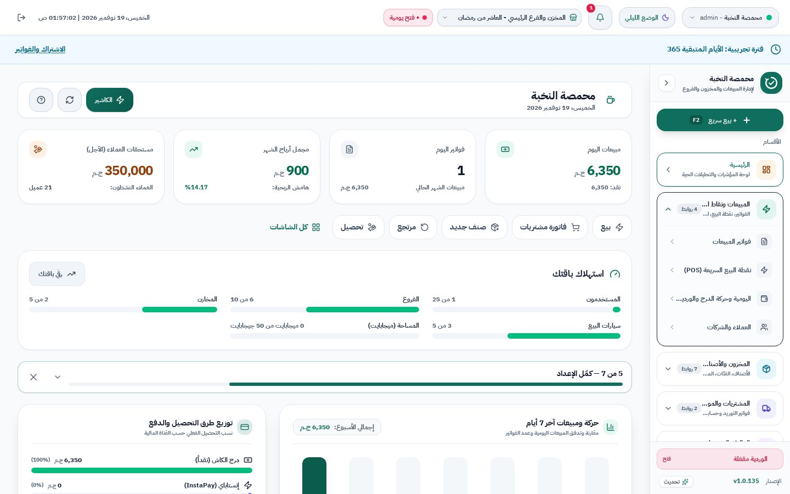
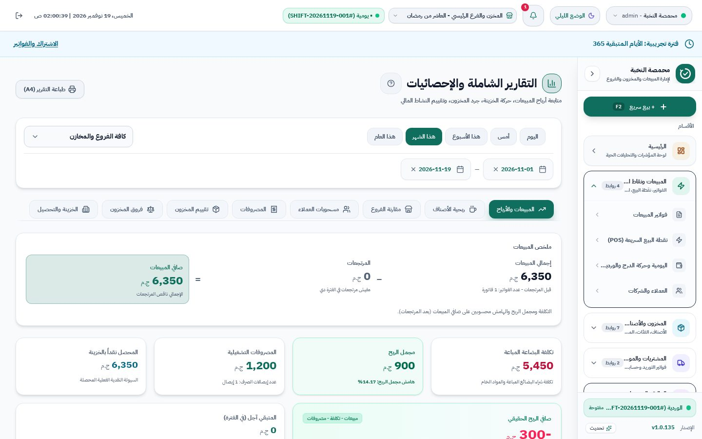

# التقارير ولوحة التحكم

> الملف ده بيشرح اللي «إبراء» (Ibraa) بيعرضه فعلًا النهارده من أرقام ولوحة تحكم وتقارير، وإزاي كل رقم بيتحسب، ومين يقدر يشوفه، وإيه المتاح في كل باقة. اللي مش موجود مكتوب صراحة في آخر الملف.

## الخلاصة في سطور

- **لوحة التحكم** هي أول شاشة: أرقام اليوم والشهر، رسم لآخر 7 أيام، ساعات الذروة، النواقص، آخر الفواتير. مين مالوش صلاحية التقارير (كاشير مثلًا) بيشوف لوحة مختلفة تمامًا: مبيعات ورديته هو بس.
- **شاشة التقارير** فيها 8 تبويبات: المبيعات والأرباح، ربحية الأصناف، مقارنة الفروع، مسحوبات العملاء، المصروفات، تقييم المخزون، فروق المخزون، الخزينة والتحصيل.
- كل أرقام المبيعات والأرباح **صافية من المرتجعات**: المرتجع بيتخصم من يوم المرتجع (مش يوم الفاتورة الأصلية)، وبيتخصم معاه تكلفة البضاعة اللي رجعت.
- الأرباح محسوبة بتكلفة الصنف **وقت البيع** (متوسط التكلفة المرجّح اللي اتسجّل على سطر الفاتورة)، فتغيير سعر الشراء بعدين مبيغيّرش أرباح فواتير قديمة.
- في الباقات: التقارير الأساسية في كل الباقات. **ربحية الأصناف ومقارنة الفروع وتفاصيل التكلفة والهامش وصافي الربح** تقارير متقدمة (باقتي «النمو» و«الأعمال»، أو إضافة «حزمة الرقابة والأرباح» على «البداية»). رقم **مجمل الربح الإجمالي** للفترة بيظهر في كل الباقات.
- التقارير بتتعرض وبتتطبع من الشاشة. **التصدير لملف Excel مذكور كميزة في الباقات لكن مفيش زرار تصدير في شاشة التقارير الحالية** (التفاصيل في «حسب الباقة» و«حدود وملاحظات»).

## مين بيستخدمه

| الدور | بيشوف إيه |
|---|---|
| صاحب المحل / المدير (admin) | كل لوحة التحكم، كل التقارير (حسب الباقة)، استهلاك الباقة |
| المحاسب | لوحة التحكم الكاملة وكل التقارير (عنده صلاحية التقارير وصلاحية رؤية التكلفة) |
| أمين المخزن | لوحة الوردية الخاصة (مالوش صلاحية التقارير)، ويشوف النواقص لو عنده صلاحية عرض الأصناف |
| الكاشير | لوحة «مبيعات ورديتك» بس، مفيش تقارير |
| مدير الاشتراك (صلاحية الفوترة) | بيشوف كمان كارت «استهلاك باقتك» على اللوحة |

> الأدوار دي هي الأدوار الجاهزة. صلاحية «عرض التقارير» ممكن تتدّي لأي دور مخصص من شاشة الأدوار.

## الشاشات

| الشاشة | بتعمل إيه |
|---|---|
| لوحة التحكم (الرئيسية) | أرقام اليوم والشهر، اتجاه 7 أيام، توزيع طرق التحصيل، ساعات الذروة، آخر الفواتير، النواقص، إجراءات سريعة، استهلاك الباقة |
| لوحة الوردية الخاصة | للي مالوش صلاحية التقارير: مبيعات فواتير ورديته بس |
| التقارير | 8 تبويبات (تحت) + فلتر فترة وفرع + طباعة A4 |
| اليومية (Daily Journal) | حركة يوم واحد: مبيعات، تحصيلات، مصروفات، كاش الدُرج (شاشة مستقلة، موصوفة في ملف الورديات والخزينة) |
| تقرير Z للوردية | ملخص وردية واحدة عند قفلها (ملف الورديات) |
| كشف حساب عميل / مورد | حركة حساب واحد على فترة (ملف العملاء والموردين) |
| كارت الصنف | آخر 50 حركة مخزون لصنف واحد |

## لقطات من الشاشات


*لوحة التحكم الرئيسية*


*التقارير الشاملة*


## لوحة التحكم

### مين يشوف إيه

| الحالة | اللي بيظهر |
|---|---|
| عنده صلاحية التقارير | الكروت الأربعة، الإجراءات السريعة، الرسوم، النواقص، آخر الفواتير |
| مالوش صلاحية التقارير | لوحة «مبيعات ورديتك»: عدد فواتير ورديته المفتوحة، صافي المبيعات، نقد/آجل، المرتجعات، فواتير الوردية. **مفيش** أرباح ولا ديون ولا مبيعات الشهر ولا رصيد الدُرج. لو مفيش وردية مفتوحة بتظهر أصفار ورسالة «افتح وردية» |

اللوحة دي مبتتخزنش مؤقتًا وبتتحسب لكل مستخدم لوحده، فمفيش طريقة يشوف بيها أرقام المحل كله.

### الفرع والفترة

- الأرقام على **الفرع النشط** (اللي مختاره المستخدم من أعلى الشاشة). لو اختار «كل الفروع» وكان مسموحله، الأرقام بتتجمّع على كل الفروع.
- «النهارده» = **يوم العمل الحالي** بتوقيت المحل (الافتراضي القاهرة، Africa/Cairo) وبحسب «بداية اليوم التجاري» في الإعدادات. لو ضابط البداية 03:00 يبقى بيع الساعة 1:30 صباحًا بيتحسب على اليوم اللي قبله.
- «الشهر» = من أول يوم في الشهر الحالي (بتوقيت المحل ويوم العمل) لحد النهارده.
- أرقام اللوحة بتتخزن مؤقتًا **60 ثانية**، يعني أي بيعة ممكن تتأخر لحد دقيقة في الكروت. «آخر الفواتير» والوردية المفتوحة بيتحدّثوا فورًا.

### الكروت الأربعة

| الكارت | بيعدّ إيه بالظبط | ملاحظات |
|---|---|---|
| **مبيعات اليوم** | مجموع صافي الفواتير **المؤكدة** النهارده (بعد خصم الفاتورة) **ناقص** المرتجعات اللي اتسجّلت النهارده | تحتها سطر «نقد / آجل» (قبل المرتجعات) وسطر «المرتجعات (عدد)» لو في مرتجعات. الفواتير الملغية مش داخلة |
| **فواتير اليوم** | عدد الفواتير المؤكدة النهارده | في ذيل الكارت: «مبيعات الشهر» (صافية من المرتجعات) وسطر «مرتجعات الشهر» |
| **مجمل أرباح الشهر** | (مبيعات الشهر − مرتجعات الشهر) − (تكلفة المباع − تكلفة المرتجع) | بيظهر لمين عنده صلاحية التقارير، **في كل الباقات**. نسبة «هامش الربحية» تحته بتظهر في الباقات المتقدمة بس |
| **ديون العملاء (الآجل)** | مجموع رصيد كل العملاء النشطين المدينين | تحته عدد العملاء النشطين. الرقم **على المحل كله** مش على الفرع |

كارت بيختفي لو الرقم مش متاح للمستخدم، مش بيظهر صفر.

> رقم ديون الموردين وإجمالي الكاش المحصّل والمصروفات وصافي كاش اليوم بيتحسبوا في الخلفية، لكن **مش معروضين ككروت** في اللوحة الحالية. الأرقام دي بتلاقيها في اليومية وتبويب الخزينة.

### باقي مكونات اللوحة

| المكوّن | بيعرض إيه |
|---|---|
| **الإجراءات السريعة** | أزرار: بيع، فاتورة مشتريات، صنف جديد، مرتجع، تحصيل (يفتح العملاء)، وكل الشاشات. كل زرار بيظهر بس لو المستخدم مسموحله يفتح الشاشة دي (صلاحيات + باقة) |
| **حركة آخر 7 أيام** | مبيعات كل يوم (صافية من مرتجعات اليوم ده) وعدد الفواتير، وإجمالي الأسبوع، ومتوسط السلة (إجمالي ÷ عدد الفواتير، قبل المرتجعات) |
| **توزيع طرق التحصيل** | نسبة كل طريقة (كاش، إنستاباي، محفظة، فيزا، تحويل بنكي) من **المبالغ المدفوعة** على فواتير آخر 7 أيام، ومعاها رقم الوردية المفتوحة |
| **ساعات الذروة** | مبيعات كل ساعة (0–23) من فواتير آخر 7 أيام بتوقيت المحل، وكثافة كل ساعة نسبةً لأقوى ساعة، وشارة «ساعة الذروة» |
| **آخر الفواتير** | آخر 8 فواتير غير ملغية للفرع، بالعميل والإجمالي والحالة (مدفوعة / آجل) وزرار معاينة وطباعة |
| **النواقص** | أقل 8 أصناف نشطة رصيدها تحت الحد (الحد الخاص بالصنف، أو الحد الافتراضي من الإعدادات)، ورابط «إعادة الطلب الذكي» |
| **قائمة البداية (Checklist)** | خطوات تجهيز المحل: بيانات الشركة، الفرع، التصنيفات، الأصناف، المستخدمين، فتح وردية، أول بيعة. بتتقفل بزرار إخفاء |
| **«لسه مفيش مبيعات»** | لمحل جديد مفيش عليه أي حركة: بدل الرسوم بتظهر دعوة لأول عملية بيع |

### كارت «استهلاك باقتك»

- **بيظهر لمين**: اللي عنده صلاحية إدارة الفوترة بس (هو اللي يقدر يرقّي).
- **بيعرض إيه**: شريط لكل مورد **محدود** في الباقة (مستخدمين، أصناف، فواتير الشهر، مساحة تخزين، عملاء، موردين، فروع/مخازن/عربيات…) بالشكل «مستخدم من حد». الموارد غير المحدودة ما بتظهرش، وأي مورد حده صفر (الباقة مش بتشمله) ما بيظهرش.
- **الألوان**:

| النسبة | لون الشريط | إطار الكارت | الرسالة |
|---|---|---|---|
| أقل من 80% | أخضر | عادي | — |
| من 80% لأقل من 100% | أصفر (كهرماني) | أصفر | «اقتربت من حد باقتك… رقّي باقتك قبل ما تتوقف الإضافة الجديدة» |
| 100% | أحمر | أحمر | «وصلت إلى حد باقتك: لا يمكن إضافة جديد فيها، وكل شيء آخر يعمل بشكل طبيعي» |

- **استثناء**: الفروع والمخازن والعربيات «حصص هيكلية» بتتحدد بالباقة مش بتتستهلك بالشغل اليومي، فلو الحصة كلها مستخدمة (فرع 1 من 1) الشريط يفضل أخضر ومبيطلعش تحذير.
- زرار «رقّي باقتك» بيفتح شاشة الاشتراك والفوترة.
- لو تحميل الاستهلاك فشل بتظهر رسالة خطأ بزرار إعادة المحاولة بدل ما يختفي الكارت.

## التقارير: القواعد المشتركة

| البند | القاعدة |
|---|---|
| **الفلاتر** | الفترة (اليوم، أمس، هذا الأسبوع، هذا الشهر، هذه السنة، أو تاريخ من–إلى مخصص) + الفرع (الافتراضي «كافة الفروع») + في تبويب المخزون فلتر الرصيد. **مفيش فلتر مستخدم/كاشير ولا فلتر تصنيف** |
| **الافتراضي** | «هذا الشهر» من أول الشهر لحد النهارده |
| **أقصى فترة** | 366 يوم. فترة أطول أو تاريخ البداية بعد النهاية بيرجّع رسالة خطأ بدل تقرير غلط |
| **حدود الفترة** | من بداية يوم «من» لحد نهاية يوم «إلى» شامل. الفاتورة بتتحسب على **تاريخ الفاتورة** (يوم العمل اللي اتسجّلت عليه) والمرتجع على **تاريخ المرتجع** والمصروف على **تاريخ المصروف** |
| **الفواتير المحسوبة** | المؤكدة بس. الملغية والمحذوفة مش داخلة |
| **المرتجعات** | مرتجعات المبيعات بس (مرتجع المشتريات بيأثر على المخزون والمورد مش على المبيعات). المرتجعات المحذوفة مش بتتعد |
| **التوقيت** | توقيت المحل (الافتراضي القاهرة) وبداية اليوم التجاري المضبوطة. «الشهر» و«النهارده» و«أمس» بتتحدد على يوم العمل مش على الساعة 12 بالضرورة |
| **الفروع** | المستخدم اللي مش مسموحله بكل الفروع بيشوف فروعه بس، وطلب فرع مش مسموحله بيتمنع |
| **الدقة** | كل الأرقام بثلاث خانات عشرية وبحساب عشري دقيق (مفيش تقريب عائم) |
| **الشاشة** | مفيش صلاحية «عرض التقارير» = مفيش تبويبات ولا بيانات |

### حساب الربح (القاعدة الأهم)

```
صافي المبيعات   = مبيعات الفواتير المؤكدة (بعد خصم الفاتورة) − قيمة مرتجعات الفترة
صافي التكلفة    = تكلفة الفواتير المؤكدة − تكلفة الأصناف المرتجعة
مجمل الربح      = صافي المبيعات − صافي التكلفة
الهامش %         = مجمل الربح ÷ صافي المبيعات × 100
صافي الربح       = مجمل الربح − مصروفات الفترة
```

- **تكلفة الفاتورة** = لكل سطر: الكمية × تكلفة الصنف **وقت البيع** (متوسط التكلفة المرجّح المسجّل على السطر).
- **تكلفة المرتجع** بالترتيب: (1) تكلفة سطر الفاتورة الأصلي لو المرتجع مربوط بيه. (2) مرتجع قديم مربوط بالفاتورة من غير سطر: أعلى تكلفة للصنف في الفاتورة دي. (3) مرتجع من غير فاتورة: التكلفة اللي رجع بيها الصنف للمخزن يوم المرتجع. (4) لو مفيش: تكلفة الصنف الحالية.
- **قيمة المرتجع** = المبلغ اللي اتحسب كاسترداد فعلًا للسطر (بعد خصم السطر وحصته من خصم الفاتورة).
- **المصروفات**: كل مصروفات الفترة بأي طريقة دفع، تتخصم من صافي الربح.
- متوسط الفاتورة = إجمالي المبيعات (قبل المرتجعات) ÷ عدد الفواتير. المرتجع مستند منفصل ومبيقللش العدد.

### مثال: تقرير ربح ليوم فيه مرتجع

اليوم: تقرير «اليوم» لفرع واحد.

| البند | الحساب | الناتج (ج.م) |
|---|---|---|
| فاتورة 1 (صافي بعد الخصم) | تكلفتها وقت البيع 600 | 1,000.000 |
| فاتورة 2 | تكلفتها وقت البيع 300 | 500.000 |
| إجمالي المبيعات | 1,000 + 500 | 1,500.000 |
| تكلفة المباع | 600 + 300 | 900.000 |
| مرتجع بنفس اليوم من الفاتورة 1 (قيمة الاسترداد 200، وتكلفة نفس الأصناف وقت البيع 120) | | |
| صافي المبيعات | 1,500 − 200 | 1,300.000 |
| صافي التكلفة | 900 − 120 | 780.000 |
| **مجمل الربح** | 1,300 − 780 | **520.000** |
| الهامش | 520 ÷ 1,300 | 40.00% |
| مصروفات اليوم | | 100.000 |
| **صافي الربح** | 520 − 100 | **420.000** |
| متوسط الفاتورة | 1,500 ÷ 2 (قبل المرتجع) | 750.00 |

- من غير المرتجع كان مجمل الربح 600؛ المرتجع نقّصه 80 بس (الاسترداد 200 ناقص التكلفة اللي رجعت 120)، لأن البضاعة رجعت للمخزن.
- لو المرتجع اتسجّل **تاني يوم**، اليوم الأول يفضل بـ 600 والمرتجع ينزّل أرباح اليوم التاني. الفاتورة بتتحسب على تاريخها والمرتجع على تاريخه.
- لو الفترة «هذا الشهر» بيتجمعوا الاتنين وتطلع نفس النتيجة الصافية.

مثال على صنف بالكسور (تبويب ربحية الأصناف): بن مطحون بيع 2.500 كجم بـ 625 ج.م وتكلفته 400، ورجع منه 0.500 كجم بقيمة 125 وتكلفة 80. الصافي: كمية 2.000 كجم، إيراد 500، تكلفة 320، ربح 180، هامش 36.0%.

## التقارير واحد واحد

### 1) المبيعات والأرباح

- **بيجاوب**: «بعت بكام، المرتجعات كام، كسبت كام، صرفت كام، وإيه اللي اتحصّل وإيه اللي لسه عند العملاء؟»
- **الفلاتر**: الفترة والفرع.
- **الأرقام**: إجمالي المبيعات (قبل المرتجعات)، المرتجعات (وعددها)، صافي المبيعات، عدد الفواتير ومتوسط الفاتورة، تكلفة البضاعة المباعة، مجمل الربح والهامش، المصروفات (وعددها)، صافي الربح، المحصّل بالفترة، المتبقي آجل بالفترة، إجمالي ديون العملاء (رصيد حالي، مش بالفترة)، وتقييم المخزون بالتكلفة وبسعر البيع والربح المتوقع (حالة المخزون **دلوقتي** مش في آخر الفترة).
- **حسب الباقة**: من غير الباقة المتقدمة بيظهر **مجمل الربح** بس. التكلفة والهامش وصافي الربح وتقييم المخزون بالتكلفة بيختفوا.

### 2) ربحية الأصناف (متقدم)

- **بيجاوب**: «أنهي أصناف بتجيب أكتر إيراد وربح؟ إيه اللي رجع منها؟»
- **الفلاتر**: الفترة والفرع.
- **الأعمدة**: الاسم، الكود، التصنيف، الوحدة، الكمية الصافية، الإيراد، التكلفة، الربح، الهامش %، وتفصيل الإجمالي والمرتجع (كمية وقيمة وتكلفة).
- **الحساب**: لكل صنف: مبيعات سطور الفواتير المؤكدة ناقص مرتجعات الفترة. صنف اتباع قبل الفترة وارتجع فيها بيظهر بصف سالب. الترتيب بالإيراد الصافي من الأعلى، 100 صنف في الصفحة، والإجماليات في الأسفل على **كل** الأصناف مش الصفحة الحالية. الصنف المحذوف اللي اتباع بيختفي من الصفوف.
- **ملحوظة**: إيراد الصنف محسوب على سعر السطر **قبل** خصم الفاتورة الإجمالي، فمجموع إيراد الأصناف ممكن يزيد عن «صافي المبيعات» في تبويب المبيعات لو فيه فواتير عليها خصم على الإجمالي.
- **حسب الباقة**: مقفول بعلامة قفل ورسالة ترقية في الباقات غير المتقدمة.

### 3) مقارنة الفروع (متقدم)

- **بيجاوب**: «أنهي فرع أو عربية توزيع أفضل مبيعًا وربحًا؟»
- **الأعمدة** لكل فرع نشط: عدد الفواتير، إجمالي المبيعات، المرتجعات، صافي المبيعات، المحصّل، المتبقي، مجمل الربح، الهامش، ونسبة مساهمته من صافي مبيعات كل الفروع.
- المستخدم بيشوف الفروع المسموحله بيها بس. فلتر الفرع مش بيأثر هنا (بتعرض كل الفروع المسموحة).
- **حسب الباقة**: مقفول في الباقات غير المتقدمة.

### 4) مسحوبات العملاء

- **بيجاوب**: «مين أكتر عملاء اشتروا؟ ومين عليه فلوس؟»
- **الأعمدة**: العميل والتليفون، عدد الفواتير، إجمالي المسحوبات، مرتجعات الفترة، صافي المسحوبات، المدفوع بالفترة، المتبقي بالفترة، والرصيد التراكمي الحالي.
- **الحساب**: فواتير الفترة المؤكدة لكل عميل، ومرتجعاته بنفس الفترة تتخصم. الترتيب بصافي المسحوبات، **أعلى 50 عميل بس**.
- هو مش تقرير أعمار ديون (Aging): مفيش تقسيم 30/60/90 يوم. تتبّع حساب عميل بالتفصيل من **كشف الحساب** بتاعه.

### 5) المصروفات

- **بيجاوب**: «بنصرف على إيه وكام؟»
- **الأعمدة**: التصنيف، المبلغ، عدد الإيصالات، من الأعلى للأقل.
- **الحساب**: كل مصروفات الفترة (والفرع) بتاريخ المصروف، بأي طريقة دفع.

### 6) تقييم المخزون

- **بيجاوب**: «مخزوني قيمته كام بالتكلفة وكام بسعر البيع؟ وإيه الربح المتوقع لو بعته كله؟»
- **الفلاتر**: الفرع، وفلتر الرصيد: الكل / المتوفر فقط / المنتهي (رصيد صفر أو أقل).
- **الأعمدة**: الصنف، الرصيد، التكلفة (متوسط مرجّح)، سعر البيع، قيمة التكلفة، قيمة البيع، الربح المتوقع، 100 صنف في الصفحة، الأعلى قيمة (بالتكلفة) أول.
- **الحساب**: الرصيد × تكلفة الصنف الحالية (المتوسط المرجّح، وآخر سعر شراء لو مفيش متوسط). على فرع معيّن: رصيد الفرع × سعر بيع الفرع المخصص لو موجود وإلا سعر الصنف. على «كل الفروع»: الرصيد الإجمالي للصنف. الإجماليات بتشمل **كل** الأصناف النشطة مش الصفحة.
- **صورة اللحظة**: بيعرض حالة المخزون **دلوقتي**، مش في آخر يوم من الفترة المختارة.
- **التكلفة**: أسعار تكلفة الوحدة بتختفي لمن ليس عنده صلاحية رؤية التكلفة. وقيمة التكلفة والربح المتوقع بتحتاج الباقة المتقدمة.
- تحليل ABC (أ/ب/ج: الأصناف اللي بتجيب أول 80% من الربح ثم 95% ثم الباقي، والمخزون الراكد وسرعة البيع اليومية) موجود في بيانات النظام، لكن **تبويب المخزون الحالي مش بيعرضه** (شوف الحدود).

### 7) فروق المخزون

- **بيجاوب**: «في أصناف رصيدها الإجمالي مش مطابق لمجموع أرصدة فروعها؟»
- **الأعمدة**: الصنف والكود، رصيد الصنف الإجمالي، مجموع أرصدة الفروع، الفرق. بحث بالاسم أو الكود. للقراءة فقط، وفاضي = كل شيء متطابق.
- أداة تشخيص وفحص سلامة، مش تقرير بزنس يومي.

### 8) الخزينة والتحصيل

- **بيجاوب**: «كام كاش وإنستاباي ومحفظة وفيزا وتحويل بنكي عندي؟ وإيه اللي دخل وخرج؟»
- **لكل طريقة دفع**: رصيد أول الفترة (كل حركة قبل الفترة، ومعاه رصيد فتح الورديات المفتوحة للكاش)، المقبوض من العملاء، المدفوع (موردين، مصروفات، استرداد للعملاء)، الاستردادات، التحويلات الداخلة والخارجة، الرسوم، صافي الحركة، رصيد آخر الفترة، ونسبة الطريقة من السيولة.
- **الإجماليات** والسجل الزمني (الأحدث أول) بصفحات، مع التحويلات بين الخزائن. الأرصدة التراكمية محسوبة على الفترة كاملة مش الصفحة.
- الطرق غير المفعّلة وبدون أي حركة بتتخفى.

### تقارير تانية خارج شاشة التقارير

| التقرير | بيجاوب | فين |
|---|---|---|
| **اليومية** | «إيه اللي حصل في يوم معيّن في الفرع: مبيعات، تحصيل، مصروفات، كاش؟» | شاشة اليومية. الكاشير يشوف حركته هو بس |
| **تقرير Z** | «الوردية دي استلمت وسلّمت كام وفيه عجز أو زيادة؟» | عند قفل الوردية (والمؤقت للوردية المفتوحة)، يحتاج ميزة الورديات |
| **كشف حساب عميل / مورد** | «الحساب ده فيه إيه، رصيد أول وآخر الفترة؟» | في شاشة العميل والمورد |
| **كارت الصنف** | «إيه حركة الصنف ده؟» | آخر 50 حركة، لمين عنده صلاحية التقارير |
| **النواقص وإعادة الطلب الذكي** | «إيه اللي لازم أشتريه؟» | اللوحة وشاشة المشتريات (إعادة الطلب ميزة متقدمة) |
| **سجل النشاط** | «مين عمل إيه ومتى؟» | ميزة سجل الرقابة، وفيه تصدير CSV |
| **تصدير الفواتير** | قائمة الفواتير في ملف CSV (حد أقصى 20,000 صف) | شاشة الفواتير |

## الطباعة والتصدير

| الخيار | الوضع الحالي |
|---|---|
| طباعة التقرير | زرار «طباعة التقرير (A4)» أعلى شاشة التقارير. بيطبع التبويب المفتوح من المتصفح (يتحفظ PDF كمان). فيه كمان صفحة طباعة رسمية: عنوان، الفترة، النطاق، وتوقيع «المحاسب» و«المراجعة» |
| التصدير لـ Excel | مذكور في وصف الإضافة «تصدير التقارير» (كشوف ومخزون وفواتير). مش فيه زرار تصدير في شاشة التقارير الحالية، ولا حاجز في النظام بيمنع أو يسمح بيه حسب الباقة (شوف الحدود) |
| تصدير الفواتير CSV | موجود في شاشة الفواتير بحد أقصى للصفوف وبحد لعدد مرات الطلب، من غير حاجز باقة ظاهر |

## الصلاحيات

| الإجراء | مين يقدر |
|---|---|
| لوحة التحكم الكاملة وكل تبويبات التقارير | admin أو دور عنده «عرض التقارير» (الجاهز: المحاسب) |
| لوحة ورديتي فقط | أي مستخدم بدون «عرض التقارير» |
| تفاصيل تكلفة الوحدة في المخزون وكارت الصنف | اللي عنده صلاحية رؤية التكلفة (الأدمن، المحاسب، أمين المخزن؛ الكاشير لا) |
| رؤية الأرباح والتكلفة والهامش | صلاحية التقارير **و** ميزة التقارير المتقدمة في الباقة (إلا إجمالي مجمل الربح) |
| كارت استهلاك الباقة | صلاحية إدارة الفوترة |

### إعداد «مين يشوف التكلفة والربح»

مفيش شاشة إعداد واحدة اسمها «ظهور الربح». الظهور بيتحكم فيه 3 طبقات:

1. **الباقة**: من غير التقارير المتقدمة، التكلفة والهامش وصافي الربح وربحية الأصناف ومقارنة الفروع والربح المتوقع للمخزون **بتتشال من الرد نفسه** (مش مخفية في الشاشة بس). إجمالي مجمل الربح للفترة هو الرقم الوحيد المتاح. (ممكن استنتاج التكلفة والهامش من مجمل الربح والمبيعات، والتفاصيل بالصنف والفرع هي الحصرية للمتقدم.)
2. **صلاحية التقارير**: من غيرها مفيش أي أرقام مالية.
3. **صلاحية رؤية التكلفة**: بتخفي **تكلفة الوحدة** (متوسط التكلفة وآخر سعر شراء) في صفوف المخزون وكارت الصنف، من غير ما تأثر على إجماليات الشاشة.

لإخفاء الأرباح عن موظف: اديله دور من غير «عرض التقارير». لو عايزه يشوف التقارير من غير التكلفة، شيله صلاحية رؤية التكلفة، لكن اعرف إن ده **مش** بيخفي COGS والربح في تبويب المبيعات (شوف الحدود).

## سؤال بزنس → التقرير اللي بيجاوبه

| سؤال البزنس | التقرير / الشاشة |
|---|---|
| بعت النهارده كام؟ | كارت «مبيعات اليوم» في اللوحة، أو التقارير > المبيعات والأرباح (اليوم) |
| بعت الشهر ده كام وكسبت كام؟ | اللوحة (مبيعات الشهر ومجمل الربح) أو المبيعات والأرباح (هذا الشهر) |
| صافي ربحي بعد المصروفات؟ | المبيعات والأرباح > صافي الربح (باقة متقدمة، وإلا استنتجه: مجمل الربح − المصروفات) |
| أنهي أصناف بتكسبني أكتر؟ | ربحية الأصناف (متقدم) |
| أنهي فرع أفضل؟ | مقارنة الفروع (متقدم) |
| مين أحسن عملائي؟ | مسحوبات العملاء (أعلى 50) |
| مين عليه فلوس وكام؟ | كارت ديون العملاء، تبويب العملاء (المتبقي والرصيد)، كشف حساب العميل |
| بعتلي كام نقد وكام آجل؟ | سطر «نقد / آجل» تحت مبيعات اليوم، وتبويب المبيعات (المحصّل والمتبقي) |
| بصرف على إيه؟ | المصروفات (حسب التصنيف) |
| كام كاش وإنستاباي عندي، وإيه اللي دخل وخرج؟ | الخزينة والتحصيل |
| طرق الدفع اللي زبائني بيستخدموها؟ | «توزيع طرق التحصيل» في اللوحة (آخر 7 أيام) |
| مخزوني قيمته كام؟ | تقييم المخزون (بالتكلفة وبسعر البيع) |
| إيه اللي خلص أو قرّب يخلص؟ | «النواقص» في اللوحة، وفلتر «المنتهي» في تقييم المخزون |
| إيه اللي لازم أشتريه؟ | إعادة الطلب الذكي (من اللوحة) |
| أنهي ساعات الزحمة؟ | «ساعات الذروة» في اللوحة |
| حركة الصنف ده إيه؟ | كارت الصنف (آخر 50 حركة) |
| وردية الكاشير فيها عجز؟ | تقرير Z للوردية |
| اللي حصل في يوم معيّن بالتفصيل؟ | اليومية |
| مرتجعاتي كام؟ | سطر المرتجعات في اللوحة وتبويب المبيعات (الإجمالي والعدد فقط، مفيش تقرير مرتجعات مستقل) |
| رصيد صنف مش مطابق للفروع؟ | فروق المخزون |
| مشتريات الشهر؟ | مفيش تقرير مشتريات مجمّع؛ قائمة فواتير المشتريات وكشف المورد |
| أنهي كاشير بيع أكتر؟ | مفيش تقرير مبيعات لكل كاشير |

## حسب الباقة

| الميزة | التجربة (مجانية) | البداية | النمو | الأعمال |
|---|---|---|---|---|
| اللوحة والتقارير الأساسية (مبيعات، عملاء، مصروفات، مخزون، خزينة، فروق المخزون) | نعم | نعم | نعم | نعم |
| إجمالي مجمل الربح | نعم | نعم | نعم | نعم |
| التقارير المتقدمة (ربحية الأصناف، مقارنة الفروع، التكلفة والهامش وصافي الربح، الربح المتوقع) | لا | لا (إضافة «حزمة الرقابة والأرباح») | نعم | نعم |
| تصدير التقارير | لا (غير معرّفة في الباقة المجانية) | مُعرّفة | مُعرّفة | مُعرّفة |

- «حزمة الرقابة والأرباح» إضافة اختيارية على «البداية» بتفتح التقارير المتقدمة وسجل النشاط وإعادة الطلب الذكي.
- ترقية الباقة أو الإضافة بتغيّر الرد فورًا، واللوحة المخزّنة بتبقى بمفتاح مختلف فمفيش نسخة قديمة بتتعرض.
- التصدير: الميزة موجودة في كتالوج الباقات ومحجوبة من الباقة المجانية على الورق، **لكن لا شاشة التقارير ولا الـ API بيطبّقوها حاليًا**. اتأكد مع الفريق قبل ما تعلنها للعميل كميزة مدفوعة.

## أسئلة شائعة

**ليه مبيعات اليوم أقل من مجموع الفواتير؟**
لأن المرتجعات اللي اتسجّلت النهارده بتتخصم. السطر تحت الكارت بيوضّح «قبل المرتجعات: نقد / آجل».

**رجّعت فاتورة من الشهر اللي فات، بتتخصم من إيه؟**
من الشهر الحالي، لأن المرتجع بيتحسب على تاريخه. فواتير الشهر اللي فات متتغيرش.

**غيّرت سعر شراء صنف، هل أرباح الفواتير القديمة تتغير؟**
لا، الربح محسوب بتكلفة وقت البيع. لكن **تقييم المخزون** بيتغير لأنه محسوب بتكلفة الصنف الحالية.

**ليه ربحية الأصناف مقفولة عندي؟**
دي تقرير متقدم. متاحة في «النمو» و«الأعمال» أو بإضافة «حزمة الرقابة والأرباح».

**ليه مش شايف نسبة الهامش في اللوحة؟**
نسبة الهامش جزء من التقارير المتقدمة. إجمالي مجمل الربح بس هو اللي بيظهر في كل الباقات.

**الكاشير مش شايف أرباح، طبيعي؟**
أيوه. الكاشير مالوش صلاحية التقارير فبيشوف لوحة ورديته بس.

**الأرقام اتأخرت دقيقة بعد بيعة؟**
اللوحة بتتخزن 60 ثانية. آخر الفواتير والوردية بيتحدّثوا فورًا، والتقارير بتتحسب وقت الفتح.

**ليه بيع بعد منتصف الليل ظهر على امبارح؟**
لأن «بداية اليوم التجاري» في الإعدادات مش 00:00. المبيعات بعد منتصف الليل لحد وقت البداية بتتحسب على اليوم السابق.

**ليه مجموع إيراد الأصناف مختلف عن صافي المبيعات؟**
إيراد الصنف قبل خصم الفاتورة الإجمالي، وصافي المبيعات بعده.

**الفترة الأطول مرفوضة؟**
أقصى فترة 366 يوم عشان التقرير يفضل سريع.

## حدود وملاحظات / فرص تطوير

- **التصدير**: زرار تصدير التقارير مش موجود في الشاشة الحالية، ومفيش حاجز باقة فعلي على «تصدير التقارير». كان فيه زرار «تصدير ABC (Excel)» في نسخة قديمة من تبويب المخزون ومبقاش مستخدم.
- **تحليل ABC** (الفئات أ/ب/ج والمخزون الراكد وسرعة البيع) محسوب في النظام لكن مش معروض في تبويب المخزون الحالي. أيضًا ABC بيحسب التكلفة بتكلفة الصنف **الحالية** مش تكلفة وقت البيع، فأرباحه ممكن تفرق عن تقرير ربحية الأصناف.
- **تقارير مش موجودة كتقارير مستقلة**: مبيعات لكل كاشير، مبيعات لكل تصنيف أو لكل يوم (غير رسم آخر 7 أيام)، تقرير مرتجعات، تقرير مشتريات، تقرير أعمار ديون (Aging)، وحركات المخزون المجمّعة. فلتر «المستخدم» غير متاح في التقارير.
- **ظهور الأرباح**: صلاحية «عرض التقارير» لوحدها بتكشف COGS والهامش وصافي الربح (مع الباقة المتقدمة). صلاحية «رؤية التكلفة» بتخفي تكلفة الوحدة بس، مش الربح الإجمالي. مفيش صلاحية «شوف المبيعات من غير الأرباح».
- **فلتر طريقة الدفع في الخزينة**: موجود في بنية الطلب لكن التقرير بيعرض كل الطرق ومفيش اختيار طريقة في الشاشة.
- **مسحوبات العملاء** محدودة بأعلى 50 عميل. فواتير الزبون النقدي بدون عميل مسجّل مش واضح من الكود إذا كانت بتظهر كصف باسم «عميل محذوف» وبتاخد مكان.
- **كارت الديون** على المحل كله حتى لو الفرع المختار فرع معيّن.
- **رسالة القفل** بتقول «متاح في باقة Pro» بينما اسم الباقة في الكتالوج العربي «النمو»: لازم توحيد التسمية.
- بداية الأسبوع في «هذا الأسبوع» مش مضبوطة صراحة في الإعدادات؛ غير موثّق (حسب الافتراضي في النظام).
- الحد الأقصى 100 صف في الصفحة (200 بحد أقصى) لقوائم الأصناف والمخزون والسجل.

## ملحق للفريق التقني

- لوحة التحكم: `GetDashboardOverviewAction` + `GetOwnShiftDashboardAction`، التخزين المؤقت `DashboardCache` (60 ثانية).
- التقارير: `ReportController` (`/api/v1/reports/*`، middleware `feature:reports.basic`، و`feature:reports.advanced` على `items` و`stores`) + Actions في `app/Actions/Reports`.
- الأساس المشترك: `InvoiceAggregates` و`SalesReturnAggregates` و`ReportDateRange` (نطاق نصف مفتوح `[from, to+1)`).
- ظهور الربح: `ProfitVisibility` (الباقة) و`CostVisibility` (صلاحية `items.view_cost`).
- مفاتيح الميزات: `reports.basic` / `reports.advanced` / `reports.export` في `config/entitlements.php` و`FeatureCatalog`؛ `reports.export` غير مطبّق على أي route حاليًا.
