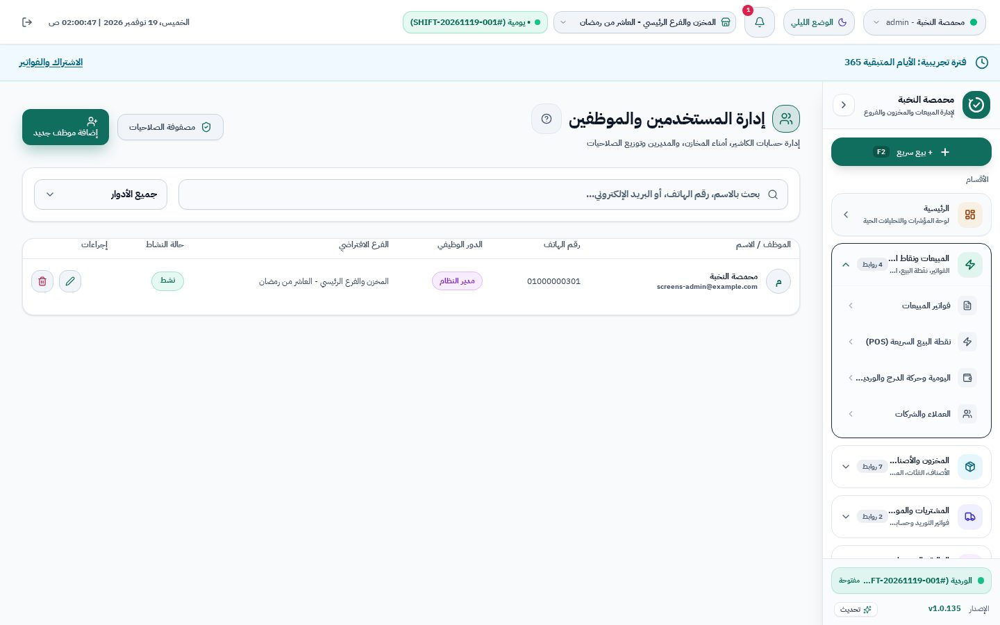
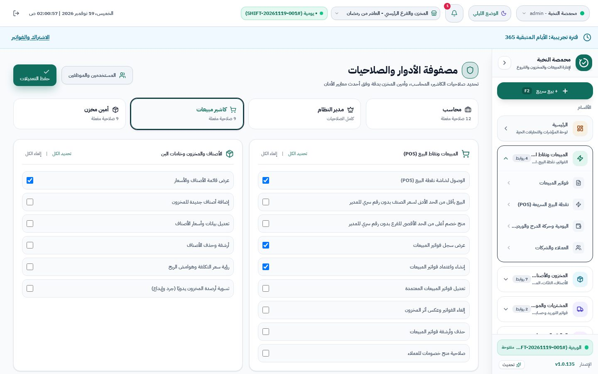
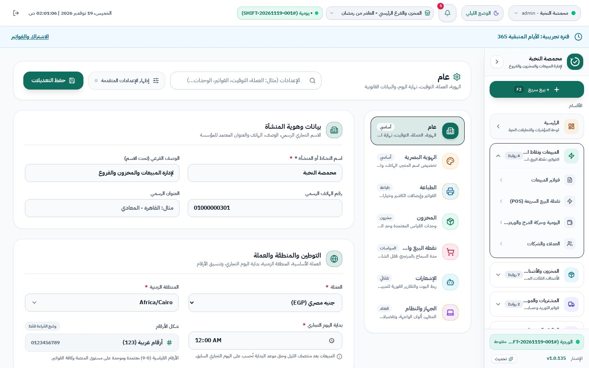
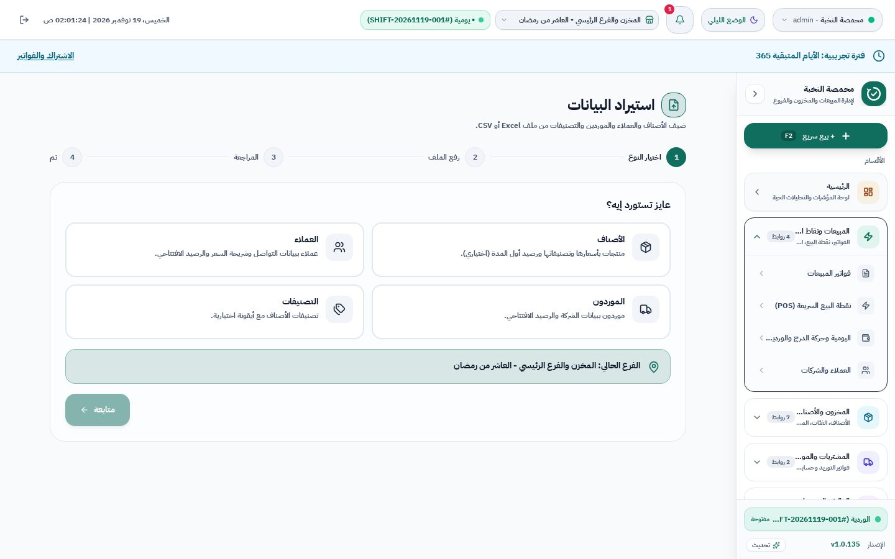
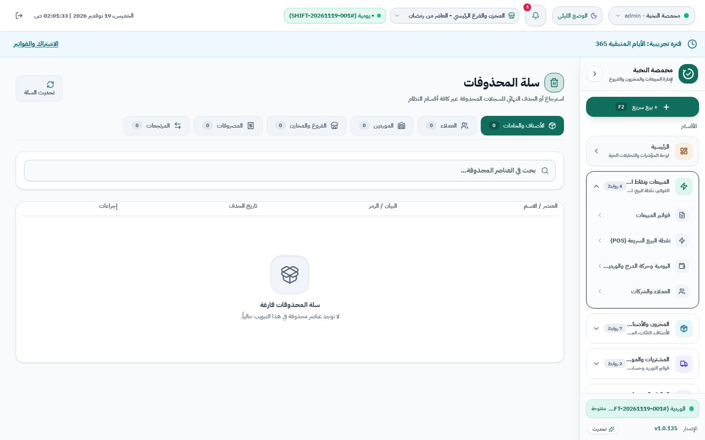
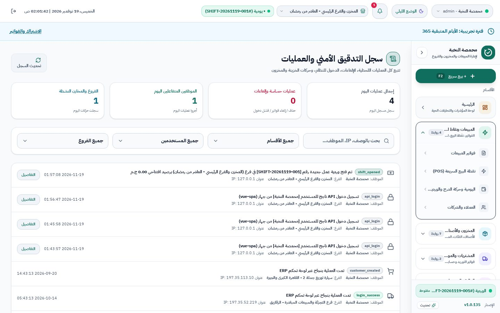
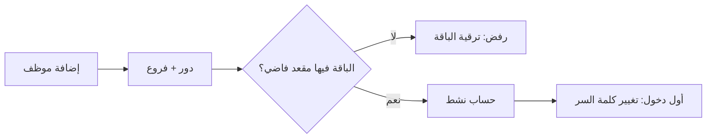

# المستخدمين والصلاحيات والإعدادات

> المجال ده بيجاوب على سؤال: «مين يقدر يعمل إيه جوه إبراء، وإزاي أظبط المحل على شغلي؟». بيغطي حسابات الموظفين، الأدوار، الفروع، شاشة الإعدادات، سلة المحذوفات، سجل النشاط، واستيراد البيانات من Excel.

## الخلاصة في سطور

- كل موظف له حساب بتسجيل دخول برقم الموبايل (أو الإيميل لو مسجّل) وكلمة سر، وله **دور واحد** يحدد إيه المسموح له.
- في **4 أدوار جاهزة**: مدير عام، كاشير، أمين مخزن، محاسب. المدير بياخد كل الصلاحيات الحالية والجاية تلقائي. باقي الأدوار تقدر تعدّل صلاحياتها من شاشة «مصفوفة الصلاحيات».
- أي موظف غير المدير **لازم يتعيّن على فرع واحد على الأقل**، وما بيشوفش ولا بيشتغل إلا على الفروع المعيّن عليها.
- العمليات الحساسة (حذف الفواتير، حذف المرتجعات، البيع تحت الحد الأدنى، تاريخ رجعي، الإعدادات، الاشتراك) مقفولة افتراضيًا على المدير بس، ولو عايز تفتحها لدور تانٍ بتديله الصلاحية بنفسك.
- عدد المستخدمين محدود بالباقة: **التجربة (المجانية) 2، البداية 3، النمو 8، الأعمال 25**.
- الإعدادات في 7 أقسام (عام، الهوية البصرية، الطباعة، المخزون، نقطة البيع والمرتجعات، الإشعارات، الجهاز والنظام). تيليجرام **مش متاح في الباقة المجانية**، وسجل النشاط **متاح في «النمو» و«الأعمال»** (أو بإضافة مدفوعة).

## مين بيستخدمه

| الدور | بيستخدمه إزاي |
|---|---|
| صاحب المحل / المدير العام | بيفتح الحسابات، يوزّع الفروع، يضبط الإعدادات، يراجع سجل النشاط، يسترجع المحذوفات |
| مدير فرع بصلاحية «إدارة المستخدمين» | بيضيف موظفين لفروعه بدون ما يبقى مدير عام (بقيود، موضحة تحت) |
| أي موظف | بيعدّل بياناته وكلمة سره وPIN الموافقة من «الملف الشخصي» |

## الشاشات

| الشاشة | بتعمل إيه | مين يدخلها |
|---|---|---|
| المستخدمون | قائمة الموظفين، بحث وفلتر بالدور، إضافة وتعديل وتعطيل وحذف، إعادة تعيين كلمة السر، فتح الحساب المقفول، ضبط PIN | صلاحية إدارة المستخدمين والأدوار |
| مصفوفة الصلاحيات | اختيار دور وتحديد/إلغاء صلاحياته بالتفصيل | نفس الصلاحية |
| الإعدادات | بيانات المحل، الطباعة، المخزون، سياسات البيع، تيليجرام، المظهر | صلاحية إدارة الإعدادات |
| سلة المحذوفات | استرجاع أو مسح نهائي لما اتحذف | صلاحية سلة المحذوفات |
| سجل النشاط | مين عمل إيه ومتى، مع فلاتر وتصدير Excel | صلاحية عرض السجل + الباقة |
| استيراد البيانات | رفع ملف Excel/CSV للأصناف والعملاء والموردين والتصنيفات | حسب نوع البيانات (موضح تحت) |
| الملف الشخصي | الاسم، الموبايل، الإيميل، كلمة السر، لغة الواجهة، الوضع الليلي/الفاتح، PIN الموافقة | أي مستخدم مسجّل دخول |

## لقطات من الشاشات

*المستخدمين*

*الأدوار والصلاحيات*

*الإعدادات*

*استيراد البيانات من Excel*

*سلة المحذوفات*

*سجل النشاط*

## رحلات العمل خطوة بخطوة

### 1. إضافة موظف جديد

1. من «المستخدمون» اضغط «إضافة موظف جديد».
2. اكتب الاسم الكامل، رقم الموبايل (هو اسم الدخول، ولازم يكون غير مكرر)، الإيميل (اختياري)، وكلمة سر لا تقل عن 8 حروف.
3. اختار **الدور الوظيفي** (كاشير، محاسب...).
4. اختار **الفروع المعيّن عليها** (لازم واحد على الأقل لغير المدير)، وبعدين «الفرع الافتراضي» من بين المختارين. لو ما اخترتش افتراضي، النظام بياخد أول فرع.
5. احفظ. الحساب بيتفتح «نشط» من الأول، والموظف **هيُطلب منه يغيّر كلمة السر أول ما يدخل** (لأن اللي حطها أنت مش هو).

مثال: صاحب محل عنده فرعين (المعادي والتجمع) وعايز كاشير للمعادي بس. بيضيف «منى سعيد» بدور كاشير ومعيّنة على فرع المعادي فقط. منى مش هتشوف فاتورة ولا خزنة ولا مخزون التجمع.

### 2. تعطيل موظف (مثلًا سيب الشغل)

- من قائمة المستخدمين اضغط تبديل الحالة. الحساب بيتحول «معطل»، **وكل جلساته المفتوحة بتتقفل فورًا** على كل الأجهزة.
- مش هتقدر تعطّل حسابك أنت.
- التعطيل هو الأفضل من الحذف (شوف «القواعد التجارية»).

### 3. موظف نسي كلمة السر

1. من القائمة اختار «إعادة تعيين كلمة المرور».
2. النظام بيولّد **كلمة سر مؤقتة** وبيعرضها لك **مرة واحدة بس**: انسخها وسلّمها للموظف.
3. كل جلساته القديمة بتتقفل، وأول ما يدخل بالمؤقتة بيُجبر يغيّرها.
4. العملية بتتسجل في سجل النشاط (من غير كلمة السر نفسها).
- مش هتقدر تعيد تعيين كلمة سر حسابك أنت من هنا، استخدم «الملف الشخصي».

### 4. حساب اتقفل بعد محاولات خاطئة

بعد 5 محاولات دخول غلط (الرقم الافتراضي) الحساب بيتوقف 15 دقيقة، ويتبعت تنبيه على تيليجرام لو متفعّل. المدير يقدر يضغط «فتح تسجيل الدخول» من شاشة المستخدمين بدل ما يستنى. إعادة تعيين كلمة السر بتفتح القفل برضه.

### 5. تعديل صلاحيات دور

1. «مصفوفة الصلاحيات» ← اختار الدور.
2. علّم أو شيل العلامة من الصلاحيات (فيه «تحديد الكل / إلغاء الكل»).
3. «حفظ الصلاحيات». التغيير بيسري على كل الموظفين اللي بالدور ده، والعملية بتتسجل (مين، أي دور، إيه اللي اتضاف واتشال).

## القواعد التجارية

### تسجيل الدخول والأمان
- الدخول بالموبايل أو الإيميل + كلمة السر. كلمة السر الجديدة 8 حروف على الأقل.
- في «دخول سريع» بدون كلمة سر، لكنه **لبيئة الاختبار فقط** ومش بيدخل على شاشات الإدارة (المستخدمين، الإعدادات، سلة المحذوفات).
- شاشة القفل: بعد مدة خمول (تتظبط من الإعدادات) بتظهر شاشة تطلب كلمة السر أو PIN المستخدم.

### حدود الباقة (المستخدمين)
- العدّاد بيحسب **كل الحسابات، النشطة والمعطلة**. يعني تعطيل موظف **مش بيفضّي مقعد**.
- لو وصلت للحد، إضافة موظف جديد بتترفض لحد ما ترقّي الباقة أو تحذف حساب قديم.
- الحساب المحذوف **بيفضّي المقعد** (بيتخرج من العدّاد)، لكن مفيش شاشة لاسترجاعه.

### من يقدر يغيّر مين (حماية من التصعيد)
- **المدير العام فقط** يقدر ينشئ مدير عام آخر أو يعدّل/يعطّل/يحذف/يعيد تعيين كلمة سر مدير.
- مدير فرع بصلاحية «إدارة المستخدمين» **ما يقدرش** يدّي دور فيه صلاحيات هو نفسه ما بيملكهاش، ولا يعيّن موظف على فرع هو مش واصل له، ولا يغيّر بيانات دخول موظف أقوى منه أو في فرع مش بتاعه.
- ما يقدرش يعدّل دور هو نفسه عليه، ولا يمنح صلاحية ما معاهوش.
- **ما تقدرش تحذف أو تعطّل حسابك أنت.**

### حذف المستخدم
- الحذف بيفشل لو الموظف له عمليات أو فواتير مسجلة باسمه. وقتها عطّله بدل ما تحذفه.

### الفروع (Branch scoping)
- كل طلب في النظام بيشتغل على **فرع واحد نشط** (الفرع اللي المستخدم مختاره من أعلى الشاشة).
- المستخدم العادي يختار بس من: فرعه الافتراضي + الفروع المعيّن عليها. أي محاولة لفرع تاني بتترفض.
- **المدير**، أو من عنده صلاحية «إدارة الفروع»، يشوف كل الفروع. وصلاحية «عرض كل الفروع مجمعة» بتدّي قراءة كل الفروع مع بعض (تقارير مجمعة) من غير ما تدّي حق التعديل فيها.
- موظف مش معيّن على أي فرع ولا ليه صلاحية «كل الفروع» بيظهر له تنبيه إنه غير معيّن على فرع، وكل شغله بيتوقف لحد ما المدير يعيّنه.
- فواتير ومرتجعات ومصروفات الفرع ما بتظهرش لموظف فرع تاني (حتى في سلة المحذوفات).

### PIN موافقة المدير
- الحد الأقصى لخصم الكاشير بيتحدد لكل فرع. لو الكاشير عدّى الحد، أو باع بأقل من الحد الأدنى لسعر الصنف، أو ألغى فاتورة فيها دفع كاش، المطلوب **PIN المدير**.
- اللي معاه صلاحية «تخطي الحد» (خصم أعلى أو سعر أقل) مش محتاج PIN، وده مقفول افتراضيًا على المدير العام.
- المدير بيضبط PIN لنفسه من «الملف الشخصي» (محتاج كلمة سره الحالية)، أو يضبطه لموظف من شاشة المستخدمين. بعد محاولات PIN غلط PIN المدير بيتقفل لباقي اليوم ويتبعت تنبيه على تيليجرام.

## الصلاحيات

### الأدوار الجاهزة

| الدور (الاسم في النظام) | الغرض |
|---|---|
| مدير عام (كامل الصلاحيات) | كل حاجة، حالية ومستقبلية، ومش محتاج تعديل يدوي |
| كاشير مبيعات (نقطة البيع وفواتير) | يبيع، يقفل ورديته، يتعامل مع العملاء |
| أمين مخزن (أصناف وتوريدات) | يستلم مشتريات، يحوّل بين الفروع، يتعامل مع الموردين |
| محاسب مالي (تقارير وكشوفات) | يراجع التقارير والمصروفات وكشوف الحسابات |

- ده الوضع **الافتراضي عند فتح محل جديد**. بعد كده تقدر تغيّر صلاحيات الكاشير والمحاسب وأمين المخزن من المصفوفة.
- **أدوار مخصصة جديدة**: الشاشات الحالية بتسمح بـ**تعديل صلاحيات الأدوار الموجودة** واختيار أي دور موجود وقت إنشاء الموظف. مفيش زرار «إنشاء دور جديد» في الشاشة (شوف «حدود وملاحظات»).

### مصفوفة الصلاحيات حسب المجال

رمز ✔ = الدور بياخد الصلاحية افتراضيًا. المدير العام ✔ في كل الصفوف. «-» = مقفولة افتراضيًا.

| المجال | الصلاحية بالعربي | مدير | كاشير | أمين مخزن | محاسب |
|---|---|:-:|:-:|:-:|:-:|
| **المبيعات** | الدخول لشاشة نقطة البيع | ✔ | ✔ | — | — |
| | عرض سجل فواتير المبيعات | ✔ | ✔ | — | ✔ |
| | إنشاء واعتماد فواتير | ✔ | ✔ | — | — |
| | تعديل فاتورة معتمدة | ✔ | — | — | — |
| | إلغاء فاتورة (وعكس المخزون) | ✔ | — | — | — |
| | حذف/أرشفة فاتورة | ✔ | — | — | — |
| | منح خصومات للعملاء | ✔ | — | — | — |
| | خصم أعلى من حد الفرع بدون PIN | ✔ | — | — | — |
| | بيع بأقل من الحد الأدنى للسعر بدون PIN | ✔ | — | — | — |
| **المرتجعات** | إدارة مرتجعات المبيعات والمشتريات | ✔ | ✔ | ✔ | — |
| | مرتجع بدون فاتورة أصلية | ✔ | — | — | — |
| | قبول مرتجع بعد انتهاء المدة | ✔ | — | — | — |
| | حذف مستند مرتجع | ✔ | — | — | — |
| **الأصناف والمخزون** | عرض الأصناف والأسعار | ✔ | ✔ | ✔ | ✔ |
| | رؤية التكلفة وهامش الربح | ✔ | — | ✔ | ✔ |
| | إضافة صنف | ✔ | — | — | — |
| | تعديل صنف وأسعاره | ✔ | — | — | — |
| | أرشفة/حذف صنف | ✔ | — | — | — |
| | تسوية الرصيد يدويًا (جرد) | ✔ | — | — | — |
| | عرض أذونات التحويل بين الفروع | ✔ | — | ✔ | — |
| | إنشاء إذن تحويل | ✔ | — | ✔ | — |
| **المشتريات** | عرض فواتير المشتريات | ✔ | — | ✔ | ✔ |
| | تسجيل مشتريات | ✔ | — | ✔ | — |
| | أرشفة فاتورة مشتريات | ✔ | — | — | — |
| | إدارة الموردين | ✔ | — | ✔ | ✔ |
| | كشف حساب مورد | ✔ | — | ✔ | ✔ |
| **العملاء** | إدارة العملاء | ✔ | ✔ | — | ✔ |
| | كشف حساب عميل | ✔ | ✔ | — | ✔ |
| | حذف عميل | ✔ | — | — | — |
| **الخزينة** | عرض اليومية والخزينة والورديات | ✔ | ✔ | — | ✔ |
| | فتح وتقفيل الورديات | ✔ | ✔ | — | ✔ |
| | إدارة الخزينة والتحويل بين الخزن | ✔ | — | — | — |
| | المصروفات (تسجيل/تعديل/حذف) | ✔ | — | — | ✔ |
| | تاريخ مستند قبل يوم العمل الحالي | ✔ | — | — | — |
| **التقارير** | التقارير المالية والأرباح ومقارنة الفروع | ✔ | — | — | ✔ |
| **الفروع** | إدارة الفروع وتعيين الموظفين | ✔ | — | — | — |
| | عرض كل الفروع مجمعة | ✔ | — | — | — |
| **الإعدادات والمستخدمون** | إدارة المستخدمين والأدوار | ✔ | — | — | — |
| | إدارة إعدادات المحل والطباعة والتكاملات | ✔ | — | — | — |
| | سلة المحذوفات | ✔ | — | — | — |
| | سجل العمليات | ✔ | — | — | — |
| | الاشتراك والفواتير والدفع | ✔ | — | — | — |

ملاحظات على المصفوفة:
- الجدول بيعكس الإعداد الأولي. أي تعديل بتعمله من «مصفوفة الصلاحيات» على محلك بيتقدّم عليه.
- أمين المخزن **مش بيعدّل الأصناف ولا الأسعار ولا التكلفة** (قرار مقصود: ده للمدير)، لكنه بيشوف التكلفة عشان يسجّل المشتريات.
- حتى لو الدور له صلاحية، بعض الشاشات محتاجة **ميزة في الباقة** (مثلًا التحويلات بين الفروع غير موجودة في الباقة المجانية، والتقارير المتقدمة والسجل في «النمو» وفوق).
- ممنوع على غير المدير يمنح صلاحية هو ما يملكهاش، ومش بيقدر يعدّل صلاحيات دور المدير.

### العمليات الحساسة المحجوزة للمدير افتراضيًا

- حذف الفواتير وإلغاؤها وتعديل الفواتير المعتمدة.
- حذف العملاء ومستندات المرتجع، والمرتجع بدون فاتورة أو بعد انتهاء المدة.
- البيع تحت الحد الأدنى للسعر، والخصم فوق حد الفرع بدون PIN.
- تسجيل مستند بتاريخ رجعي.
- تسوية المخزون يدويًا، إنشاء/تعديل/حذف الأصناف.
- الإعدادات، الهوية البصرية والشعار، الاشتراك والدفع، المستخدمون والأدوار، سلة المحذوفات، سجل النشاط، إدارة الفروع.
- كل دي مفروضة **من السيرفر** وليس بإخفاء الأزرار بس.

## الإعدادات المتاحة

الدخول من «الإعدادات». على الموبايل بتظهر الأقسام كبطاقات تدخل عليها، وعلى الكمبيوتر قائمة جنب النموذج. فيه بحث سريع عن أي إعداد، وزرار «إظهار الإعدادات المتقدمة». لو عدّلت وخرجت من غير حفظ بيحذّرك. من غير صلاحية الإعدادات بتشوف الشاشة للقراءة بس.

| القسم | الخيارات | بتأثر في الشغل إزاي |
|---|---|---|
| **عام: هوية المنشأة** | اسم النشاط (إجباري)، الوصف الفرعي، الهاتف الرسمي، العنوان | بتظهر على الفواتير والإيصالات |
| **عام: بيانات قانونية** | السجل التجاري، رقم التسجيل الضريبي | بتظهر في ترويسة فاتورة A4 (فاضي = السطر مخفي) |
| **عام: اللغة والتوقيت** | العملة (جنيه، ريال سعودي، درهم، دينار كويتي، ريال قطري، دولار)، المنطقة الزمنية، اللغة الافتراضية، شكل الأرقام، **بداية اليوم التجاري** | العملة على كل المبالغ. «بداية اليوم التجاري» (مثلًا 05:00): مبيعات بعد منتصف الليل لحد الساعة دي بتتحسب على اليوم السابق، ويتأثر بيها تقفيل اليوم والتقارير |
| **الهوية البصرية** | شعار للوضع الفاتح وآخر للداكن، لون النظام (ألوان جاهزة أو كود لون)، ترويسة الإيصال (لحد 6 أسطر، 80 حرف للسطر)، تذييل الإيصال (لحد 500 حرف) | الشعار والألوان في الواجهة والإيصالات. الصور بتتفحص وبتتعاد معالجتها، ومش مقبول SVG ولا GIF ولا ICO (يُفضّل PNG بخلفية شفافة وبحد أقصى 3 ميجا) |
| **الطباعة** | إظهار الشعار، اسم المنشأة، الوصف الفرعي، رصيد العميل على الإيصال الحراري، رمز QR، ملاحظة تذييل الفاتورة | شكل الإيصال الحراري وفاتورة A4 |
| **المخزون** | وحدات القياس المعتمدة (قطعة، كجم، علبة... أو وحدة مخصصة، بترتيب تختاره)، حد النواقص الافتراضي، السماح بالرصيد السالب | الوحدات هي اللي بتظهر عند إضافة صنف. حد النواقص بيطبق على الأصناف اللي ملهاش حد خاص. الرصيد السالب لو اتفعّل يسمح بالبيع والتحويل لما الرصيد يخلص (بيطلب تأكيد) |
| **نقطة البيع والمرتجعات** | طرق الدفع المسموحة (الكاش دايمًا شغال)، أزرار الكاش السريعة (لحد 6 مبالغ)، نسب الخصم السريعة (لحد 4، ما تعدّيش سقف الفرع)، الطباعة التلقائية بعد البيع (بدون / حراري)، عدد نسخ الإيصال (1 لـ 3)، **مدة السماح بالمرتجع بالأيام** (فاضي = بلا حد، أقصاها 3650)، **أقصى أيام لتأخير تاريخ المستند** (لمن عنده صلاحية التاريخ الرجعي)، **قفل الشاشة بعد الخمول** (0 إلى 240 دقيقة، صفر = مقفول)، **الوردية مطلوبة للبيع** (لكل فرع) | تتحكم في شاشة الكاشير. الوردية المطلوبة معناها ما فيش بيع بدون وردية مفتوحة، وما ينفعش تلغيها وفيه وردية مفتوحة في الفرع |
| **الإشعارات (تيليجرام)** | تفعيل الإشعارات، توكن البوت، معرف المحادثة، زرار «إرسال رسالة تجريبية» | شوف قسم تيليجرام تحت |
| **الجهاز والنظام** | المظهر (فاتح/داكن)، ألوان الواجهة، تفضيلات الجهاز | تفضيل شخصي للجهاز ده |

ملاحظات سريعة:
- **الترقيم**: مفيش إعداد في الشاشة لتغيير شكل أرقام الفواتير أو بدايتها (الترقيم تلقائي).
- **الضريبة**: الإعدادات بتحفظ **رقم التسجيل الضريبي** وبيتطبع، ومفيش في الشاشة نسبة ضريبة قيمة مضافة قابلة للضبط.
- **سقف الخصم لكل فرع** و**مفاتيح البيع السريعة (POS)** بتتظبط من شاشة الفروع، مش من الإعدادات العامة، وليها صلاحية الإعدادات + الوصول للفرع.
- **واتساب**: مفيش إعداد. زرار «مشاركة الفاتورة عبر واتساب» بيظهر في تفاصيل الفاتورة وشاشة البيع، وبيفتح واتساب برسالة جاهزة فيها رقم الفاتورة والإجمالي والمدفوع والمتبقي. الميزة متاحة في كل الباقات.

### تيليجرام (متاح في الباقات المدفوعة فقط)
- بتعمل بوت من تيليجرام، وتحط توكنه ومعرف المحادثة (شخص أو جروب) في الإعدادات، وتجرّب «رسالة تجريبية».
- **التوكن يتحفظ مشفّر ومش بيتعرض تاني**؛ اتركه فاضي عند الحفظ ليبقى القديم. لو مفتاح التشفير اتغير على السيرفر هتحتاج تكتبه من جديد (بيظهر تنبيه).
- اللي بيتبعت: ملخص نهاية اليوم التجاري (مرة يوميًا بعد ما اليوم يخلص بتوقيت المحل)، تنبيه ورديات مفتوحة أكتر من 24 ساعة (مرة لكل وردية)، تنبيه قفل حساب بعد محاولات دخول غلط، تنبيه قفل PIN المدير. تنبيه النواقص اليومي موجود لكنه **مقفول افتراضيًا على مستوى المنصة**.
- المحل اللي ما حطّش البوت الخاص به **ما بيبعتش له حاجة**.

## سلة المحذوفات

- بتعرض 6 تبويبات: **الأصناف، العملاء، الموردين، الفروع، المصروفات، المرتجعات**.
- **الاسترجاع** متاح لكل التبويبات **ماعدا المرتجعات** (لأن حذف المرتجع بيعكس أثره على المخزون والخزنة، واسترجاعه معناه إعادة تطبيق على رصيد اتغيّر).
- **المسح النهائي** متاح بعد كده (الصنف يختفي تمامًا). مسح عميل أو مرتجع نهائيًا محتاج كمان صلاحية «حذف العميل» أو «حذف المرتجع».
- الاسترجاع بيحترم حد الباقة: صنف/فرع/عميل/مورد مرجعه بياخد مكانه تاني، ولو الباقة ممتلئة الاسترجاع بيترفض.
- بحث بالاسم أو الكود، وعدّاد لكل تبويب، وكل صف بيقول «اتحذف من قد إيه».
- حسب الفرع: مصروفات ومرتجعات الفروع التانية ما بتظهرش لموظف مش معيّن عليها. الفروع المحذوفة بيشوفها المدير ومن عنده «إدارة الفروع» بس.
- **مدة الاحتفاظ**: مفيش مسح تلقائي، العناصر بتفضل لحد ما حد يسترجعها أو يمسحها.
- **اللي مش في السلة**: الفواتير (بتتأرشف/تتلغي وتظهر في قائمتها)، والمستخدمون.

## سجل النشاط

- بيسجل: تسجيل الدخول والخروج ومحاولات الدخول الفاشلة وقفل الحساب، إصدار وإلغاء الفواتير، تعديل أسعار الأصناف، المشتريات والمصروفات، تحويلات الخزنة والمخزون، تعديل صلاحيات الأدوار، إعادة تعيين كلمات السر وضبط PIN، تغيير شرط الوردية، والحذف والأرشفة.
- كل سطر فيه: الموظف، الفرع، الوقت، وصف بالعربي، عنوان IP والجهاز، وتفاصيل «قبل/بعد» عند فتح العملية.
- الشاشة فيها 4 مؤشرات لليوم (إجمالي العمليات، الحساسة والإلغاءات، الموظفين النشطين، الفروع النشطة)، عرض «شريط زمني» أو «جدول»، فلتر بالقسم والإجراء والموظف والفرع والفترة، بحث، وتصدير Excel.
- **مين يشوفه**: صلاحية «عرض السجل» (المدير افتراضيًا)، وكمان **الباقة لازم تشمله**. وكل مستخدم يشوف سجلات الفروع المسموح له بيها.
- المنصة بتحتفظ بالسجلات سنتين (730 يوم) كمعيار.

## استيراد البيانات

- **بيستورد إيه**: الأصناف (مع رصيد أول المدة وتكلفته اختياريًا)، العملاء (مع الرصيد الافتتاحي وشريحة السعر تجزئة/جملة)، الموردين (مع الرصيد الافتتاحي)، التصنيفات.
- **مين يقدر**: لكل نوع نفس صلاحية إضافته يدويًا: الأصناف والتصنيفات (إضافة صنف)، العملاء (إدارة العملاء)، الموردين (إدارة الموردين)، والمدير لكل الأنواع. غير كده الشاشة بتقول «ملكش صلاحية استيراد».
- **ملف**: Excel (.xlsx) أو CSV، حتى 5 ميجا و**5000 صف** في المرة.

### الخطوات
1. **اختيار النوع** (لازم تكون على فرع محدد، مش «كل الفروع»، لأن رصيد أول المدة بيتضاف للفرع الحالي).
2. **رفع الملف**: حمّل «النموذج» الجاهز وابدأ منه عشان الأعمدة تطابق بالظبط (فيه صف مثال).
3. **المراجعة**: النظام بيقراه من غير ما يحفظ حاجة، ويعرض إجمالي الصفوف وعدد السليم والفيه أخطاء والمكرر، مع فلتر وملاحظة لكل صف. تنبيهات ذكية زي «سعر البيع أقل من التكلفة: هيتباع بخسارة».
4. **التأكيد**: «استيراد N سجل». لو فيه صفوف غلط لازم تعلّم «تخطي الصفوف اللي فيها أخطاء واستيراد الباقي» وإلا مش هيكمل.
5. **النتيجة**.

### أخطاء شائعة
- أعمدة مطلوبة ناقصة، أو ملف فاضي، أو أكتر من 5000 صف.
- رقم مش صحيح أو بكسور أكتر من المسموح، أو سالب.
- شريحة السعر مش «تجزئة» أو «جملة»، أو «صنف موزون» مش «نعم/لا».
- **مكرر**: السجل موجود بالفعل أو متكرر في الملف نفسه، بيتخطى.
- الاستيراد بيتعامل كله مرة واحدة: لو حصل تعارض (كود مكرر اتعمل في نفس اللحظة) **مفيش حاجة بتتستورد** وترفع الملف تاني.
- جلسة الاستيراد بتنتهي، ولو انتهت ارفع الملف تاني. ونفس الملف ما ينفعش يتأكد مرتين في نفس الوقت.
- حد الاستخدام: 20 عملية في الدقيقة.
- الاستيراد بيحترم حدود الباقة (مثلًا المجانية 100 صنف و50 عميل و20 مورد).

## حسب الباقة

| البند | التجربة (مجانية) | البداية | النمو | الأعمال |
|---|:-:|:-:|:-:|:-:|
| حد المستخدمين | 2 | 3 | 8 | 25 |
| إشعارات تيليجرام | — | ✔ | ✔ | ✔ |
| سجل النشاط | — | — | ✔ | ✔ |
| مشاركة واتساب | ✔ | ✔ | ✔ | ✔ |
| الاستيراد من Excel | ✔ | ✔ | ✔ | ✔ |
| سلة المحذوفات والأدوار والإعدادات | ✔ | ✔ | ✔ | ✔ |

- سجل النشاط ممكن يتفعّل لباقة أقل عن طريق إضافة «حزمة التحكم» (مع التقارير المتقدمة وإعادة الطلب)، ولو الباقة تشمله بس الصلاحية ناقصة الشاشة بتتقفل برضه.
- حدود الباقة ممكن المسؤول يعدّلها لمحل معين (استثناءات لكل محل).
- قدرات الباقة بتتفحص **من السيرفر**: مفيش لف على الزرار المخفي.

## أسئلة شائعة

**هل أقدر أعمل أكتر من دور لموظف واحد؟**
لا، الموظف له دور واحد. لو محتاج مزيج، عدّل صلاحيات الدور.

**موظف اتعطّل، هل مقعده بيفضى؟**
لا. العدّاد بيحسب النشط والمعطل. لو عايز تفضّي مقعد لازم تحذف الحساب (لو مفيش عمليات باسمه).

**الكاشير عايز يعمل خصم 25% والحد 10%، أعمل إيه؟**
يطلب PIN المدير. أو تديه صلاحية «خصم أعلى من حد الفرع بدون PIN»، أو ترفع حد الخصم للفرع من شاشة الفروع.

**نسيت كلمة سري أنا كمدير؟**
مفيش «إعادة تعيين» لحسابك من نفس الشاشة. استخدم «تغيير كلمة المرور» لو لسه داخل، أو اطلب من مدير تاني. لو مفيش، تواصل مع الدعم.

**الموظف مش شايف أي حاجة بعد ما دخل.**
غالبًا مش معيّن على فرع. افتح حسابه وعيّن له فرع واحد على الأقل.

**ممكن موظف يشوف فرعين بس مش الكل؟**
أيوه: عيّنه على الفرعين.

**مسحت صنف بالغلط؟**
من سلة المحذوفات استرجعه. لو مسحته نهائي مش هيرجع.

**استوردت ملف فيه صفوف غلط، هل اتحفظ حاجة؟**
لا قبل ما تضغط «استيراد». بعد التأكيد بيتحفظ السليم فقط (لو علّمت تخطي الأخطاء).

**ليه تيليجرام مش شغال عندي؟**
اتأكد إنك على باقة مدفوعة، وإن البوت أضيف لمحادثة الجروب، والتوكن ومعرف المحادثة صح (استخدم «رسالة تجريبية»).

## حدود وملاحظات / فرص تطوير

- **مفيش إنشاء دور جديد من الشاشة** (كاشير رئيسي، مشرف...). المتاح تعديل الأدوار الأربعة الموجودة. ده أهم فرصة تطوير في المجال، وشاشة المستخدمين بتتعامل مع أدوار مخصصة بمسمى «دور: ...» لو اتعملت من برا.
- **المستخدم المحذوف مش بيظهر في سلة المحذوفات**، وما فيش واجهة لاسترجاعه.
- **تنظيف سجل النشاط التلقائي لمحلات المستأجرين غير مؤكد** (إعداد الاحتفاظ سنتين موجود لكن ما لقيناش جدولة لمسح سجلات المحل نفسها).
- **سجل النشاط في الباقات الأقل**: الشاشة والتصدير مقفولين بالباقة، وغير موثّق في الكود اللي راجعناه هل التسجيل نفسه بيستمر في الخلفية (يؤثر لو المحل رقّى بعد كده وعايز يشوف التاريخ).
- **تيليجرام: التنبيهات المجدولة** (الملخص اليومي وتنبيه الورديات) ما فيهاش فحص واضح للباقة، فممكن محل مجاني يستلمها لو ضبط البوت قبل كده. اختبار الإرسال اليدوي هو المقفول فعليًا في المجانية.
- **PIN المدير**: شاشة المستخدمين بتطلب 6 أرقام بالظبط، و«الملف الشخصي» بيقول 4–6 أرقام. تضارب بسيط في النص.
- **مفيش ضبط لنسبة الضريبة، ولا لترقيم الفواتير، ولا لقالب واتساب** من الإعدادات.
- **الدخول السريع** مخصص للاختبار، وهناك خيار «الدخول بالبصمة» على التطبيق في نصوص الواجهة، مش موثّق هنا لأنه مش جزء من الإعدادات المتاحة للمدير.
- القيود على الإعدادات (مثل بداية اليوم التجاري وسياسة المرتجع) **بتسري على كل الفروع**، مفيش قيمة مختلفة لكل فرع عدا الوردية المطلوبة وسقف الخصم.

---

### ملحق للفريق التقني (مختصر)

- المصدر: `database/seeders/PermissionsSeeder.php` (الصلاحيات والأدوار)، `lang/ar/permissions.php` و`roles.php` و`users.php` و`settings.php`.
- الباقات: `database/seeders/Catalog/PlanCatalog.php` (`max_users`)، `FeatureCatalog.php` (`audit.logs`, `telegram.notifications`, `whatsapp.share`).
- الأفعال: `app/Actions/Users/*`، `app/Actions/Roles/UpdateRolePermissionsAction.php`، `app/Actions/Trash/*`، `app/Actions/Imports/*`، `app/Services/Import/SpreadsheetReader.php` (`MAX_DATA_ROWS = 5000`).
- نطاق الفرع: `app/Support/ActiveStore.php`، `app/Support/Trash/TrashScope.php`.
- قفل الحساب: `app/Support/Auth/AccountLockout.php` (5 محاولات / 15 دقيقة من `config/rate_limits.php`).
- مسارات الواجهة: `resources/js/router/index.js`.
