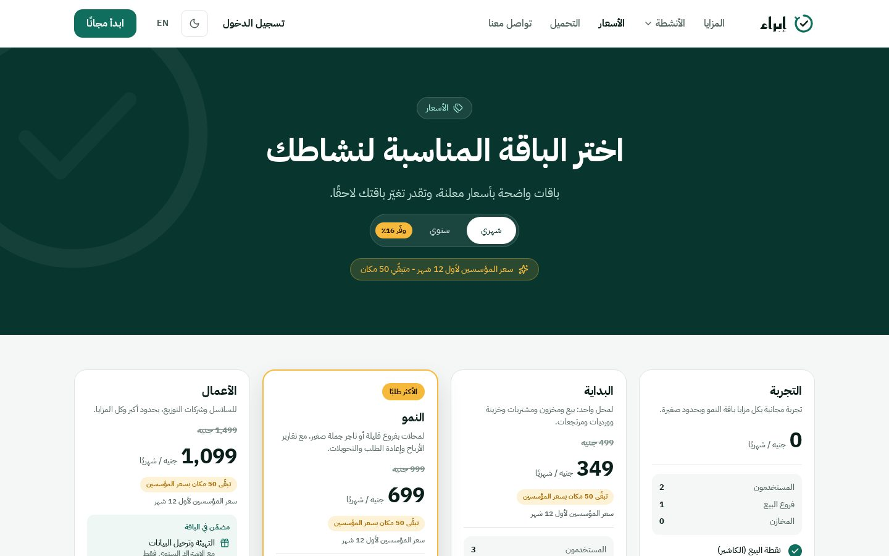
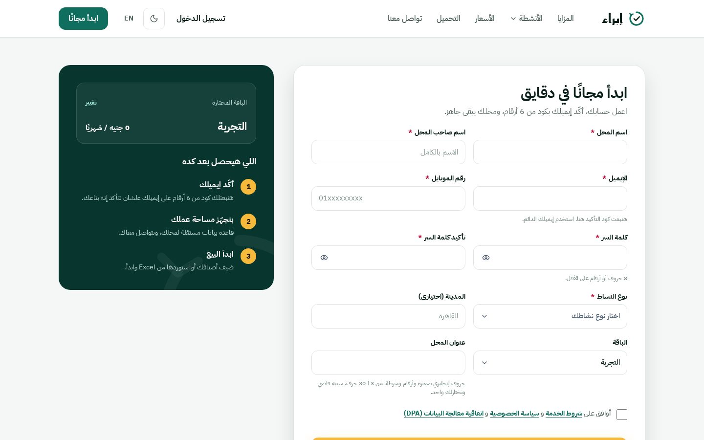
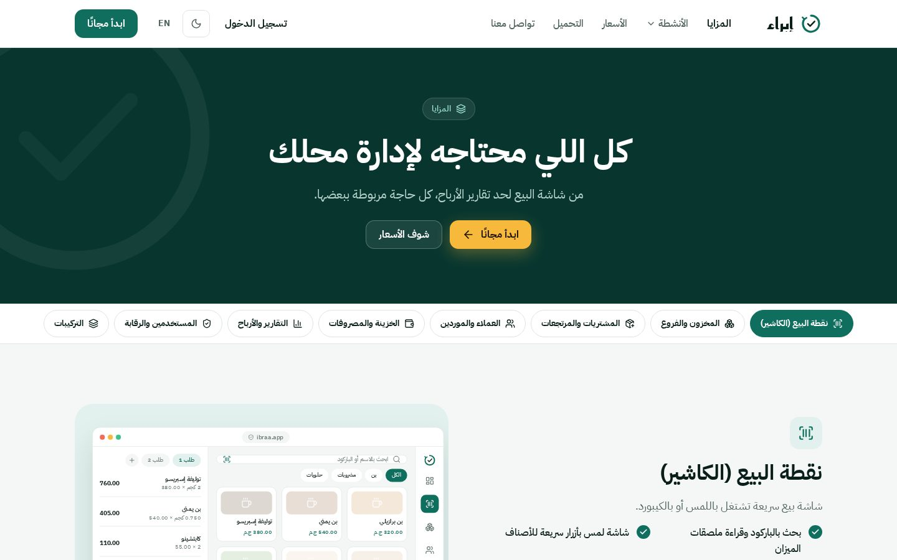
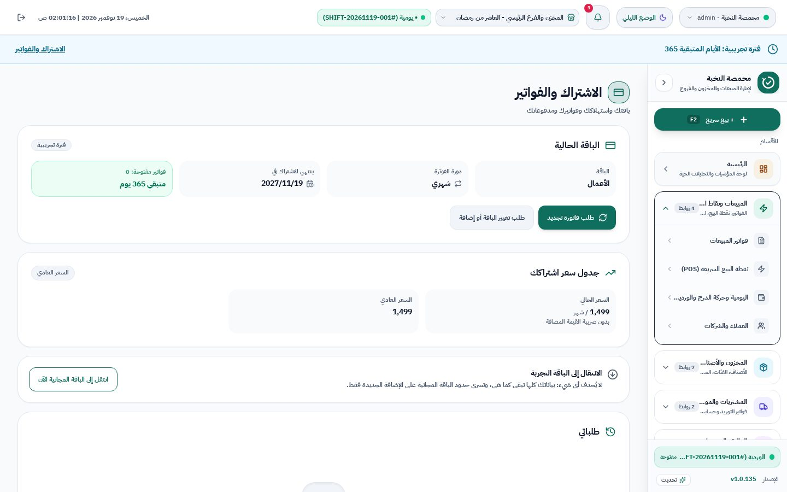
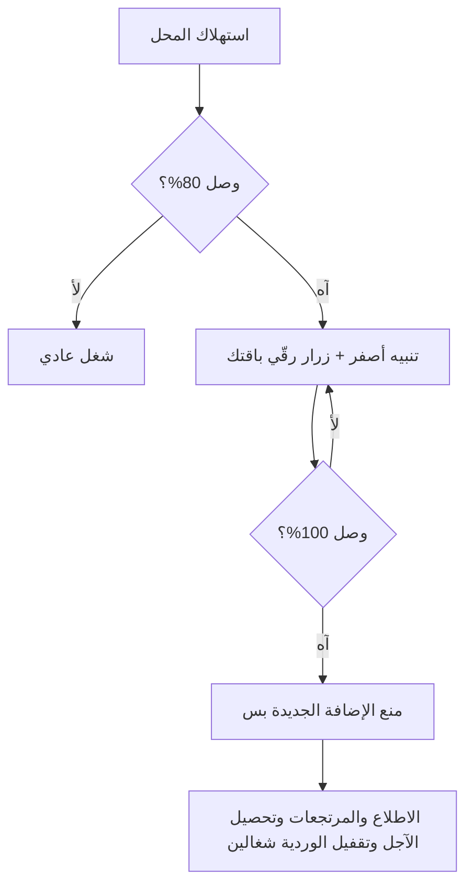
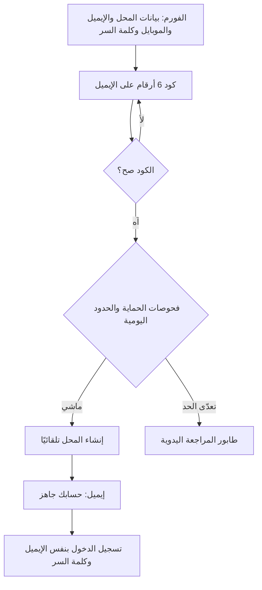
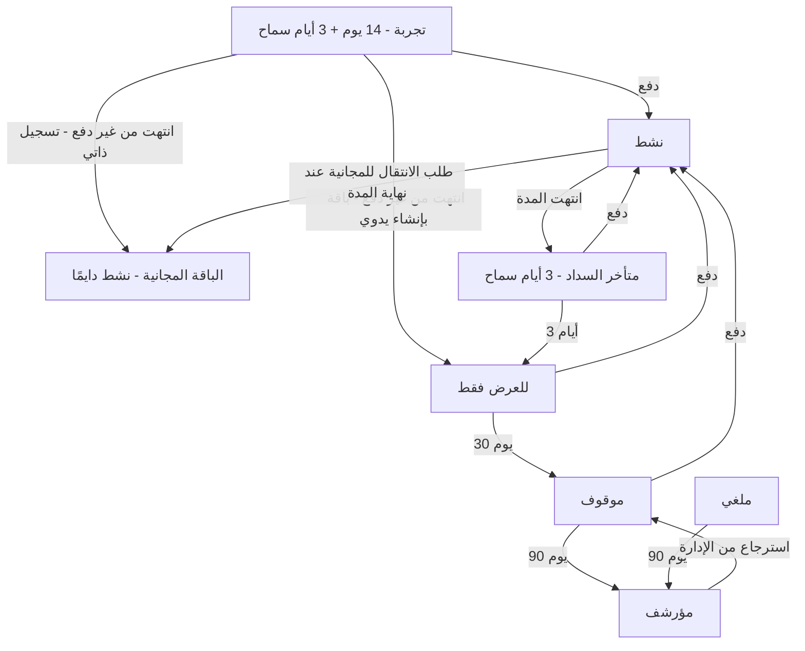

# الباقات والتسجيل والاشتراك ولوحة إدارة المنصة

> الأرقام في الملف ده مأخوذة من الكتالوج الحالي في الكود (تاريخ الكتابة 2026-11-19). كل الأسعار **بدون ضريبة القيمة المضافة (14%)**، الضريبة بتتضاف على فاتورة الاشتراك.

## الخلاصة في سطور

- فيه **4 باقات**: «التجربة» وهي المجانية الدايمة (0 جنيه)، «البداية» (499)، «النمو» (999)، «الأعمال» (1,499)، شهريًا، والسنوي = 10 شهور بس.
- **الباقة المجانية مالهاش تاريخ انتهاء**. الحدود فيها على حجم الشغل (فواتير، أصناف، عملاء…) مش على المزايا الأساسية.
- **التسجيل ذاتي بالكامل**: فورم، كود 6 أرقام على الإيميل، والمحل بيتعمل لوحده من غير موافقة حد، وبيوصل إيميل «محلك جاهز».
- عند الوصول لحد الباقة **بيتمنع الإضافة الجديدة بس**، الاطلاع والمرتجعات وتحصيل الآجل وتقفيل الوردية شغالين دايمًا.
- فريق المنصة بيتحكم في كل حاجة من الكونسول: الباقات، حدود وميزات كل محل لوحده، الفواتير والمدفوعات، وإعدادات التسجيل.
- **المطلوب من صاحب المشروع لسه:** مزوّد إيميل + ضبط DNS لدومين `ibraa.app`. من غيرهم الإيميلات (كود التأكيد وحسابك جاهز) **مش هتوصل للعملاء**.

> **ملاحظة على الأسماء:** الأسماء اللي العميل بيشوفها في الشاشات: «التجربة» (وهي المجانية الدايمة)، «البداية»، «النمو»، «الأعمال». اسم «التجربة» للباقة المجانية الدايمة ممكن يفهّم العميل إنها بتنتهي، ومحتاج يتراجع.

## مين بيستخدمه

| الدور | بيعمل إيه |
|---|---|
| زائر / صاحب محل جديد | بيشوف الأسعار ويسجّل محله بنفسه |
| صاحب المحل / مدير الاشتراك | بيتابع الباقة والاستهلاك، يطلب ترقية، يدفع الفواتير |
| الكاشير والموظفين | بيشوفوا رسايل الحد (مثلًا «وصلت لحد الفواتير الشهر ده») وبيطلبوا من المالك الترقية |
| فريق المنصة (Super Admin) | بيدير المحلات والباقات والفواتير والتسجيل من لوحة منفصلة، ومحمي بالتحقق بخطوتين |

## الشاشات

### عند صاحب المحل والزائر

| الشاشة | بتعمل إيه |
|---|---|
| صفحة الأسعار (موقع التسويق) | عرض الباقات شهري/سنوي، جدول مقارنة الحدود والمزايا، الإضافات، جدول أسعار المؤسسين، مقارنة باقتين |
| صفحة التسجيل | فورم التسجيل، شاشة الكود، شاشة «بنجهّز محلك» |
| الاشتراك والفواتير (داخل المحل) | الباقة الحالية، الاستهلاك والحدود، الإضافات، الفواتير، دفع فاتورة (رفع إيصال)، طلب تغيير باقة أو إضافة، طلب فاتورة تجديد، الانتقال للمجانية |
| ويدجت «استهلاك باقتك» (الداشبورد) | أشرطة استهلاك لكل حد، أصفر عند الاقتراب، وزرار «رقّي باقتك» |
| شريط الفواتير الشهرية في الكاشير | تنبيه قبل ما فواتير الشهر تخلص، ورسالة واضحة لما تخلص |
| شريط الاشتراك + جرس التنبيهات | عدّاد أيام التجربة/الاشتراك، أيام السماح، حالة «للعرض فقط» |

### عند فريق المنصة

| الشاشة | بتعمل إيه |
|---|---|
| الداشبورد | أرقام عامة، توزيع المحلات على الباقات، آخر المحلات |
| المحلات (قائمة + تفاصيل محل) | بحث وفلترة، حالة المحل، تغيير الحالة، تمديد التجربة، أرشفة/استرجاع، نسخ احتياطية، إعادة تعيين كلمة سر المالك، وحدات القياس، استثناءات المحل |
| الباقات | تعديل الأسعار والحدود والمزايا، علامة «باقة مجانية دائمة»، سجل التغييرات، «هيأثر على N محل» |
| محلات قربت من الحد | قائمة فرص الترقية |
| طلبات تغيير الباقة | مراجعة طلبات الترقية/الإضافات وإصدار فاتورة الفرق |
| الفواتير والمدفوعات | فواتير الاشتراك، مراجعة إيصالات الدفع (قبول/رفض)، تسجيل دفع يدوي، إلغاء فاتورة |
| سجل التسجيلات | مين سجّل، اتأكد إمتى، اتعمل إمتى، أخطاء، الطابور اليدوي، إيقاف محل |
| إعدادات المنصة | البراند، باقة التسجيل الافتراضية، باقة ما بعد التجربة، مدة التجربة، تشغيل/إيقاف التسجيل، الحد اليومي |
| إصدارات التطبيق | رفع نسخ APK وتفعيلها وحذفها |
| الوحدات | وحدات القياس على مستوى المنصة |

## لقطات من الشاشات

*صفحة الأسعار والباقات*

*صفحة التسجيل الذاتي*

*صفحة المزايا*

*الاشتراك والفواتير داخل المحل*

## الباقات والأسعار

### الأسعار (بدون ضريبة 14%)

| الباقة | شهري | سنوي (= 10 شهور) |
|---|---|---|
| التجربة (المجانية الدايمة) | 0 | 0 |
| البداية | 499 | 4,990 |
| النمو، «الأكثر طلبًا» | 999 | 9,990 |
| الأعمال | 1,499 | 14,990 |

مثال: محل على «البداية» بيدفع سنويًا 4,990 + ضريبة 14% (698.60) = 5,688.60 جنيه، بدل 5,988 + ضريبة لو دفع شهري 12 مرة.

### جدول أسعار المؤسسين (أول 50 عميل مدفوع)

الفكرة: أول 50 عميل بيدفعوا فعلًا بياخدوا سعر مخفّض **بيتحسب من أول دفعة مؤكدة** (مش من التسجيل ولا من التجربة).

| الباقة | شهور 1–12 (مؤسسين) | شهور 13–24 (انتقالي) | بعد كده |
|---|---|---|---|
| البداية | 349 شهري / 3,490 سنوي | 429 / 4,290 | 499 / 4,990 |
| النمو | 699 / 6,990 | 849 / 8,490 | 999 / 9,990 |
| الأعمال | 1,099 / 10,990 | 1,299 / 12,990 | 1,499 / 14,990 |

- **المكان بيتحجز عند أول دفعة مؤكدة**، ومش بيرجع حتى لو العميل لغى أو الاشتراك خلص.
- سعر المؤسسين على **سعر الباقة بس**، الإضافات دايمًا بسعرها الكامل.
- شاشة الاشتراك في المحل بتعرض «جدول سعر اشتراكك»: السعر الحالي، والخطوة الجاية، وتاريخها. وفيه إشعار قبل ما السعر يتغير (30 يوم).
- لو فاتورة اتصدرت بسعر المؤسسين وبعدها الأماكن خلصت، **الفاتورة الصادرة بتتحترم** ومبتتغيّرش.
- صفحة الأسعار بتعرض «متبقّي X مكان من 50».

### العرض الترويجي (السعر المشطوب)

- مفيش عرض شغال دلوقتي في الكتالوج. صاحب المشروع يقدر يشغّل عرض من الكونسول على أي باقة.
- السعر المشطوب («كان») **بيتعرض بس لو** فيه تاريخ انتهاء للعرض، **وسعر «كان» أعلى من السعر الحقيقي**، واللحظة الحالية جوه فترة العرض.
- السعر المشطوب للعرض بس، **اللي بيتفوتر هو السعر الحقيقي دايمًا**. لو سعر الباقة اتعدّل بعد كده وبقى السعر المشطوب مش أعلى، بيختفي من الصفحة لوحده.
- بيظهر معاه «خصم X٪» و«العرض ينتهي في [تاريخ]».

## الحدود لكل باقة

| البند | التجربة (مجانية) | البداية | النمو | الأعمال |
|---|---|---|---|---|
| المستخدمين | 2 | 3 | 8 | 25 |
| الفروع | 1 | 1 | 3 | 10 |
| المخازن الإضافية | 0 | 1 | 2 | 5 |
| العربيات (Vans) | 0 | 0 | 1 | 5 |
| الأصناف | 100 | بلا حد | بلا حد | بلا حد |
| فواتير البيع في الشهر | 150 | بلا حد | بلا حد | بلا حد |
| العملاء | 50 | بلا حد | بلا حد | بلا حد |
| الموردين | 20 | بلا حد | بلا حد | بلا حد |
| المساحة | 200 MB | 2 GB | 10 GB | 50 GB |

- العميل النقدي (Walk-in) **مش بيتحسب** في حد العملاء.
- عدّاد الفواتير بيتصفّر أول كل شهر (بتوقيت القاهرة).
- كل الأرقام دي بتتعدّل من الكونسول من غير نشر كود. الخانة الفاضية = بلا حد.

## المزايا لكل باقة

المزايا الأساسية (**موجودة في كل الباقات**): الكاشير، إنشاء وتعديل الفواتير، مشاركة واتساب، إدارة الأصناف وحركتها، المشتريات، المصروفات، المدفوعات (آجل وكشوف حساب)، الورديات، الخزنة، المرتجعات، التقارير الأساسية، الطباعة الحرارية وA4.

| الميزة | التجربة (مجانية) | البداية | النمو | الأعمال |
|---|---|---|---|---|
| المزايا الأساسية (القائمة فوق) | نعم | نعم | نعم | نعم |
| تصدير التقارير | لا | نعم | نعم | نعم |
| إشعارات تليجرام | لا | نعم | نعم | نعم |
| التحويلات بين الفروع والمخازن | لا | نعم | نعم | نعم |
| التركيبات (Mixes) | لا | إضافة | نعم | نعم |
| إعادة الطلب (اقتراحات الشراء) | لا | ضمن حزمة الرقابة | نعم | نعم |
| التقارير المتقدمة (الأرباح) | لا | ضمن حزمة الرقابة | نعم | نعم |
| سجل النشاط | لا | ضمن حزمة الرقابة | نعم | نعم |
| الدعم المميز | — | إضافة | إضافة | **مشمول** |
| جلسة التهيئة (Onboarding) | — | إضافة (1,500 مرة واحدة) | إضافة | **مجانية مع الاشتراك السنوي** |

مش متاحة لأي باقة دلوقتي: عروض الأسعار (Quotations)، البيع بدون إنترنت (POS Offline)، الدومين المخصص (مؤجل لمرحلة لاحقة)، والـ API (مخفي ومش بيتباع).

## الإضافات (Add-ons)

كل الأسعار شهري / سنوي (السنوي = 10 شهور)، بدون ضريبة. الإضافات بتتباع على «البداية» و«النمو» و«الأعمال» (مش على المجانية).

| الإضافة | شهري | سنوي | بتدّي إيه |
|---|---|---|---|
| فرع إضافي | 249 | 2,490 | +1 فرع، +1 مستخدم |
| مخزن إضافي | 149 | 1,490 | +1 مخزن |
| عربية إضافية | 249 | 2,490 | +1 عربية، +1 مستخدم |
| مستخدم إضافي | 79 | 790 | +1 مستخدم |
| مساحة 10 GB | 49 | 490 | +10 GB |
| التركيبات (Mixes) | 199 | 1,990 | ميزة التركيبات (على «البداية» بس؛ «النمو» فيها أصلًا) |
| حزمة الرقابة (Control Bundle) | 199 | 1,990 | التقارير المتقدمة + سجل النشاط + إعادة الطلب (لـ«البداية») |
| الدعم المميز | 299 | 2,990 | دعم أولوية |
| جلسة التهيئة | 1,500 مرة واحدة | — | خدمة |

**خصم الكمية** (بيتطبّق على **كل** الكمية لما توصل للحد، مش على الزيادة بس):
- فرع/عربية: 249 للواحدة، **212** من الكمية 3، **187** من الكمية 6 (شهري).
- مستخدم إضافي: 79، و**59** من المستخدم السادس.

مثال: 3 فروع إضافية شهريًا = 3 × 212 = 636 جنيه (مش 747).

إضافات اتشالت من البيع (بس اللي اشتراها قبل كده بيحتفظ بيها): حزمة 5,000 صنف، وتقارير متقدمة وسجل نشاط كإضافات منفصلة (اتحوّلوا لحزمة الرقابة).

## الباقة المجانية الدائمة

- **0 جنيه، مالهاش تاريخ انتهاء**، مفيش فواتير ولا تجربة، والمحل عليها دايمًا «نشط».
- محدش بيتجبر يرقّي، الحد بس بيمنع الإضافة الجديدة.
- حدودها: مستخدمين 2، فرع واحد، 100 صنف، 50 عميل، 20 مورد، 150 فاتورة بيع شهريًا، 200 MB، من غير مخازن إضافية أو عربيات.
- **المقفول فيها:** تصدير التقارير، إشعارات تليجرام، التحويلات، التركيبات، إعادة الطلب، التقارير المتقدمة، سجل النشاط.
- **الشغال فيها:** كل الأساسي (كاشير، فواتير، آجل وكشوف حساب، ورديات، خزنة، مرتجعات، مشتريات، تقارير أساسية، طباعة، واتساب).
- أي باقة ممكن تتعلّم «مجانية دائمة» من الكونسول (بشرط كل أسعارها صفر وبدون أيام تجربة).

## لما المحل يقرّب من حد الباقة أو يوصله

- **عند 80%**: بيظهر تنبيه أصفر في ويدجت الاستهلاك بالداشبورد، وفي الكاشير لو الحد هو الفواتير الشهرية («استهلكت X من Y فاتورة»). والمحل ده بيظهر في قائمة «محلات قربت من الحد» عند فريق المنصة.
- **عند 100%**: بيتمنع **إنشاء الجديد بس** (فاتورة بيع، صنف، عميل، مورد، مستخدم، رفع ملف) برسالة واضحة وزرار «رقّي باقتك». للكاشير الرسالة بتقول يطلب من المالك.
- **اللي بيفضل شغال:** الاطلاع على كل البيانات، التقارير، **المرتجعات**، **تحصيل الآجل**، **تقفيل الوردية**.
- **الفروع والمخازن والعربيات «مخصصات» مش تنبيهات**: الفرع الواحد في المجانية هو «1 من 1» من أول يوم، فمش بيطلّع تحذير ولا بيدخل قائمة فرص الترقية. المنع بيحصل بس لما تحاول تضيف واحد زيادة.
- لو المحل نزل لباقة أصغر وعنده بيانات فوق الحد: **مفيش حاجة بتتمسح**، بس مايقدرش يضيف لحد ما ينزل تحت الحد أو يرقّي.
- رسالة الفواتير الشهرية بتقول تاريخ بداية العدّاد الجديد (أول الشهر الجاي).

مثال: محل مجاني عمل 120 فاتورة من 150 → 80% → تنبيه أصفر. وصل 150 → بيع جديد متوقف لحد أول الشهر الجاي أو الترقية، لكن لو زبون رجّع أصناف أو سدّد آجل أو الكاشير قفل ورديته، كله بيشتغل عادي.

## رحلة التسجيل الذاتي

1. **الفورم:** اسم المحل، اسم المالك، الإيميل، الموبايل، **كلمة السر (العميل بيختارها)**، نوع النشاط، المدينة (اختياري)، عنوان المحل (يتقترح من الاسم ويتعدل)، الموافقة على الشروط والخصوصية واتفاقية معالجة البيانات، واختيار الباقة (الافتراضي المجانية).
2. **كود التأكيد:** 6 أرقام على الإيميل، صالح **15 دقيقة**، **5 محاولات** غلط وبيتلغي، إعادة الإرسال بعد **60 ثانية**. بيتخزن مشفّر مش نص.
3. **بعد التأكيد:** المحل بيتجهّز في الخلفية (غالبًا أقل من دقيقة) والشاشة بتعرض «بنجهّز محلك». لو التجهيز اتأخر، العميل بيتبعتله إيميل «محتاجين وقت زيادة» ويقدر يقفل الصفحة.
4. **إيميل «محلك جاهز»:** لينك الدخول، الإيميل اللي هيدخل بيه، الباقة، وتاريخ نهاية التجربة لو في تجربة. **كلمة السر مش بتتبعت**، لأنه هو اللي اختارها، وفي الإيميل تذكير يستخدم «نسيت كلمة السر» لو محتاج.
5. **الدخول:** بنفس الإيميل وكلمة السر.

### الباقة المدفوعة وقت التسجيل (تجربة)

- لو العميل اختار باقة مدفوعة: بياخد **تجربة 14 يوم** على الباقة دي بمزاياها وحدودها (المدة قابلة للتعديل من الإعدادات).
- لو التجربة خلصت **من غير دفع** → المحل **ينزل للباقة المجانية تلقائيًا** (مش للعرض فقط) وبياناته كلها محفوظة.
- قبل نهاية التجربة بـ 7 أيام بتتصدر فاتورة الاشتراك الأولى علشان العميل يلحق يدفع.
- لو مفيش باقة مجانية مضبوطة كباقة «ما بعد التجربة»، المحل بيبقى للعرض فقط بعد التجربة.
- المحل اللي فريق المنصة بيعمله بإيده على باقة مدفوعة **مش** بياخد التجربة دي: بيستنى الدفع.

### الحماية من الإساءة

| الحماية | التفاصيل |
|---|---|
| محل مجاني واحد | لكل إيميل ولكل رقم موبايل (الإيميل بيتقارن بعد توحيد النقاط و+tag في Gmail). لو الإيميل عنده محل، بيوصله إيميل «عندك محل بالفعل» مع لينك الدخول بدل ما يتعمل محل جديد |
| إيميلات مؤقتة | دومينات الإيميل المؤقتة (زي mailinator وغيرها) متحجوبة، والقائمة قابلة للتوسعة |
| عناوين محجوزة | أسماء زي admin وapi وwww وsupport وbilling وغيرها مينفعش تتاخد كعنوان محل |
| أسماء فيها لينكات | الأسماء اللي فيها لينكات أو إيميلات أو أسماء مواقع مرفوضة |
| سقف أكواد التأكيد | 5 أكواد في الساعة لنفس الإيميل من نفس الشبكة، 10 في الساعة و15 في اليوم للإيميل، و1,000 كود في اليوم للمنصة كلها (وبعدها التسجيل يتوقف لحد نص الليل ويوصل تنبيه) |
| الحد اليومي للإنشاء | افتراضي **100 محل في اليوم**؛ الزيادة بتروح **طابور المراجعة اليدوية** (مش بتترفض) ويوصل تنبيه تليجرام |
| سقف الشبكة | **3 محلات في اليوم** لكل شبكة (IPv4 بشبكة /24)؛ الزيادة بتروح للطابور اليدوي |
| تنظيف | التسجيلات اللي ماتأكدتش بتتمسح بعد 24 ساعة؛ الأسرار وعنوان الـ IP للتسجيلات المنتهية بتتمسح بعد 30 يوم |
| إيقاف عام | الكونسول فيها مفتاح «التسجيل الذاتي» لإيقاف التسجيل كله مؤقتًا |

## دورة حياة الاشتراك والحالات

حالة المحل هي اللي بتحدد الوصول. المحل اللي على باقة مجانية **مبيمرّش بالدورة دي**، هو «نشط» دايمًا (إلا لو اتأرشف بسبب الخمول، أو الأدمن أوقفه).

| الحالة | اللي بيشوفه صاحب المحل | بتتغير إمتى |
|---|---|---|
| **تجربة (trial)** | شغال بكل مزايا الباقة، وشريط «الأيام المتبقية». تذكيرات قبل النهاية بـ 7 و3 و1 يوم | 14 يوم + **3 أيام سماح بوصول كامل**، وبعدها: ينزل للمجانية (تسجيل ذاتي) أو يبقى للعرض فقط |
| **نشط (active)** | شغال بالكامل. تذكيرات تجديد قبل النهاية بـ 7 و3 و1 يوم | لحد نهاية المدة المدفوعة |
| **متأخر السداد (past_due)** | **لسه شغال بالكامل** مع تنبيهات «جدّد قبل ما الحساب يتحول للعرض فقط» وعدّاد أيام السماح | **3 أيام** بعد نهاية المدة، وبعدها للعرض فقط |
| **للعرض فقط (read_only)** | يشوف بياناته ويصدّرها، **مفيش إضافة ولا تعديل** (الرسالة بتتغير حسب السبب: انتهت التجربة / في انتظار السداد / انتهى الاشتراك / قرار إدارة). زرار «اطلب الفاتورة» أو «ادفع» | **30 يوم** وبعدها موقوف |
| **موقوف (suspended)** | الدخول ممنوع. لو السبب عدم سداد، بيقدر يدخل مسؤول الاشتراك بس علشان يسدد. الرسالة: كلّم الإدارة أو جدّد | **90 يوم** وبعدها مؤرشف |
| **ملغي (cancelled)** | الدخول ممنوع؛ كلّم الإدارة لإعادة التفعيل | 90 يوم وبعدها مؤرشف |
| **مؤرشف (archived)** | الدخول ممنوع. **البيانات محفوظة**. بتتاخد نسخة احتياطية نهائية ومتحقق منها قبل الأرشفة | الاسترجاع بيد فريق المنصة. المسح النهائي أمر يدوي مخصوص مش أوتوماتيك |

- أي **دفعة مؤكدة** بترجّع المحل «نشط» من أي حالة غير مؤرشف.
- تمديد التجربة: **مرة واحدة 7 أيام**، بيد فريق المنصة، ولمحل ماسبقلهوش دفع.
- المدد قابلة للتغيير في ملف الإعدادات (مش من الشاشة)؛ مدة السماح (3 أيام) ممكن تتغير بمتغير بيئة.
- الإيقاف بسبب «مخالفة» مش بيتأرشف تلقائيًا أبدًا.

## الفواتير والدفع وتغيير الباقة

### فاتورة الاشتراك والدفع
- فواتير الاشتراك بترقيم `SUB-…` وتستحق خلال **7 أيام** من الإصدار، وفيها بنود وضريبة 14%، وفيها صفحة طباعة/PDF.
- الدفع **يدوي دلوقتي**: العميل بيحوّل (إنستاباي أو فودافون كاش، وفيه بيانات الحساب في شاشة الدفع) ويرفع **إيصال** (JPG/PNG/WEBP/PDF حتى 5 ميجا) مع رقم العملية وتاريخ الدفع.
- فريق المنصة بيراجع الإيصال: **قبول** (بيفعّل الاشتراك) أو **رفض بسبب**. ممكن كمان يسجّل دفع يدوي مباشرة (إنستاباي، فودافون كاش، تحويل بنكي، كاش).
- **دفع جزئي:** لو المبلغ أقل من المتبقي، الحساب **مش بيتفعّل** لحد سداد الباقي (والشاشة بتنبّه العميل).
- العميل يقدر يلغي دفعته وهي لسه قيد المراجعة. فريق المنصة يقدر يلغي (Void) فاتورة.
- بوابات الدفع الإلكتروني (Paymob، Fawry) متعرّفة في النظام كطرق دفع لكن مش مفعّلة للعميل دلوقتي (شوف «حدود وملاحظات»).

### طلب ترقية أو إضافة
- من «الاشتراك والفواتير» العميل بيقدّم **طلب تغيير باقة** أو **طلب إضافة** (الكمية والدورة). **التغيير مش أوتوماتيك**: الدعم بيراجع الطلب ويصدر **فاتورة بالفرق**، والتفعيل بعد السداد.
- طلب مفتوح واحد بس من كل نوع؛ العميل يقدر يلغيه، والإدارة تقدر ترفضه بسبب.
- السعر اللي بيظهر للعميل «للعلم فقط» والفاتورة النهائية بيحددها الدعم.

### الانتقال للباقة المجانية (Downgrade)
- من نفس الشاشة: «انتقل للباقة المجانية عند نهاية مدّتي».
- الانتقال **بيتجدول لنهاية المدة المدفوعة**، والباقة الحالية بتفضل شغالة بكل مزاياها لحد التاريخ ده. لو مفيش مدة مدفوعة شغالة، الانتقال بيحصل فورًا.
- **مفيش حاجة بتتمسح.** بعد الانتقال بتسري حدود المجانية على الإضافة الجديدة بس.
- العميل يقدر **يلغي الجدولة** قبل التاريخ.
- مش متاح لمحل موقوف أو ملغي أو مؤرشف.

## المحلات المجانية الخاملة

| بعد قد إيه من آخر دخول | اللي بيحصل |
|---|---|
| **60 يوم** | إيميل تذكير واحد للمالك: «محلك مستنيك» مع تاريخ الأرشفة المتوقع |
| **90 يوم** | **أرشفة** (بعد نسخة احتياطية نهائية متحقق منها) + إيميل «محلك اتأرشف» |

- **مفيش مسح نهائي أبدًا** بالسياسة دي. البيانات محفوظة وبترجع عند الطلب.
- **استرجاع بخطوة واحدة:** فريق المنصة بيعمل «استرجاع» والمحل المجاني اللي اتأرشف بسبب الخمول بيرجع **نشط مباشرة** (وعدّاد الخمول بيبدأ من جديد).
- الأرشفة بتستنى التذكير: لو العميل ماوصلوش تذكير من 7 أيام على الأقل، التذكير بيتبعت الأول والأرشفة بتتأجل.
- محل مالكه مالوش إيميل صالح **مبيتأرشفش أبدًا** (لأن محدش اتنبّه).
- المحلات المدفوعة والتجريبية والموقوفة مش بتدخل في السياسة دي.
- كل نشاط من العميل (استخدام التطبيق) بيصفّر العدّاد.
- السياسة بتشتغل يوميًا (الساعة 5 الصبح)، وبحد أقصى 25 أرشفة في اليوم الواحد.

## استثناءات المحل (Overrides)

فريق المنصة يقدر يخصّص محل واحد من غير ما يغيّر الباقة:

- **حد مخصص** لأي بند (مستخدمين، فروع، أصناف، فواتير، عملاء، موردين، مساحة…): قيمة معينة أو «غير محدود».
- **منح ميزة** مش في باقته، أو **سحب ميزة** موجودة في باقته.
- لازم **سبب** (3 إلى 255 حرف) بيتسجل في سجل المراجعة، و**تاريخ انتهاء اختياري** (الاستثناء المنتهي بيتجاهل لوحده).
- الشاشة بتعرض لكل بند: قيمة الباقة، الاستثناء، والقيمة **الفعلية**، ومين عملها.
- حذف الاستثناء بيرجّع المحل لقيمة الباقة.
- استخدامات مفيدة: تعويض عميل، تجربة ميزة لعميل، عميل كبير محتاج حد أعلى شوية.

## لوحة إدارة المنصة (للفريق)

- **الدخول:** على دومين الإدارة بس، بحساب مشغّل منفصل، و**التحقق بخطوتين إجباري**. العمليات الحساسة (إنشاء/أرشفة/استرجاع محل، تغيير حالته، تعديل الباقات وإعدادات المنصة، رفع/حذف إصدارات التطبيق، إعادة تعيين كلمة سر المالك، إعادة محاولة التجهيز) بتطلب **إعادة إثبات التحقق بخطوتين** (صالح 15 دقيقة).
- **المحلات:** قائمة بحث وفلترة، تفاصيل المحل (حالته، باقته، إحصائيات، وحدات القياس، فواتيره)، إنشاء محل يدوي، إعادة محاولة تجهيز فاشل، تشغيل الـ migrations، رفع حد المعدل، نسخ احتياطي، وإعادة تعيين كلمة سر المالك.
- **الباقات:** تعديل كل سعر وحد وميزة (بما فيها العملاء والموردين)، علامة المجانية، وعرض ترويجي. **قبل الحفظ** بتظهر رسالة «التعديل ده هيأثر على N محل» لازم تتأكد. وتبويب «السجل» بيعرض آخر التغييرات ومين عملها.
- **محلات قربت من الحد:** كل محل استخدم 80% أو أكتر من أي حد استهلاكي، مرشحين للترقية، ومنها بتفتح المحل مباشرة.
- **الفواتير والمدفوعات وطلبات التغيير:** زي ما اتشرح فوق.
- **إعدادات التسجيل:** باقة التسجيل الافتراضية، باقة «ما بعد التجربة» (الباقات المجانية الدائمة بس)، مدة التجربة، الحد اليومي، مفتاح التسجيل الذاتي.
- **إصدارات التطبيق:** رفع APK وتفعيله وإيقافه.
- **الوحدات:** وحدات القياس على مستوى المنصة وتخصيصها لمحل.
- **المراجعة (Audit):** كل عملية حساسة (دخول المشغلين، تعديل باقة، نقل محل للمجانية، حفظ حد مخصص…) بتتسجل في **سجل مراجعة للإضافة فقط**، مش بيتعدّل ولا بيتمسح. (مفيش شاشة عرض ليه في الواجهة دلوقتي، شوف الملاحظات.)
- **تنبيهات تليجرام:** تسجيل جديد (أو ملخص لو كتير)، الوصول للحد اليومي، فشل تجهيز محل، سقف أكواد الإيميل.

## القواعد التجارية (ملخص)

- كل الأسعار بدون ضريبة؛ الضريبة 14% بتتضاف في الفاتورة. السنوي = 10 شهور.
- المبالغ بتتخزن بدقة 3 خانات عشرية ومبتتحسبش بفاصلة عائمة.
- سعر المؤسسين على الباقة بس، ومكانه بيتحجز عند أول دفعة مؤكدة.
- السعر المشطوب للعرض بس ومبيأثرش على الفاتورة.
- الحدود بتمنع **الإنشاء الجديد** مش القراءة ولا العمليات التصحيحية (مرتجع، تحصيل، تقفيل وردية).
- مفيش بيانات بتتمسح تلقائيًا في أي مرحلة (الأرشفة بتحتفظ بكل حاجة، والمسح النهائي يدوي ومحكوم).
- تعديل باقة بيطبَّق فورًا على كل محلاتها.

## الصلاحيات

- **صاحب المحل ومدير الاشتراك:** يشوف الاشتراك والفواتير، يدفع، يطلب تغيير، يجدول الانتقال للمجانية.
- **باقي الموظفين:** بيشوفوا رسايل الحد ويتوجّهوا للمالك.
- **فريق المنصة:** صلاحيات مقسّمة (إدارة المحلات، الباقات، الفوترة…)؛ المشغّل اللي صلاحيته قراءة بس بياخد «ممنوع» مش طلب تحقق. العمليات الحساسة بتحتاج التحقق بخطوتين الحديث.

## الإعدادات المتاحة (من الكونسول)

| الإعداد | الأثر |
|---|---|
| باقة التسجيل الافتراضية | الباقة اللي بيبدأ بيها محل سجّل من غير ما يختار |
| باقة «ما بعد التجربة» | المجانية اللي ينزل ليها اللي ماداعش |
| مدة التجربة | افتراضي 14 يوم للباقات اللي مالهاش تجربة خاصة |
| الحد اليومي للإنشاء التلقائي | افتراضي 100 |
| التسجيل الذاتي (تشغيل/إيقاف) | افتراضي شغال |
| أسعار/حدود/مزايا كل باقة + العرض الترويجي | من محرر الباقات |

الأرقام الأمنية (سقف الأكواد، سقف الشبكة، قائمة الدومينات المحجوبة والعناوين المحجوزة، مدد الدورة، أيام الخمول) في ملفات الإعدادات على السيرفر ومش من الشاشة.

## أسئلة شائعة

**هل الباقة المجانية بتخلص بعد فترة؟** لأ، دايمة. بتتأرشف بس لو المحل ماحدش دخله 90 يوم، والبيانات بتفضل محفوظة.

**وصلت 150 فاتورة في المجانية، أعمل إيه؟** البيع الجديد بيقف لحد أول الشهر الجاي أو الترقية. المرتجعات وتحصيل الآجل وتقفيل الوردية شغالين.

**هل بيتمسح حاجة لو نزلت لباقة أصغر؟** لأ. بس مش هتقدر تضيف جديد فوق الحد.

**ممكن أسجّل أكتر من محل مجاني بنفس الإيميل أو الموبايل؟** لأ، محل مجاني واحد لكل إيميل ولكل موبايل. محل تاني محتاج الدعم.

**ليه كلمة السر مش في إيميل «حسابك جاهز»؟** لأنك اخترتها بنفسك، وإرسالها بالإيميل أقل أمانًا.

**التجربة خلصت وماداعتش، هيحصل إيه؟** لو سجّلت بنفسك: بتنزل للباقة المجانية وبياناتك محفوظة. لو الأدمن عمل المحل بإيده: بيبقى للعرض فقط لحد الدفع.

**الترقية بتتم إزاي؟** بتقدّم طلب من «الاشتراك والفواتير»، الدعم بيصدر فاتورة الفرق، بتدفع وترفع الإيصال، وبعد تأكيده بتتفعّل.

**سعر المؤسسين بيتحجز إمتى؟** عند أول دفعة مؤكدة، مش عند التسجيل.

**الإضافة بتتحسب بإيه لو اشتريت 3 فروع؟** 212 جنيه للفرع شهريًا (636 إجمالي)، لأن الخصم بيتطبّق على الكمية كلها.

**محلي اتأرشف بسبب الخمول، أرجّعه إزاي؟** كلّم الدعم، بيرجّعه بخطوة واحدة وبيرجع نشط على الباقة المجانية.

## حدود وملاحظات / فرص تطوير

- **الإيميل مش شغال على الإنتاج بعد.** الإعداد الافتراضي بيكتب الرسايل في ملف سجل بدل ما يبعتها. المطلوب من صاحب المشروع: **مزوّد إيميل** (مقترح في قرار التصميم: Brevo أو Zoho Mail أو Amazon SES)، **سجلات DNS (SPF + DKIM + DMARC)** لدومين `ibraa.app`، وتحديد عنوان الإرسال (مقترح `no-reply@ibraa.app`) وعنوان الرد. لحد ما يحصل: كود التأكيد وحسابك جاهز وتذكير الخمول **مش هتوصل للعملاء**، فالتسجيل الذاتي عمليًا مش هيكمل.
- الدفع **يدوي فقط** (تحويل + إيصال + مراجعة بشرية). بوابات Paymob وFawry مش مفعّلة.
- **تغيير الباقة المدفوعة طلب بيراجعه الدعم**، مش ترقية فورية بضغطة زرار.
- مفيش **شاشة لعرض سجل المراجعة (Audit)** في لوحة المنصة، التسجيل موجود لكن العرض مش ظاهر في واجهة الكونسول الحالية.
- لا يوجد **إيميل تنبيه عند 80% من الحد**، التنبيه الحالي داخل التطبيق (الداشبورد/الكاشير) وفي قائمة الكونسول؛ قرار التصميم الأصلي كان فيه إيميل شهري، ومش لاقيه متنفّذ.
- التجربة على باقة مدفوعة **ممكن تبقى بوعد غير واضح للعميل**: الفورم بيسمح باختيار باقة مدفوعة، وإيميل «حسابك جاهز» بيذكر تاريخ نهاية التجربة، لكن مفيش خطوة دفع ضمن التسجيل نفسه.
- حد العملاء والموردين بيشتغل على المجانية بس (باقي الباقات بلا حد)؛ مفيش باقة وسيطة بحدود جزئية.
- الأرقام الأمنية للتسجيل (السقوف، الدومينات المحجوبة) بتتغير من ملفات الإعداد على السيرفر ومحتاجة نشر، مش من الكونسول.

## ملحق للفريق التقني

- الكتالوج: `backend/database/seeders/Catalog/{PlanCatalog,FeatureCatalog,AddonCatalog}.php`؛ الحدود: `App\Enums\LimitResource`؛ الحالات: `App\Enums\TenantStatus`.
- الإعدادات: `config/{billing,signup,tenant_lifecycle}.php`؛ الراوتات المركزية: `routes/central.php`.
- التنفيذ: `app/Services/Entitlements/*`، `app/Services/Billing/FounderPricingService.php`، `app/Support/Billing/PlanPromotion.php`، `app/Actions/{Signup,Billing,Tenants}/*`.
- قرار التصميم: `docs/03-architecture/free-plan-and-self-signup-2026-11-18.md`.
- أوامر الجدولة المرتبطة: `tenants:handle-dormant-free`، `tenants:send-lifecycle-reminders`، `billing:issue-trial-invoices`، `signup:prune-unverified`، `mail:test`.
