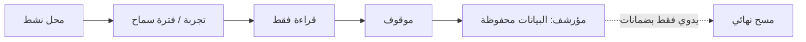

# الأمان والخصوصية والتشغيل والنسخ الاحتياطي

> آخر مراجعة: 2026-11-19. المصدر: الكود الحالي ووثائق التشغيل. أي حاجة مش متنفّذة مكتوبة صراحةً في قسم «حدود وملاحظات».

## الخلاصة في سطور

- **كل محل له قاعدة بيانات مستقلة تمامًا**، مفيش جدول مشترك بين محلين، فمحل عمره ما يشوف بيانات محل تاني.
- **الحسابات المالية دقيقة**: المبالغ والكميات بتتخزن بـ 3 خانات عشرية، وكل عملية بيع/مخزون/خزنة بتتم «كلها أو ولا حاجة» ومقفولة ضد البيع المزدوج.
- **نسخ احتياطي ليلي مشفّر** لقاعدة المنصة وقاعدة كل محل، بيترفع برّه السيرفر ويتتحقق منه، مع الاحتفاظ بـ 7 يومي + 4 أسبوعي + 3 شهري.
- **مفيش حذف تلقائي لبيانات أي محل**: الأرشفة بتحتفظ بالبيانات، والمسح النهائي يدوي بالكامل ومحاط بضمانات.
- **فريق المنصة** بيدخل بتحقق ثنائي (2FA) وبيتطلب منه إعادة التحقق قبل العمليات الحساسة، وكل أفعاله متسجّلة في سجل رقابة بيتحفظ سنتين.
- **تنبيهات للفريق التقني** (إيميل + Telegram) لو النسخ الاحتياطي أو الـ scheduler أو الـ queue أو القرص فيه مشكلة.

## مين بيستخدمه

| الدور | علاقته بالموضوع |
|---|---|
| صاحب المحل | بيعتمد على عزل بياناته وصلاحيات موظفيه، وبيطلب من الدعم استرجاع/تصدير |
| الكاشير / الموظف | بيدخل بحسابه، صلاحياته ونطاق فروعه محدودة |
| فريق المنصة (Super Admin) | بيدير المحلات من لوحة المنصة بـ 2FA وسجل رقابة |
| المسؤول التقني (CTO / DevOps) | النسخ الاحتياطي، النشر، الاستعادة، المسح النهائي |
| فريق المبيعات والدعم | بيجاوب العميل (جدول الأسئلة في آخر الملف) |

## 1. عزل البيانات (الخصوصية بين المحلات)

**إزاي بيشتغل:** لما محل بيتسجّل، النظام بيعمل له **قاعدة بيانات خاصة بيه** (فواتير، أصناف، عملاء، خزنة، مخزون، مستخدمين). كل طلب بيوصل للنظام بيتحدد فيه المحل من الدومين، والنظام بيتحول لقاعدة المحل ده بس. بيانات محل تاني مش موجودة في نفس القاعدة أصلًا.

**يعني إيه للعميل:**
- مفيش «فلتر غلط» ممكن يعرض بيانات محل تاني، لأن البيانات فعليًا في قاعدتين مختلفتين.
- النسخ الاحتياطي والاستعادة والأرشفة بتتم **لكل محل لوحده**، استرجاع محل ما بيلمسش غيره.
- حذف أو تجميد محل (لعدم الدفع مثلًا) ما بيأثرش على باقي المحلات.
- بيانات الاشتراك والفوترة والمحلات نفسها بتتخزن في قاعدة مركزية للمنصة، منفصلة عن بيانات التشغيل بتاعة المحلات.
- أدوات المراقبة (Pulse وTelescope) بتكتب في القاعدة المركزية بس، مش جوه قواعد المحلات.

**المحل الموقوف/المؤرشف:** بيتحجب عنه الدخول (حسب الحالة، شوف قسم دورة حياة الاشتراك)، لكن بياناته محفوظة.

## 2. الصلاحيات ونطاق الفروع داخل المحل

- كل مستخدم له **دور** (مدير، كاشير، أو أدوار مخصصة) وصلاحيات بالتفصيل: مثلًا الكاشير ممكن يبيع لكن ما يشوفش الأرباح أو يلغي فاتورة.
- **العمليات الحساسة** (إلغاء فاتورة، تسوية مخزون، الإعدادات، إدارة المستخدمين والأدوار) بتتأكد منها **من السيرفر**، مش بس بإخفاء الزرار في الشاشة.
- **نطاق الفرع**: المستخدم بيشتغل على فرع/مخزن معيّن (بيتبعت مع كل طلب)، والنظام بيرفض لو المستخدم مش مسموح له بالفرع ده. فمدير فرع ما يشوفش بيانات فرع مش بتاعه إلا لو صلاحياته تسمح.
- **بيانات التكلفة والأرباح** ليها صلاحية مستقلة وبتتخفي من أي مستخدم ما عندوش الصلاحية دي.
- تفاصيل الصلاحيات في [`../07-operations/security-permissions.md`](../07-operations/security-permissions.md).

## 3. أمان الحسابات والجلسات

### مستخدمي المحل
| الموضوع | الوضع الحالي |
|---|---|
| كلمة المرور | الحد الأدنى 8 حروف لأي كلمة مرور جديدة أو متغيّرة (طول بس، من غير شروط تعقيد) |
| تخزين كلمة المرور | مش بتتخزن نصًا؛ مش بترجع في أي رد من النظام |
| محاولات الدخول الغلط | بعد 5 محاولات غلط لنفس الحساب، الحساب بيتقفل 15 دقيقة حتى لو كتب الباسورد الصح بعد كده. فيه كمان حد لعدد المحاولات من نفس الجهاز/الشبكة |
| الجلسة على الجهاز | رمز دخول (token) صلاحيته **12 ساعة ثابتة من وقت الدخول**، مش بيتجدد بالاستخدام، فبعد 12 ساعة لازم دخول جديد. الرموز المنتهية بتتنضف يوميًا |
| قفل الشاشة | الموظف ممكن يقفل الشاشة ويفتحها بكلمة مروره أو **رقم PIN** (4–6 أرقام) من غير ما يسجّل خروج |
| تغيير كلمة المرور | متاح من الحساب، بيطلب الكلمة الحالية وكلمة مختلفة عنها |
| إجبار تغيير الباسورد | المنصة تقدر تفرض تغيير كلمة المرور (مثلًا بعد إعادة ضبط من الدعم) |
| إنهاء الجلسات | فريق المنصة يقدر يلغي كل رموز دخول محل معين لو لزم |

### فريق المنصة (Super Admin)
- **تحقق ثنائي (2FA)** على حسابات لوحة المنصة، وفيه حدود على محاولات كود التحقق وعلى استرجاع كلمة المرور.
- **جلسة المنصة 4 ساعات** (رمز دخول منفصل عن رموز المحلات).
- **إعادة تحقق قبل العمليات الحساسة (Step-up)**: لو آخر تحقق ثنائي عدّى عليه أكتر من **15 دقيقة**، النظام بيطلب كود جديد قبل ما ينفّذ. ده مطبّق حاليًا على: إنشاء محل، حذف/مسح محل، فك أرشفة محل، تغيير إعدادات قاعدة بيانات المحل.
- **سجل رقابة لأفعال المنصة**: كل تغيير حالة محل، أرشفة، مسح، تعديل حدود... بيتسجّل (مين عمل إيه وامتى). السجل **بيتحفظ سنتين** وبعدها بيتنظّف تلقائيًا، وحساب التطبيق نفسه ما عندوش صلاحية تعديل أو حذف السجل في الإنتاج (التنظيف بيتم بحساب مخصوص).
- لوحات المراقبة التقنية (Telescope / Pulse / Horizon) متاحة لمسؤولي المنصة بس، وTelescope **مقفول في الإنتاج** كشرط من شروط النشر.

### سجل نشاط المحل
المحل (في الباقات اللي فيها الميزة دي) بيشوف سجل نشاط لعمليات موظفيه ويقدر يصدّره CSV.

## 4. ضمانات الدقة المالية

| الضمان | يعني إيه بالمثال |
|---|---|
| **3 خانات عشرية** | المبالغ والكميات بتتخزن بدقة 3 خانات: بيع 0.250 كجم بسعر 180.00 ج = 45.000 ج بالظبط، من غير أخطاء تقريب الأرقام العشرية |
| **حساب بدقة ثابتة** | كل الجمع والضرب بيتم بحساب دقيق للأرقام العشرية، مش بالطريقة اللي بتسبب «0.1 + 0.2 = 0.30000000000000004» |
| **كله أو ولا حاجة** | فاتورة بيع بتخصم مخزون وتسجل دفعة وتحدّث رصيد عميل. لو أي خطوة فشلت (انقطاع نت، خطأ) كل الخطوات بترجع كأنها ما حصلتش، مفيش فاتورة نصها اتسجل |
| **قفل ضد البيع المزدوج** | آخر 1 كجم من صنف، وكاشيرين باعوه في نفس اللحظة: النظام بيقفل صف المخزون أثناء التعديل، فالتاني بيستنى ويشوف الرصيد الحقيقي ويترفض لو مش كفاية |
| **نفس القفل للخزنة والأرصدة** | تحويلات الخزنة وأرصدة العملاء والموردين بنفس الآلية |
| **أدوات كشف الانحراف** | النظام فيه أوامر للفريق التقني تفحص انحراف المخزون وإعادة حساب إجماليات الورديات (للتشخيص، مش للعميل) |

## 5. النسخ الاحتياطي والاستعادة

### إيه اللي بيتنسخ
| العنصر | التفاصيل |
|---|---|
| قاعدة المنصة المركزية | كل يوم |
| قاعدة كل محل (غير المؤرشف) | كل يوم، ملف مستقل لكل محل |
| ملفات المستخدمين (لوجو، مرفقات، إيصالات) | كل يوم |
| الإعدادات السرية (ملف البيئة والمفاتيح) | **مستبعدة عمدًا** من نسخ الملفات |

### إزاي وفين ومتى
- **التوقيت**: 01:30 (قواعد البيانات)، 02:30 (ملفات المستخدمين)، 03:00 (تنظيف النسخ القديمة).
- **التشفير**: كل نسخة قاعدة بيانات اتضغطت في أرشيف **مشفّر (AES-256)** بكلمة سر خاصة بالمنصة. من غير كلمة السر مفيش أرشيف بيتفتح، فهي محفوظة خارج السيرفر عند المسؤول التقني.
- **المكان**: بيترفع على تخزين خارجي (Google Drive في تصميم الإنتاج) غير سيرفر التطبيق، فخراب السيرفر ما يضيّعش النسخ. **تنبيه صدق:** وثيقة التشغيل بتقول إن إعداد حساب Google Drive وأول تمرين استعادة حقيقي **لسه ما اتنفذوش** وقت كتابة الوثيقة (شوف «حدود وملاحظات»).
- **التحقق**: بعد الرفع النظام بينزّل النسخة تاني ويقارن بصمتها (SHA-256)، ويفتحها ويقرأها لآخرها، ويقارن عدد الصفوف لكل جدول بالقاعدة الحية. نسخة ما عدّتش التحقق ما بتتسجلش «سليمة».
- **الاحتفاظ**: 7 أيام يومي + 4 أسابيع + 3 شهور لكل قاعدة. أحدث نسخة عمرها ما بتتمسح.
- **أمان تشغيلي**: لو كلمة سر التشفير مش متظبطة في الإنتاج، النسخ **يرفض يشتغل** والنشر يفشل (مش بيطلع نسخ من غير تشفير بصمت).
- **لو نسخة فشلت**: باقي المحلات بتكمل، وبيوصل إيميل (وTelegram لو متظبط) بقايمة اللي فشل وسببه.

### الاستعادة
- بتتم **بيد الفريق التقني** بأمر مخصوص، مش من شاشة للعميل.
- الاستعادة **عمرها ما بتكتب فوق قاعدة موجودة**: بتعمل قاعدة جديدة بإسم مميز، وتتأكد إن عدد صفوف كل جدول مطابق، وبعدين تتبدّل يدويًا بقرار واعٍ.
- التمرين (drill) الافتراضي بيمسح النسخة المستعادة بعد التأكد.

### النسخة النهائية قبل الأرشفة
أي محل بيتأرشف (مثلًا موقوف بعد مدة، أو محل مجاني خامل) النظام **الأول** بياخد له نسخة نهائية، يرفعها، ويتحقق منها على كل مخزن نسخ. **لو النسخة النهائية فشلت، الأرشفة بتتلغى والمحل يفضل زي ما هو.** النسخ النهائية (وكمان نسخ «قبل المسح») **عمرها ما بتتمسح** تلقائيًا.

## 6. اللي عمره ما بيتحذف تلقائيًا

- **الأرشفة ≠ الحذف**: المحل المؤرشف قاعدته محفوظة ويقدر الدعم يفك أرشفته (بتحقق 2FA حديث).
- **المسح النهائي (`purge`) يدوي 100%**: بأمر في سطر الأوامر، مش مجدول، مش بيتنفذ من الـ API، ومفيش خيار «إجبار». ومحمي بـ:
  1. المحل لازم يكون مؤرشف 30 يوم على الأقل، أو موقوف/ملغي 90 يوم على الأقل. المحل الموقوف بسبب مخالفة **ما يتمسحش**.
  2. لازم تكون فيه نسخة احتياطية حديثة ومتحقق منها لنفس المحل.
  3. تمرين استعادة ناجح على قاعدة مؤقتة.
  4. كتابة **كود المحل** بالظبط وتأكيد تاني.
  5. تسجيل المسح في سجل الرقابة. بعد المسح بيفضل سجل أساسي (فوترة، سجل أحداث، سجل النسخ) ولا يمكن إعادة استخدام نفس كود المحل.
- **التسجيلات اللي ما اتأكدش إيميلها** (تسجيل ذاتي): بتتمسح بعد 24 ساعة من **طلب التسجيل** فقط، ومفيش قاعدة محل اتعملت أصلًا.

## 7. المهام المجدولة اليومية

| الوقت | المهمة | الغرض بالبساطة |
|---|---|---|
| كل دقيقة | نبضات المراقبة | تأكيد إن الـ scheduler والـ queue شغالين، وإرسال نبضة لخدمة مراقبة خارجية (لو متفعلة) |
| كل 5 دقايق | فحص صحة المنصة | قاعدة البيانات، الكاش، المساحة، الـ queue، حداثة النسخ الاحتياطي… وتنبيه لو في مشكلة |
| كل 15 دقيقة | تنبيهات Telegram للمحلات | الملخص اليومي بعد نهاية يوم المحل + تنبيه وردية متأخرة |
| 01:00 | تحديث حالة الاشتراكات | نقل المحلات بين تجربة/سماح/قراءة فقط/موقوف حسب التواريخ |
| 01:10 | فواتير الاشتراك التجريبي | إصدار أول فاتورة اشتراك للمحلات اللي تجربتها بتنتهي خلال 3 أيام |
| 01:30 | النسخ الاحتياطي للقواعد | مشفّر ومتحقق منه |
| 02:30 | نسخ ملفات المستخدمين | لوجو، مرفقات، إيصالات |
| 03:00 | تنظيف النسخ القديمة | حسب سياسة 7/4/3 |
| 03:15 | تنظيف سجل رقابة المنصة | حذف اللي أقدم من سنتين فقط |
| 03:30 | تنظيف رموز الدخول المنتهية | من قواعد كل المحلات |
| 03:45 | تنظيف الكاش المنتهي | صيانة |
| 04:20 | حذف التسجيلات غير المؤكدة | تسجيلات ما أكدتش الإيميل خلال 24 ساعة |
| 05:00 | المحلات المجانية الخاملة | تذكير بعد 60 يوم من غير نشاط، أرشفة بعد 90 يوم (بنسخة نهائية متحقق منها، من غير حذف) |
| 09:00 | تذكيرات انتهاء التجربة/الاشتراك | إشعار داخل التطبيق لصاحب المحل + ملخص Telegram للمشغّل |
| 09:00 | تنبيه نقص المخزون على Telegram | **معطّل افتراضيًا** لحد ما يتحول لتنبيه لكل محل |
| أسبوعيًا | تنظيف بيانات Pulse القديمة | صيانة |

> الأوقات الافتراضية؛ بعضها (التنظيف اللي بيمسك الاشتراكات، التذكيرات، المحلات الخاملة) قابل للتغيير من الإعدادات.

## 8. المراقبة والتنبيهات

| الحدث | يتبلّغ بيه مين، إزاي |
|---|---|
| فشل نسخة احتياطية (لأي قاعدة) | إيميل + رسالة Telegram نصية بس (من غير ملفات أو تفاصيل حساسة) + السجل |
| فشل فحص الصحة (قرص، قاعدة، queue، scheduler، حداثة النسخ…) | إيميل + Telegram (بحد أقصى رسالة في الساعة لتجنب الإزعاج) |
| توقف السيرفر أو الـ cron بالكامل | خدمة مراقبة خارجية بتنتظر «نبضة» كل دقيقة، لو وقفت بتنبّه (لو الخدمة اتفعّلت) |
| صفحة فحص الحياة العامة | رابط فحص عام بسيط بيستخدمه أي monitor خارجي |
| أخطاء التطبيق | Sentry لو الـ DSN متظبط؛ بيتم **تنقية** الرسائل من أي توكن أو كلمة مرور أو بيانات مستخدم قبل الإرسال |
| فشل تنبيهات Telegram لمحل | بيتسجّل كخطأ حرج، وباقي المحلات تكمل |

صاحب المحل نفسه بيستلم: تذكيرات انتهاء التجربة/الاشتراك داخل التطبيق، وتنبيهات Telegram الخاصة بمحله لو فعّلها.

## 9. النشر والتحديثات

**الويب (SaaS):**
1. المطوّرون بيعملوا إصدار بعلامة نسخة (tag)، وده بيشغّل خط نشر آلي.
2. الخط بيشغّل **كل الاختبارات** ثم يبني الحزمة (من غير ملفات سرية أو أدوات تطوير).
3. النشر على الإنتاج **بيحتاج موافقة صريحة** من المسؤول، وإصدار واحد في المرة.
4. قبل النشر بوابة فحص إعدادات: لو Telescope مش مقفول، أو وضع التصحيح شغال، أو كلمة سر التشفير ناقصة، أو إعدادات الإيميل ناقصة، النشر **بيفشل**.
5. النشر بيبدّل الإصدار بدون توقف ملحوظ، وبيشغّل فحص صحة بعده. **لو فشل بعد التبديل بيرجع تلقائيًا للإصدار السابق.** والرجوع اليدوي متاح بأمر واحد.
6. تغييرات قاعدة البيانات مصممة تكون **متوافقة للخلف** لأنها ما بتترجعش تلقائيًا.

**Android (APK) وWindows (Desktop):**
- بيتم رفع الإصدار من لوحة المنصة مع بصمة SHA-256 إجبارية، وصفحة تحميل عامة (`/download`) فيها آخر إصدار وبصمته.
- **شاشة التحديث**: اختياري = بتظهر مرة في كل فتح للتطبيق ويقدر العميل يأجلها لحد الفتح الجاي. **إجباري** = من غير زر إغلاق ولازم يحدّث.
- التطبيق **بيرفض تثبيت أي ملف** بصمته أو حجمه مش مطابق، أو (Android) توقيعه مختلف. لو فشل 3 مرات خلال 24 ساعة بيفتح صفحة التحميل اليدوي.
- في Windows: لو الإصدار الجديد فشل يشتغل 3 مرات، التطبيق بيعرض على المستخدم الرجوع للإصدار السابق (من غير رجوع صامت).
- الويب: المستخدم بياخد الإصدار الجديد بمجرد النشر (نفس التطبيق على المتصفح).

## 10. ملاحظات التوافر

- كل محل شغّال على قاعدة مستقلة، فمشكلة في قاعدة محل مش بتوقّف المحلات التانية.
- نسخ احتياطي يومي = أقصى فقد بيانات متوقع في كارثة كاملة للسيرفر **حوالي 24 ساعة** (من آخر نسخة 01:30). مفيش نسخ لحظي مستمر.
- سلوك نقطة البيع عند انقطاع النت غير موثّق في هذا الملف؛ راجع وثيقة نقطة البيع.
- المحل في «قراءة فقط» (بعد انتهاء الاشتراك) بيقدر يشوف بياناته لكن مش يكتب، ومحل «موقوف» مش بيدخل. فترة السماح الافتراضية 3 أيام بكامل الصلاحيات.
- لا يوجد التزام مكتوب بنسبة توافر (SLA) في الكود أو الوثائق.

## 11. الخصوصية

| السؤال | الوضع |
|---|---|
| إيه بيانات العملاء المخزنة؟ | اللي صاحب المحل بيدخله: اسم، تليفون، عنوان، أرصدة وتعاملات (فواتير ودفعات). |
| مين يقدر يوصل لها؟ | موظفو المحل حسب صلاحياتهم ونطاق فرعهم. فريق المنصة تقنيًا عنده وصول إدارة النظام، وأفعاله على المحلات متسجّلة ومحمية بـ 2FA حديث للعمليات الحساسة |
| بيانات المحل بتتشارك مع حد؟ | لا مع محلات تانية. التنبيهات على Telegram بتروح لحساب صاحب المحل اللي ظبطه بنفسه |
| الأخطاء والمراقبة | بيتم تنقية البيانات الشخصية (مستخدم، جسم الطلب، الكوكيز) قبل إرسال الأخطاء للمراقبة الخارجية |
| تصدير البيانات | متاح تصدير CSV لقوائم محددة (مثل الفواتير وسجل النشاط) من داخل التطبيق. **مفيش زرار «حمّل كل بياناتي» شامل**؛ الدعم الفني ممكن يستخرج نسخة من النسخ الاحتياطي (اللي مشفّرة وبيد الفريق التقني) عند الطلب |
| حذف بيانات العميل عند الطلب | **مفيش مسار آلي مبني للحذف عند الطلب.** الحذف الوحيد = المسح النهائي اليدوي للمحل كله بالضمانات في القسم 6. حذف عميل واحد داخل المحل غير موثّق هنا كإجراء خصوصية |
| احتفاظ النسخ | النسخ الاحتياطي العادي بتتدوّر (7/4/3). النسخ «النهائية» و«قبل المسح» بتفضل ولا تتمسح تلقائيًا، اعتبر ده في أي رد على طلب حذف |
| سياسة الخصوصية والشروط | في إعدادات قانونية في الكود، لكن **نص الشروط/الخصوصية الفعلي** يحتاج مراجعة قانونية من المالك قبل الاعتماد عليه |

## جدول: سؤال يسأله العميل عن الأمان ← الإجابة

| سؤال العميل | الإجابة |
|---|---|
| هل بياناتي ممكن تظهر لمحل تاني؟ | لا. كل محل له قاعدة بيانات مستقلة، مفيش بيانات مشتركة بين المحلات |
| الموظف يقدر يشوف الأرباح؟ | بس لو أعطيته صلاحية الأرباح. الكاشير العادي ما يشوفهاش، والمنع من السيرفر مش بس إخفاء زرار |
| مدير فرع يشوف فرع تاني؟ | لا، إلا لو اتحدد له وصول للفرع ده |
| لو سرق حد كلمة سر موظف؟ | الحساب بيتقفل 15 دقيقة بعد 5 محاولات غلط، والجلسة بتنتهي بعد 12 ساعة، وتقدر تغيّر كلمة المرور وتلغي جلسات المحل من الدعم |
| لو الجهاز اتسرق؟ | رمز الدخول بينتهي بعد 12 ساعة من تسجيل الدخول. للطوارئ الدعم بيلغي كل جلسات المحل. ننصح بقفل الشاشة بـ PIN |
| ممكن ينقص مخزون أو تتكرر فاتورة لو النت قطع في النص؟ | لا. العملية كلها أو ولا حاجة، والمخزون مقفول وقت التعديل |
| لو بعنا آخر قطعة من كاشيرين في نفس الوقت؟ | واحد بس ينجح، التاني بيتم رفضه |
| في نسخ احتياطي؟ | نعم، كل ليلة لكل محل، مشفّرة ومتحقق منها، وبتترفع على تخزين خارجي. بتتحفظ 7 أيام + 4 أسابيع + 3 شهور |
| لو اتمسح غلط حاجة، ترجعوها؟ | بنقدر نسترجع من آخر نسخة ليلية (أقصى فقد حوالي يوم). الاستعادة بيد الفريق التقني |
| لو اشتراكي خلص، بياناتي بتتمسح؟ | لا. بتنتقل لقراءة فقط ثم إيقاف ثم أرشفة والبيانات محفوظة. المسح النهائي يدوي ومحمي ومش قبل 30–90 يوم، وبنسخة متحقق منها |
| ممكن أطلب بياناتي كاملة؟ | تصدير قوائم CSV من التطبيق، وللنسخة الكاملة اطلب من الدعم. (مفيش تصدير شامل آلي) |
| ممكن أطلب مسح بياناتي؟ | بنقدر نعمل مسح نهائي للمحل كله بالإجراءات المحمية. مفيش حذف آلي من التطبيق |
| مين من فريقكم يقدر يدخل على بياناتي؟ | فريق المنصة المصرّح له، بـ 2FA، وأفعاله بتتسجل لمدة سنتين |
| التحديثات آمنة؟ | الإصدار بيتفحص (SHA-256 وتوقيع على Android) وبيتم رفضه لو مش مطابق |
| لو السيرفر وقع؟ | في فحص صحة كل 5 دقايق وتنبيهات للفريق، ونشر بيرجع تلقائيًا لو فشل. مفيش التزام SLA مكتوب |
| هل في 2FA لموظفيّ أنا؟ | **لا حاليًا**؛ الـ 2FA لفريق المنصة بس. موظفو المحل: كلمة مرور + PIN اختياري لقفل الشاشة |

## حدود وملاحظات / مخاطر معروفة

**مخاطر تشغيلية داخلية (للفريق، مش للعرض على العميل):**
- **سكربتات قديمة في الريبو فيها بيانات اعتماد مضمّنة** (تخص بيئة اختبار قديمة ومحل حي قديم). القرار الحالي إن كل القيم تُعتبر مسرّبة، وتدويرها مؤجّل لحد قبل أول عميل مدفوع أو قبل تحويل المحل الحي القديم لمستأجر. **مطلوب** تذكرة تدوير وإزالة هذه السكربتات من الريبو. (مفيش قيم مذكورة هنا عمدًا.)
- **إعداد النسخ الاحتياطي على Google Drive وأول تمرين استعادة حقيقي لسه ما اتنفذوش** حسب وثيقة التشغيل. لحد ما يحصل، ما نقدرش نقول إن النسخ الخارجي مثبت بالتجربة.
- **كلمة سر تشفير النسخ** لازم تتحفظ خارج السيرفر؛ ضياعها = ضياع القدرة على فتح كل النسخ.
- **بيئة الإنتاج الفعلية على VPS الجديد** (أول نشر/بروفة) كانت من خطوات المسؤول التقني؛ حالة اكتمالها في الوثائق «لم تُنفَّذ» وقت المراجعة.
- النشر الحالي بالإصدارات الموسومة فقط عبر الخط الآلي؛ سكربت النشر القديم **متقاعد**.

**فجوات في المنتج:**
- مفيش 2FA لمستخدمي المحلات (فقط لفريق المنصة).
- مفيش سياسة تعقيد كلمات المرور (طول فقط)، ولا انتهاء دوري لها.
- مفيش تصدير شامل للبيانات ولا حذف عند الطلب (GDPR-style) كمسار آلي.
- مفيش استعادة ذاتية من لوحة العميل أو من لوحة المنصة (الاستعادة بسطر أوامر).
- مفيش نسخ احتياطي لحظي (RPO حوالي 24 ساعة).
- خطوة إعادة التحقق (Step-up) مطبّقة على بعض عمليات المنصة، ووثيقة الكود بتقول إن عمليات تانية (انتحال هوية المحل، الفوترة اليدوية) مخطط تحميلها عليها، راجع قبل الاعتماد على الوعد ده.
- تنبيه نقص المخزون على Telegram معطّل لحد ما يتحول لنسخة بتشتغل لكل محل.

## ملحق للفريق التقني

- وثائق: `docs/07-operations/backup-restore.md`, `deploy-runbook.md`, `monitoring.md`, `queue-and-scheduler.md`, `secrets.md`, `security-permissions.md`.
- الجدولة: `backend/routes/console.php`. إعدادات الدورة: `config/tenant_lifecycle.php`، النسخ: `config/backup.php`، الدخول: `config/auth.php` و`config/rate_limits.php`، جلسة المنصة وstep-up: `config/central.php`.
- الأوامر اليدوية: `backup:tenants`, `backup:restore-tenant`, `backup:swap-tenant`, `tenants:purge`.
